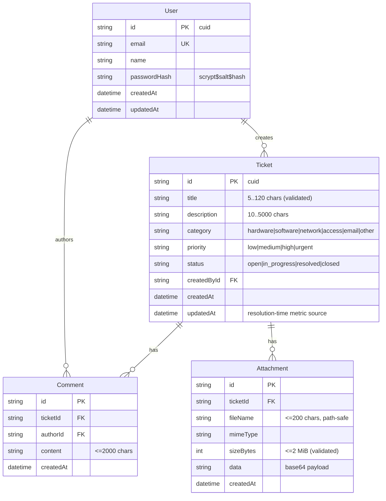

# ServiceDesk — Master Project Architecture Document (PAD) v1.0

**Classification:** Internal Engineering Reference
**Status:** DEFINITIVE, PRODUCTION-LOCKED BLUEPRINT
**Companion Document:** README.md (user-facing), AGENTS.md (agent instructions), CLAUDE.md (contribution standards)
**Last Updated:** 2026-10-26
**Audience:** Senior Engineers, Tech Leads, DevOps, and Onboarding Engineers
**Rule:** Every architectural decision in this document traces to a specific rationale. Nothing is here "because it's popular."

---

## Table of Contents

1. [System Overview & Decisions](#1-system-overview--decisions)
2. [High-Level System Topology](#2-high-level-system-topology)
3. [Application Architecture](#3-application-architecture)
4. [Data Architecture](#4-data-architecture)
5. [Design System Reference](#5-design-system-reference)
6. [Security Architecture](#6-security-architecture)
7. [Testing Strategy](#7-testing-strategy)
8. [Build & Deployment](#8-build--deployment)
9. [Developer Handbook](#9-developer-handbook)
10. [Known Issues & Outstanding Tasks](#10-known-issues--outstanding-tasks)
11. [Key Files Reference](#11-key-files-reference)
12. [Glossary](#12-glossary)

---

## 1. System Overview & Decisions

### 1.1 Document Metadata & Purpose

ServiceDesk is an IT support ticketing portal — a visual-parity, feature-superset clone of the base44 ServiceDesk reference application, rebuilt as a single deployable Next.js process with a SQLite database. This PAD is the definitive engineering reference for onboarding, debugging, and replication: it captures the layer model, the data contract, the security architecture, and the hard-won framework quirks that are not obvious from filenames.

**How to use it:** a new engineer should read §1–§4 before touching code; anyone debugging styling/auth/navigation should read §3.3, §5, and §6 first; operators should read §8–§9.

### 1.2 Technology Stack Summary

| Layer | Technology | Version | Key Rationale |
|---|---|---|---|
| Web framework | Next.js (App Router, `output: standalone`) | 16.4.0 | One-process deployment; server-rendered auth guard; route handlers replace a separate API tier |
| UI runtime | React | 19.3.0 | Required by Next 16; no `forwardRef` needed in new code |
| Language | TypeScript (strict) | 5.9.3 | Type-safe contracts across pages, API, and tests |
| Styling | Tailwind CSS (CSS-first `@theme inline`) | 4.3.3 | Matches the reference's utility-class DOM; v4 removes the config file entirely |
| Components | shadcn/ui on Radix primitives | vendored in `src/components/ui` | The reference app uses the same primitives (`data-sidebar` DOM) — parity at the component level |
| Icons | lucide-react | 0.525.0 | Reference-matched icon set (`lucide-users`, `lucide-circle-alert`, …) |
| ORM | Prisma | 6.19.3 | Schema-as-code + typed client; CLI's schema-relative `file:` URL rule anchors the db-path contract |
| Database | SQLite | — | Zero-config single-file DB; the reference's data model fits comfortably |
| Auth | Custom HMAC cookie sessions + Node scrypt | — | Email/password only; no supply-chain surface; fully unit-tested |
| Unit tests | Vitest | 5.0.3 | Fast node-environment tests for pure seams |
| E2E tests | Playwright (Chromium) | 1.64.0 | Drives the PRODUCTION standalone build, not a dev server |
| Runtime | Bun (dev/seed) / Node ≥ 20 (server) | 1.3.x / ≥20 | Bun runs TS seeds natively; the standalone server is plain Node |

### 1.3 Architecture Decision Records (ADRs)

**ADR-001: Clone the reference with Next.js App Router + route-group auth guard**

- **Context:** The reference is a base44 SPA with client-side routing and JWT-in-localStorage auth. The clone must reproduce its routes (`/dashboard`, `/submitticket`, `/mytickets`, `/ticketdetails?id=`) and its visual DOM while being a maintainable, deployable artifact.
- **Decision:** Next.js 16 App Router. Public routes (`/login`, `/signup`, `/forgotpassword`) are standalone pages; all authenticated pages live in the `src/app/(app)/` route group whose `layout.tsx` resolves the session server-side and redirects unauthenticated visitors to `/login` before any page markup streams.
- **Rationale:** Server-side guarding removes the flash-of-login-page and keeps auth logic in one place. The route group preserves the reference's URL shapes without a path prefix.
- **Consequences:** Pages under `(app)` are client islands (they hydrate onto the server shell) — acceptable because the interactivity (filters, forms, comments) is inherently client-side. The guard lives in exactly one file.
- **Alternatives Rejected:** A `middleware`/`proxy.ts` gate (duplicates the session resolution and complicates the cookie flow for no gain at this scale); pure SPA with client auth (loses SSR guard, weaker parity tooling).

- **Session-19 amendment (the proxy as a UX decoration layer):** `src/proxy.ts` now exists — but it is NOT the auth gate ADR-001 rejected. It checks cookie PRESENCE only (no HMAC, no session resolution) on the four `(app)` routes and decorates the cookie-less bounce with `?from_url=<absolute url>` (the reference's measured deep-link contract — an unauthenticated `/ticketdetails?id=X` returns to that ticket after sign-in, not the dashboard). The `(app)` layout guard remains the authoritative verifier; `safeRedirectTarget` (`src/lib/redirect.ts`) validates the target at use time (same-origin, auth-pages rejected, `/dashboard` fallback — the open-redirect guard). The ADR's concern (duplicated session resolution) is specifically absent from the proxy.

**ADR-002: SQLite via Prisma, one file at `<repo>/db/custom.db`, resolved by a tested seam**

- **Context:** The deployment must be one process with zero external services, and `DATABASE_URL="file:../db/custom.db"` (schema-relative) must point at the same file for the Prisma CLI, `next dev`, `next build`, and the standalone server — which `process.chdir`s into `.next/standalone`.
- **Decision:** `prisma/schema.prisma` + `src/lib/db-path.ts`. Relative `file:` URLs resolve against the first "anchor" directory containing `prisma/schema.prisma` (module repo root → standalone-repo detector → CWD fallback); absolute and non-SQLite URLs pass through. The Prisma client singleton (`src/lib/db.ts`) sets `process.env.DATABASE_URL` via this seam before instantiation.
- **Rationale:** The Prisma CLI anchors relative `file:` URLs against the schema file; the runtime seam replicates that exact rule, so all four processes open ONE database file regardless of working directory.
- **Consequences:** 15 unit tests pin the contract (`tests/db-path.test.ts`). Production deployments may use absolute paths, which pass through untouched. npm scripts additionally pin `DATABASE_URL` inline because an ambient exported variable overrides `.env` files.
- **Alternatives Rejected:** Always-absolute paths (breaks the "clone and run" story); Postgres (violates the zero-service constraint; `skills/rootless-postgresql` exists if the data model outgrows SQLite).

**ADR-003: Hand-rolled HMAC cookie sessions + scrypt instead of an auth library**

- **Context:** The app needs email/password auth only. The reference uses base44's platform JWT-in-localStorage, which is not reproducible and is weaker than httpOnly cookies.
- **Decision:** `src/lib/auth.ts` — sessions are `base64url(JSON payload).HMAC-SHA256(payload)` in an httpOnly, SameSite=Lax cookie (7-day TTL, `Secure` in production, `AUTH_SECRET` signing key); passwords hash with Node `scrypt` (64-byte key, 16-byte per-user salt, constant-time verification). Login/signup/forgot-password are rate-limited per IP (10/15 min, in-memory sliding window).
- **Rationale:** ~150 auditable lines replace a dependency tree; every primitive (sign, verify, tamper, expiry, hashing, rate limit) is unit-tested. httpOnly cookies remove the XSS token-theft class entirely.
- **Consequences:** The rate limiter is per-process (fine for single-server deploys; documented limitation for horizontal scale). Password reset is request-logging only (no mail transport configured) — the API response is enumeration-safe.
- **Alternatives Rejected:** NextAuth/Auth.js (OAuth machinery we do not need); Better Auth (adds a dependency for the same contract); storing tokens in localStorage (XSS-exposed, matches neither our threat model nor production-grade standards).

**ADR-004: Tailwind v4 CSS-first tokens with `@theme inline`, measured-reference styling**

- **Context:** Visual parity with the reference is a hard requirement, and the reference's DOM is utility-class based (shadcn). Tailwind v4 changed the configuration model.
- **Decision:** No `tailwind.config.js`. `src/app/globals.css` declares semantic tokens as `@theme inline { --color-*: var(--*) }` over a literal-hex `:root` palette (light + dark). All reference-measured values (sidebar `#fafafa`, cyan→blue gradients, amber/emerald accents, navy scale) live in that one file.
- **Rationale:** `@theme inline` is the officially supported pattern for referencing `:root` variables; a bare `@theme` with `var()` chains is silently dropped by the v4 build (pinned in `docs/Tailwind-V4-Validation-Report.md` and the scandihaven hard lessons). Utilities then compose the reference's exact classes.
- **Consequences:** Two cascade rules must be respected forever: (1) never regress `inline`; (2) variant utilities (e.g. `data-[active=true]:text-*`) outrank plain utilities — overrides on variant-styled primitives need the `!` modifier (see the `text-white!` comment in `app-sidebar.tsx`).
- **Alternatives Rejected:** Tailwind v3 + config file (fights the toolchain's current default); CSS modules (breaks utility-class parity with the reference DOM).

**ADR-005: Superset features stay additive to the reference surface**

- **Context:** The clone must be a functional superset (production-ready) while preserving visual parity.
- **Decision:** Additions are: working signup, forgot-password request, file attachments (2 MiB × 3, base64 in SQLite, streamed downloads), owner-side status transitions, search/filter/sort/scope on My Tickets, comment threads, average-resolution-time metric, health endpoint, rate limiting, security headers, toasts, skeletons. None of them alter reference-visible structure — they extend existing cards/panels.
- **Rationale:** Every addition lives where the reference has a stub or an obvious gap; the E2E suite pins both the reference contracts (mobile sheet, gradient active nav) and the additions.
- **Consequences:** The "All Tickets" scope toggle and the status dropdown are visible superset affordances — documented here as intentional deviations.
- **Alternatives Rejected:** Admin/agent workflows (scope creep beyond the reference's user-facing portal).

**ADR-006: E2E drives the production standalone build, not the dev server**

- **Context:** Dev-mode behavior differs from production (dev overlay, Turbopack chunking), and the standalone `server.js` has its own working-directory quirks.
- **Decision:** `playwright.config.ts` boots `bun .next/standalone/server.js` on :3100 with an isolated `db/e2e.db` (schema pushed + seeded by the global setup) and one shared authenticated `storageState` produced by a setup project.
- **Rationale:** Tests the exact artifact that ships; the isolated DB keeps runs deterministic; the single sign-in respects the rate limiter budget.
- **Consequences:** `bun run build` must precede `test:e2e`. The standalone-repo detector in `db-path.ts` is exercised for real on every run.
- **Alternatives Rejected:** Testing against `next dev` (misses standalone-specific defects — exactly the class this project's db-path work exists for).

---

## 2. High-Level System Topology

```mermaid
flowchart TB
    subgraph Client
        B[Browser - desktop / mobile]
    end
    subgraph Edge
        PX[Reverse proxy - optional\nforwards X-Forwarded-Proto]
    end
    subgraph App["Single Next.js process (standalone server.js)"]
        RSC[Server Components\n(app) layout guard · root layout]
        PAGES[Client page islands\ndashboard · submitticket · mytickets · ticketdetails\nlogin · signup · forgotpassword]
        API[Route handlers /api/*\nauth · tickets · comments · attachments\nstats · health]
        AUTH[auth.ts\nHMAC sessions · scrypt · rate limit]
        DBP[db-path.ts + db.ts\nURL resolution · Prisma singleton]
    end
    subgraph Data
        SQLite[(SQLite file\ndb/custom.db)]
    end
    B --> PX --> RSC
    RSC --> PAGES
    B -->|fetch JSON| API
    API --> AUTH
    API --> DBP
    RSC --> AUTH
    AUTH --> DBP
    DBP --> SQLite
```

**Runtime characteristics:** one process, ~50 MiB RSS class, SQLite in WAL-less file mode. Scaling is vertical (SQLite handles this workload comfortably to thousands of tickets); the first horizontal-scale milestone requires moving the rate limiter to shared storage and the database to Postgres (`skills/rootless-postgresql` documents the path).

**Key constraints:** the process must start from the repo root (npm scripts guarantee the CWD the db-path and standalone trace rely on); `X-Forwarded-Proto` must reach it behind TLS-terminating proxies so cookie `Secure` attributes derive correctly.

---

## 3. Application Architecture

### 3.1 The Layer Model

```
Layer 0: Pages & chrome — src/app/** (route group guard, client islands, shadcn ui/)
         Rule: no domain logic; every mutation goes through Layer 2; auth checks never appear here.
Layer 1: API route handlers — src/app/api/**
         Rule: validate input (Layer 3), resolve the session (Layer 3), call Prisma,
               return { error, errors? } JSON with a correct status code. Never throw across the boundary.
Layer 2: Data access — src/lib/db.ts (Prisma singleton) + prisma/schema.prisma
         Rule: all queries through the singleton; no direct @prisma/client imports in app code.
Layer 3: Domain seams — src/lib/{auth,validation,constants,utils,db-path}.ts
         Rule: pure (no React, no DB in the pure parts), unit-tested, single source of truth
               for the ticket vocabulary, session crypto, input rules, and the db-path contract.
```

The golden rule: **domain rules live in Layer 3, are consumed identically by Layers 0–2, and are pinned by unit tests** — the UI never re-implements validation, and the API never re-defines the vocabulary.

### 3.2 Annotated Directory Structure

```
service-desk/
├── prisma/
│   ├── schema.prisma            ← User/Ticket/Comment/Attachment; relative file: URL anchors here
│   └── seed.ts                  ← idempotent (upsert-by-email, existence-by-title) demo corpus
├── db/                          ← SQLite file lands here (custom.db gitignored; .gitkeep tracked)
├── src/
│   ├── app/
│   │   ├── (app)/               ← AUTHENTICATED route group
│   │   │   ├── layout.tsx       ← server session guard + ToastProvider + sidebar chrome
│   │   │   ├── dashboard/       ← stat cards, performance metrics, recent tickets, bottom CTA
│   │   │   ├── submitticket/    ← form + emoji category select + attachment upload
│   │   │   ├── mytickets/       ← search + status/priority/sort/scope controls + card list
│   │   │   └── ticketdetails/   ← description, comments, ticket info panel, owner status control
│   │   ├── api/
│   │   │   ├── auth/{login,signup,logout,me,forgot-password}/route.ts
│   │   │   ├── tickets/route.ts                ← GET list (filters) + POST create
│   │   │   ├── tickets/[id]/route.ts           ← GET detail + PATCH owner status
│   │   │   ├── tickets/[id]/comments/route.ts  ← POST comment (tx: comment + touch updatedAt)
│   │   │   ├── tickets/[id]/attachments/[attachmentId]/route.ts ← streamed download
│   │   │   ├── stats/route.ts                  ← mine + global counts + avg resolution
│   │   │   └── health/route.ts                 ← liveness + DB probe
│   │   ├── login/ · signup/ · forgotpassword/  ← standalone auth cards
│   │   ├── layout.tsx           ← root metadata/head (system font stack, OG images, viewport), globals.css
│   │   ├── page.tsx             ← "/" → /dashboard | /login
│   │   └── globals.css          ← Tailwind v4 tokens (@theme inline) + light/dark palettes
│   ├── components/
│   │   ├── ui/                  ← shadcn primitives: sidebar, sheet, select, dialog-free set,
│   │   │                          button, card, input, label, textarea, badge, avatar, separator,
│   │   │                          skeleton, tooltip, toast(radix)
│   │   ├── app-sidebar.tsx      ← nav (gradient active) + QUICK STATS + user footer + logout
│   │   ├── app-sidebar-chrome.tsx ← SidebarProvider + SidebarInset + mobile header (md:hidden)
│   │   ├── ticket-bits.tsx      ← Status/Priority/Category badges + TicketCard (reference classes)
│   │   └── toast.tsx            ← Radix toast viewport + useToast context
│   ├── hooks/
│   │   └── use-mobile.ts        ← useSyncExternalStore media query (no effect setState)
│   └── lib/
│       ├── auth.ts              ← sign/verify session, scrypt hash/verify, rate limit, getSession
│       ├── constants.ts         ← ticket vocabulary + emoji/label maps + attachment limits
│       ├── validation.ts        ← ticket/comment/signup/login/attachment guards
│       ├── utils.ts             ← cn, formatDateTime ("Oct 9, 2026 at 12:47 AM"), formatDuration
│       ├── db-path.ts           ← the DATABASE_URL resolution contract (pure, tested)
│       ├── db.ts                ← Prisma singleton (resolves URL via db-path first)
│       └── __tests__/           ← auth, domain (constants+validation), utils unit tests
├── tests/
│   ├── db-path.test.ts          ← 15 tests pinning the URL contract
│   └── e2e/                     ← auth, dashboard, tickets, mobile-navigation specs
│                                  + auth.setup.ts (shared session) + global-setup.ts (e2e.db)
├── scripts/
│   ├── smoke-test.sh            ← API surface on a throwaway standalone server
│   ├── probe-gradients.mjs      ← Playwright probe: sidebar gradients via UI login
│   └── gradient-test{,2}.mjs    ← isolated oklab/lab() gradient rendering experiments
├── docs/
│   ├── DEPLOYMENT.md            ← production build/run/env contract
│   ├── Tailwind-V4-Validation-Report.md ← the v3→v4 facts behind ADR-004
│   ├── how-to-git-push-using-ssh-wrapper_SKILL.md + ssh_git_wrapper_v3.py
│   ├── screenshots/             ← 10 dev-server captures (desktop ×8 incl. the s13 attachment pair + the s14 inline view, mobile ×2)
│   └── …                        ← prompts, skills inventory (repo scaffolding provenance)
├── skills/                      ← the in-repo skill catalog used to build this clone
├── next.config.ts               ← standalone + tracing root + devIndicators:false + headers
├── vitest.config.ts · playwright.config.ts · eslint.config.mjs · tsconfig.json
└── package.json                 ← scripts pin DATABASE_URL inline (see ADR-002)
```

### 3.3 Critical Code Patterns

**Pattern 1 — The session guard (server) + client islands**

```tsx
// src/app/(app)/layout.tsx — the ONLY auth check in the chrome
export default async function AppGroupLayout({ children }) {
  const user = await getCurrentUser();      // lib/auth.ts → cookies() (async in Next 16)
  if (!user) {
    // s37: the verify-failure bounce preserves the deep link — the proxy
    // forwards its constructed target as the x-sd-from-url request header
    // (the cookie-present path), and loginBounceUrl mirrors the proxy's
    // Location construction. An expired session's shared link survives.
    const target = (await headers()).get("x-sd-from-url");
    redirect(loginBounceUrl(target));       // streams before any page markup
  }
  return (
    <ToastProvider>
      <AppSidebarChrome user={user}>{children}</AppSidebarChrome>
    </ToastProvider>
  );
}
```

*Why this pattern:* one guard, zero duplicated checks, no flash of unauthenticated content. The s37 amendment keeps the guard TOTAL across the cookie lifecycle: the cookie-less fast path bounces in the proxy (from_url in the Location), and the cookie-present-but-invalid path (tampered/expired) bounces HERE with the same from_url — the reference's client-side gate preserves the pre-auth destination in all unauthenticated cases, and ours now does too, without moving session resolution out of the layout (the ADR-001 boundary: the proxy forwards information, the layout verifies). Pages stay `"use client"` islands that hydrate onto the shell — the reference app's exact interactive behavior with server-side safety.

**Pattern 2 — Validated-string enums as the single vocabulary**

```ts
// src/lib/constants.ts (excerpt) — SQLite has no enums; this is the contract
export const TICKET_STATUSES = ["open", "in_progress", "resolved", "closed"] as const;
export type TicketStatus = (typeof TICKET_STATUSES)[number];
export function isTicketStatus(v: unknown): v is TicketStatus { /* … */ }
```

*Why this pattern:* the API, the UI badges (`STATUS_BADGE_CLASSES`), the filters, and the E2E assertions all import the same arrays — adding a status is a one-file change plus tests, with compile-time safety everywhere else.

**Pattern 3 — The Tailwind v4 variant-cascade override (load-bearing `!`)**

```tsx
// src/components/app-sidebar.tsx — active nav item
isActive
  ? "bg-gradient-to-r from-cyan-500 to-blue-600 text-white! shadow-lg shadow-cyan-500/30"
  : "text-slate-600 hover:bg-gradient-to-r hover:from-cyan-50 hover:to-blue-50 hover:text-cyan-700"
```

*Why this pattern:* the shadcn `SidebarMenuButton` base carries `data-[active=true]:text-sidebar-accent-foreground`; Tailwind v4 orders variant utilities after plain ones, so a plain `text-white` silently loses. The `!` modifier is pinned by an E2E computed-style assertion (`mobile-navigation.spec.ts`), and the comment explains the why for the next maintainer.

**Pattern 4 — Cancellable client fetches on route change**

```tsx
// src/components/app-sidebar.tsx — QUICK STATS refresh (excerpt)
React.useEffect(() => {
  let cancelled = false;
  fetch("/api/stats").then((r) => (r.ok ? r.json() : null)).then((data) => {
    if (!cancelled && data?.global) setStats(/* … */);
  }).catch(() => { /* non-critical; skeleton stays */ });
  return () => { cancelled = true; };
}, [pathname]);
```

*Why this pattern:* stats stay live per navigation without a server-state library; the cancel flag prevents a stale response from a previous route overwriting the current one; failures degrade to the skeleton rather than an error boundary.

**Pattern 5 — Mobile off-canvas sheet with auto-close on navigate**

```tsx
<Link href={item.href} onClick={() => setOpenMobile(false)}> … </Link>
```

*Why this pattern:* the shadcn Sidebar renders as a Radix Sheet on mobile but does not close itself on navigation — without this line the overlay traps the user after every nav tap. The behavior is pinned by the E2E spec ("tapping a nav link navigates AND auto-closes the sheet").

---

## 4. Data Architecture

### 4.1 Database Schema



Indexes: `Ticket(createdById, createdAt DESC)` (My Tickets + Recent Tickets), `Ticket(status)` (global quick stats), `Comment(ticketId, createdAt)` (thread order), `Attachment(ticketId)`.

### 4.2 Persistence Strategy

- **One file, four processes:** the Prisma CLI, `next dev`, `next build`, and the standalone server all open `<repo>/db/custom.db` through the `db-path.ts` anchor rule (ADR-002). Migrations are `prisma db push` for this scale; the schema is forward-only in practice (additive columns first, backfill, then drop).
- **Seeding is idempotent:** users upsert by email (never overwriting an existing password hash); tickets skip on title match. The E2E global setup reuses it against `db/e2e.db`.
- **Attachments in SQLite:** base64 columns capped at 2 MiB × 3 per ticket keep the deployment single-file; the download route streams bytes with a sanitized `Content-Disposition`. If attachment volume grows, the documented upgrade is object storage + a URL column.

---

## 5. Design System Reference

### 5.1 Typographic System

- **Typeface: the system stack** (session-5 re-measure — the reference loads NO webfont; `--font-sans` is pinned in `@theme inline` to `ui-sans-serif, system-ui, …`; do NOT reintroduce next/font Inter). Smoothing left at `auto` (no `antialiased`).
- **Scale:** page titles `text-4xl font-bold tracking-tight` with `text-lg text-slate-600` subtitles (reference scale, session 2); card titles `text-lg font-semibold`; stat values `text-4xl font-bold` with proportional digits (no `tabular-nums` — the reference renders proportional); body `text-sm text-slate-600`; micro-labels `text-xs uppercase tracking-wider text-slate-500` (sidebar group labels).

### 5.2 Color Tokens

| Token | Light | Usage |
|---|---|---|
| `--background` | `#ffffff` | Body base (white — stock, session 9); the visible slate-50 page base comes from the gradient wrappers (`from-slate-50 via-white to-blue-50/30`) |
| `--sidebar` | `#fafafa` | Sidebar panel — measured, NOT white |
| `--primary` / `--ring` | `#171717` / `#0a0a0a` | Near-black pair (stock shadcn, sessions 6+9): `--primary` drives every `hover:bg-primary/80` badge to the dark `rgba(23,23,23,0.8)` on hover; focus rings near-black; cyan accents come from explicit `*-cyan-500` utilities |
| `--border` / `--input` | `#e5e5e5` | Neutral-200 (stock, session 9) — every default-`border` Card/control edge; the desktop sidebar edge overrides with explicit `border-slate-200/60` |
| `--foreground` | `#0a0a0a` | Near-black (stock, session 9) — the outline CategoryBadge text + inherited card text |
| `--sidebar-ring` | `#3b82f6` | Blue-500 (stock, session 9) — the nav-item + group-label keyboard focus rings |
| `--navy-950/900/800` | `#0a1628/#0f2744/#1a3a5c` | Login logo badge, dark theme surfaces |
| `--amber-500` | `#f59e0b` | "Open" quick-stat badge |
| `--emerald-500` | `#10b981` | Resolved accents, success toasts |

Session-9 note: the reference's entire `:root` is verbatim stock shadcn (zinc neutrals, near-black primary, blue-500 sidebar ring) — verified by a full-block token diff, both sites resolved to RGB. The remainder of the family (secondary/muted/sidebar-*) matches stock zinc too, though it renders nowhere today (unused components / defeated by call-site classes).

Badge pairs (status): open `bg-amber-100 text-amber-800 border-amber-300`; in_progress `bg-blue-100 text-blue-700`; resolved `bg-emerald-100 text-emerald-800`; closed `bg-slate-100 text-slate-600`. Priority: low slate, medium blue, high orange, urgent red. All measured from the reference DOM.

### 5.3 Component Primitives

shadcn/ui (New York flavor) vendored in `src/components/ui/` — **sidebar** (with its Sheet-based mobile representation and `useSidebar` context) is the keystone: it reproduces the reference's `data-sidebar` attribute DOM, which is what the E2E specs assert against. Select, Tooltip, and Toast are Radix-portal components; their content renders in portals (assert accordingly in tests).

### 5.4 Motion / Animation

- Cards/links: `transition-all duration-300` + hover lift (`hover:shadow-xl`), icon-tile scale on group hover (`group-hover:scale-110`), ticket-card arrow slide (`group-hover:translate-x-1`).
- Entrance animation (session 3, measured from the reference's framer-motion): `animate-rise-in` — `opacity 0→1` + `translateY(20px)→0`, 0.3 s `cubic-bezier(0.34, 1.56, 0.64, 1)` (≈ a ~310 ms spring with ~12% overshoot, no stagger) on dashboard stat cards + recent rows, mytickets cards, the submit form card, and the detail back+grid wrapper.
- Mobile sheet: `slide-in-from-left` 500 ms open / 300 ms close (E2E waits 700 ms before geometry assertions).
- Decorative stat-card circles: `opacity-10` corner gradient scaling to 150% over 500 ms on hover.
- `prefers-reduced-motion` is honored globally (globals.css) and on the rise-in entrance utility — see §10 (resolved session 3).

---

## 6. Security Architecture

### 6.1 Security Rules

| Rule | Enforcement |
|---|---|
| Sessions are unforgeable | HMAC-SHA256 over the payload; `timingSafeEqual` verification (unit-tested tamper/expiry cases); a missing/short `AUTH_SECRET` FAILS HARD in production — the first session operation throws, never minting or accepting a cookie on the public dev constant (the s87 closure) |
| Passwords are never reversible | scrypt + per-user salt; constant-time compare; hash format verified on read |
| Cookies are unreachable from JS | `httpOnly` + `SameSite=Lax` + `Secure` in production (`sessionCookieOptions()`) |
| Auth endpoints resist brute force | Per-IP sliding-window rate limit (10/15 min) with `Retry-After` on 429 |
| Every authenticated route checks the session | `(app)` layout guard (server) + per-request `getCurrentUser()` in every handler |
| Ticket mutations are owner-scoped | PATCH refuses non-owners with 403; list scope defaults to `mine` |
| No account enumeration | forgot-password returns an identical generic message; login errors are identical for unknown email and wrong password |
| Input is validated before use | `src/lib/validation.ts` guards (lengths, vocabulary, email shape, attachment size/count/filename/MIME — the closed allowlist, s23) on every mutating handler |
| Write routes bar form-transport CSRF | Every JSON parse gates on `application/json` (`parseBodyContentType`, the s88 closure): a non-JSON transport answers 415, never parsing or minting — the `<form enctype="text/plain">` trick blocked (SameSite=Lax gates cookie SENDING, never SETTING) |
| A11y regressions are gate failures | The e2e suite runs the WCAG-tagged axe scan (`tests/e2e/a11y.spec.ts`, the s89 two-gate) on every served surface × width — structural violations zero outside the sanctioned register (the Radix Select modal artifact, cited live against the reference's own DOM); the engine is a declared devDependency |
| Touch targets meet the 44px floor or carry a cited exception | The e2e suite runs the 44px touch-floor census (`tests/e2e/touch-floor.spec.ts`, the s90 two-gate) on every mobile-band surface at 375x667 — every visible interactive control >= 44x44 OR register-matched (the register's parity entries cite the reference's own identical figures measured live on its DOM; the superset entries cite the quiet-subordinate doctrine; a NEW under-44 control without a registration is a gate failure) |
| Visible focus is a gate, not a review comment | The e2e suite runs the keyboard-focus census (`tests/e2e/visible-focus.spec.ts`, the s91 two-gate) on every registration surface at BOTH bands — every walked control must show a visible focus indication at :focus-visible (a colored ring layer in box-shadow OR outline-style !== 'none' — the default outline counts; the bare-link family relies on it) OR carry a cited register entry (GATE 2's form held at runtime; the register born EMPTY — the two-systems census measured every focusable control visible on both systems); the measurement law rides the spec (the settled read + the ring-layer parse + the Radix select-trap fallback + the coverage-completion pass) |
| Attachments cannot escape the download route | Filename sanitized (`[^\w.\- ]` → `_`) for `Content-Disposition`; size capped at upload |
| SQL injection is structurally impossible | All queries via Prisma; no string-built SQL exists |
| Clickjacking/mimetype sniffing blocked | `X-Frame-Options: DENY`, `X-Content-Type-Options: nosniff`, `Referrer-Policy`, `Permissions-Policy` (next.config.ts headers) |
| Secrets never enter the tree | `.env` gitignored; ssh wrapper shreds key material; pre-commit habit documented in CLAUDE.md |

### 6.2 Security Utilities Inventory

`src/lib/auth.ts` (sessions, hashing, rate limiting, client IP extraction), `src/lib/validation.ts` (all input guards), `src/app/api/tickets/[id]/attachments/[attachmentId]/route.ts` (download sanitization), `next.config.ts` (security headers), `docs/ssh_git_wrapper_v3.py` (secret-free push flow).

### 6.3 Authentication & Authorization

Single role today: **authenticated user**. Ownership is the authorization unit — a user reads any ticket (mirroring the reference's shareable detail URLs) but may only transition tickets they created. There is no admin role by design (ADR-005); introducing agents/admins would add an `isAgent` flag plus a guarded transition path, not a new auth system.

### 6.4 Threat Model (key vectors)

| Vector | Mitigation |
|---|---|
| Session forgery/tampering | HMAC + constant-time verify (unit-pinned) |
| XSS stealing tokens | No tokens in JS-reachable storage (httpOnly cookies); React auto-escaping; no `dangerouslySetInnerHTML` |
| Brute-force login/signup/reset | Shared per-IP rate limiter; E2E budgeted to stay under it |
| Ownership bypass via API | Server-side `createdById` comparison on every mutation |
| Malicious uploads | Size/count caps, MIME recorded but content streamed with `Content-Disposition: attachment` (never inline), path-safe filenames |
| Open redirect / CSRF surface | No redirect params exist; SameSite=Lax cookies; mutations are JSON POSTs (not form-encodable cross-site) |
| Secret leakage via repo | `.env` ignored; wrapper-managed keys; documented pre-commit scan habit |

---

## 7. Testing Strategy

### 7.1 Test Distribution

| Category | Files | Tests | Location | Framework |
|---|---|---|---|---|
| Unit — auth (session/crypto/rate-limit + the s38 clientIp XFF seam: the rightmost-element trust, the trim, the single-element/xrealip/unknown fallbacks, the malformed tail + the s39 bucket-eviction block: the threshold-gated sweep of fully-expired shells, the mixed-bucket over-eviction guard, the one-sweep-per-minute gate + re-arm) | 1 | 20 | `src/lib/__tests__/auth.test.ts` | Vitest |
| Unit — api-methods (the s40 405/OPTIONS shape seam: methodNotAllowed answers 405 + the exact {error} envelope + the RFC 9110 §15.5.6 Allow header; optionsNoContent answers 204 + empty body + the honest advertisement — the source-of-truth pin for the 11-route stub matrices) | 1 | 3 | `tests/api-methods.test.ts` | Vitest |
| Unit — the s41 allow-list single-source pins (the routeAllow derivation — the canonical method order, the HEAD-iff-GET rule, the OPTIONS append, input-order independence — plus the 11-route consistency cross-check: each route module's export-key set, its OPTIONS 204 advertisement, and every 405 stub shape all derive from the implemented-methods array; @/lib/db vi-mocked, the api-catchall import pattern) | 1 | 17 | `tests/api-allow-source.test.ts` | Vitest |
| Unit — the s41 health degraded-path pins (the 503 + the exact {status, db, time} body + the `[health]` console.error prefix — the DB-down branch unpinned for 41 sessions, closed via the vi.mock db seam; the prefix pin is the byte-level freeze that caught the s18 display-layer lie) | 1 | 2 | `tests/health-degraded.test.ts` | Vitest |
| Unit — the s42 routeAllow fail-fast pins (the input-validation seam: unknown method names THROW at module scope — the silent-drop contract inverted; the self-documenting message carries the offending name + the canonical set; lowercase input throws; the boundary pin accepts every canonical member) | 1 | 4 | `tests/route-allow-validation.test.ts` | Vitest |
| Unit — the s42→s87 AUTH_SECRET config-safety pins (the secret() prod/dev asymmetry RESHAPED at the fail-hard posture: prod+missing → signSession THROWS, no token minted + the actionable [auth] message; prod+short(<16) → THROWS (the boundary); prod+missing → verifySessionToken THROWS on an attacker-crafted token — the forged-cookie acceptance path, the s87 closure of the forgeable-session class the s42 warn-once fallback shipped; prod+valid(≥16) → silent + signs; dev+missing → silent + the DEV fallback signs) | 1 | 6 | `tests/auth-secret-warning.test.ts` | Vitest |
| Unit — the s42 forgot-password audit-trail pins (the known-user line + the unknown-email line + the response NON-distinction — identical 200 + generic body for both, the enumeration-safe client contract; distinct XFF IPs per POST so the pins never burn each other's rate-limit buckets) | 1 | 3 | `tests/forgot-password-logs.test.ts` | Vitest |
| Unit — the s43 db-script pins (the AGENTS.md invariant #3 automated: every runtime + db:* script carries the inline DATABASE_URL pin — the RULE-based derivation with the db:generate codegen exception; the smoke script's throwaway pins code-shaped ×3; the playwright config const + wiring + the global-setup provisioning env) | 1 | 6 | `tests/db-script-pins.test.ts` | Vitest |
| Unit — the s43 seed-corpus pins (the canonical 4/11/3 shape + the upsert natural keys + the referential integrity + the vocabulary cross-check against constants.ts + the four-status QUICK STATS coverage + the demo-login contract — via the side-effect-free prisma/seed-data.ts extraction) | 1 | 9 | `tests/seed-corpus.test.ts` | Vitest |
| Unit — the s44 e2e-provisioning pins (the global-setup bun/npx fallback chain shape, code-shaped + `tsx` ∈ devDependencies — the documented npx seed fallback resolves locally, never the network — + `prisma` ∈ dependencies for the db-push fallback) | 1 | 4 | `tests/e2e-provisioning.test.ts` | Vitest |
| Unit — the s45 CI-contract pins (the workflow's silent-failure surface: the frozen-install step in both jobs, the hidden-files artifact flag, the [main] triggers, the bun.lock tsx entry — line-anchored code-shaped) | 1 | 6 | `tests/ci-contract.test.ts` | Vitest |
| Unit — the s46 env-contract pins (the .env.example ↔ codebase bidirectional coverage: every code-read env var documented, every documented var live, the canonical DATABASE_URL literal — line-anchored) | 1 | 3 | `tests/env-contract.test.ts` | Vitest |
| Unit — the s47 .gitignore hygiene pins (the secret-guard surface, EXECUTABLE: check-ignore on `.env` / the credential patterns (`*.key`, `*.pem`, `ssh-key.txt`) / the db binaries + the tracked-surface pin — `git ls-files` matches no secret-shaped path, the PAD §7.4 checklist automated — + the inverse pin: `.env.example` tracked and never ignored, the quickstart source) | 1 | 5 | `tests/gitignore-contract.test.ts` | Vitest |
| Unit — the s47 DEPLOYMENT.md claims pins (the docs surface that never had a drift watch: the route-module count — fs-counted 12, doc line-anchored, the stale '16' closed — and the smoke-claim '121 steps', the stale '30 E2E checks' closed) | 1 | 2 | `tests/docs-contract.test.ts` | Vitest |
| Unit — the s48 corpus-count consistency pins (the drift-watch automation, family-shaped: every live unit (9 sites) / e2e (10) / parity (3) / smoke-steps (4) claim site across the five docs names ONE number, minimum-site floors; the stale '54'/'57'/'11-step'/'107' SKILL-appendix figures + README's '163 parity' closed; PAD §10 historical rows excluded by boundary) + the s50 quickstart BRIDGE pin (the README Quick Start's verify-setup output line held to the RUNTIME: the quoted file figure == the fs listing of the vitest include patterns, the quoted test figure == the §7.1 Vitest rows' sum, and the family canonical == that same sum — the s48 blind spot closed: a whole-family drift now fails loudly) | 1 | 5 | `tests/corpus-count-contract.test.ts` | Vitest |
| Unit — the s48 stack-version pins (the README badge row + the PAD §2 tech table ↔ the installed node_modules versions + the bun.lock resolved entries — bidirectional, floor-guarded; the s45 tsx-entry doctrine generalized to the seven documented packages) | 1 | 2 | `tests/version-contract.test.ts` | Vitest |
| Unit — the from_url redirect-target guard (s19) + the loginBounceUrl layout-bounce seam (s37) | 1 | 11 | `src/lib/__tests__/redirect.test.ts` | Vitest |
| Unit — domain (constants + validation incl. the s23 attachment-MIME allowlist + the s24 parseListParams pagination seam + the s25 parseListFilters vocabulary seam + the s26 parseListSearch literal-search seam + the s27 parseListQuery param-set seam + the s28 parseStatsQuery empty-grammar seam + the s29 parseNoQuery shared empty-grammar seam) | 1 | 75 | `src/lib/__tests__/domain.test.ts` | Vitest |
| Unit — next-config headers contract (the s30 HSTS + poweredByHeader pins + the s34 cache-behavior contract: the universal rule, the API blanket no-store, the s15 attachment exception with its exact immutable-private window, the load-bearing order, the /api scoping) | 1 | 9 | `tests/headers-config.test.ts` | Vitest |
| Unit — utils (date/duration formatting incl. `formatDate`; timezone-pinned at UTC — s15) | 1 | 10 | `src/lib/__tests__/utils.test.ts` | Vitest |
| Unit — db-path URL contract | 1 | 15 | `tests/db-path.test.ts` | Vitest |
| Unit — the s33 API catch-all 404 contract (unknown /api/** paths answer 404 + JSON on every method incl. the bare segment; HEAD empty-body; OPTIONS 404-not-204; the known routes unshadowed; the set-cookie attribute set on the login/signup/logout trio; 5+5 parallel mutations all-2xx with the coherent final count) | 1 | 19 | `tests/api-catchall.test.ts` | Vitest |
| Unit — the s36 proxy-contract pins (the from_url construction + the matcher boundary; the spoofed-Host guard, the X-Forwarded-Proto flip, the X-Forwarded-Host ignore, the login-page reflection surface, the unmatched sub-path 404, the deep-link query survival) | 1 | 8 | `tests/proxy-fromurl.test.ts` | Vitest |
| Unit — the s35 request-size seam (the shared parseBodySize 10 MiB ceiling checked BEFORE the body is read — 413 + the message naming 10485760; the attachment size-honesty + canonical-base64 + boundary pins; the chunked pass-through) | 1 | 11 | `tests/body-size.test.ts` | Vitest |
| Unit — the s49 PAD §7.1 test-distribution pins (the per-file runtime pins: the nested vitest JSON run + the playwright --list, bidirectional — every row names its file's runtime count, every runtime file has a row; + the smoke-row agreement with the s48 corpus family) | 1 | 3 | `tests/pad-testcount-contract.test.ts` | Vitest |
| Unit — the s51 prerequisites-contract pins (the README Quick Start's Requires line held two-sided to the codebase: the seed's crypto is node:crypto (scryptSync + randomBytes + randomUUID, no Python anywhere in the seed) + the Requires line exists, claims Node.js ≥ 20 + Bun ≥ 1.1, and carries NO Python token — the false 'Python ≥ 3.9 for the seed's crypto imports' claim that survived 50 sessions can never return) | 1 | 2 | `tests/prereq-contract.test.ts` | Vitest |
| Unit — the s52 doc-freshness-contract pins (the four dated docs' freshness claims held to their git last-commit dates (the +0800 operator-timezone convention) + the SKILL-internal ledger coherence (the description's session == the last lesson's tag, its date == the frontmatter) + the no-future-dating guard — the stale '2026-10-09' claims and the session-50 description can never return) | 1 | 3 | `tests/docdate-contract.test.ts` | Vitest |
| Unit — the s53 size-claim pins (the PAD §11 Key Files Reference's figures held EXACT to the fs line counts — the `~` hedges that drifted 3.6x stale for 44 sessions closed; the grammar rejects the tilde form; the row floor 18 + the prisma/seed-data.ts key-coverage; + the SKILL's backticked-path size claims + the auth compound claim's test figure chained to this table's runtime-pinned auth row) | 1 | 3 | `tests/pad-keyfiles-contract.test.ts` | Vitest |
| Unit — the s54 route-head social URL seam pins (the s12 seam's missing unit layer — the coverage-completeness closure: the s12 trio agreement (canonical == og:url == the segment, twitter:url the segment's absolute) + the s17 wholesale-REPLACES og-set completeness + the asset-truth pair (OG_IMAGES declares the real 512x512 PNG) + the s8 DESCRIPTION freeze; the E2E mechanism pins stay in visual-parity.spec.ts) | 1 | 4 | `src/lib/__tests__/route-head.test.ts` | Vitest |
| Unit — the s54 source-side coverage pins (the PAD §7.3 universal held to the fs + the test-import graph: the fs boundary — a new src/lib seam fails loudly until mapped or excluded; the map verification — every mapped test exists AND imports its source; the exclusion exactness + the §7.3 claim-presence) | 1 | 3 | `tests/pad-coverage-contract.test.ts` | Vitest |
| Unit — the s55 plan-status pins (the remediation plans' execution-status sections held to the state they assert: the closed-plans completeness — every plan numbered below the current session carries zero unchecked boxes, the closeout omission caught at the next boundary; the self-contradiction guard — an unchecked box whose own text asserts completion caught the moment it is written; the enumeration honesty — the glob-driven walk + the corpus floor 53 + the current session's plan present) | 1 | 3 | `tests/plan-status-contract.test.ts` | Vitest |
| Unit — the s56 artifact-existence pins (the durable-artifact existence claims: the persistence grammar — every persisted-scripts claim names an fs file; the push-range reachability — every backticked `A..B` hex-range citation names two git-reachable commits, the pre-import history annotated on the line; the bare-citation reachability — every backticked hex commit citation resolves in git, the exact known-non-commit exclusion set + the needed-ness guard, the exclusion MATCH-scoped since s59 (never a line-level escape) — plus the s59 no-silent-skip parity: every bare-hex token claimed or excluded, never silently dropped, with the co-location shape floor; + the s62 screenshots family-integrity pin 5: every docs/screenshots/*.png structurally valid (magic + IHDR + IEND + the 4 KiB floor) at the recorded lineage dimensions + the ten-name set + the 8/2 desktop/mobile split, via the standing helper scripts/check-screenshots.py — the s17/s18 asset-truth doctrine extended to the parity-evidence surface) | 1 | 5 | `tests/artifact-existence-contract.test.ts` | Vitest |
| Unit — the s57 doc-enumeration pins + the s63 worklog extension (the numbered families held to their index sequences: the plan corpus enumerates exactly {2..CURRENT} — complete, contiguous, no extras; the session-log corpus contiguous from 1 with the one-session-lag floor at the previous session's agent log doc 2N−11; the agent-log correspondence — every paired session N ≥ 12 carries its agent log at doc 2N−11 (header-identified) + its operator transcript at doc 2N−10; the s63 pin 4 — the WORKLOG task-number family, the fourth numbered family: the coverage {1..max} minus the nine frozen historical holes [50, 54, 110, 115, 164, 168, 171, 179, 181] with the paired frozen-set comparison, the protocol fields complete, the separator structure 1:1, no exact-duplicate IDs — via the standing helper `scripts/check-worklog.py`, the coordination surface pinned) | 1 | 4 | `tests/doc-enumeration-contract.test.ts` | Vitest |
| Unit — the s58 doc-path-reachability pins (the whole-path existence-claim contract: every backticked path-shaped reference in the five core docs resolves on the fs — the four-entry measured exclusion set (the runtime-target + transient + replaced-static forms, each genuinely cited, the needed-ness guard); the checked-reference floor 500 — the vacuous-pass guard) | 1 | 3 | `tests/doc-path-reachability-contract.test.ts` | Vitest |
| Unit — the s60+s61 scripts-integrity pins (the committed scripts' own-name + own-syntax contracts: the static AST undefined-name check via the standing helper `scripts/check-undefined-names.py` — a loaded name must be defined in its file, imported, a param, a builtin, or a dunder; the s56_b lineage class: the make-battery's blind `.replace()` propagates stale variable names across generations — the s58/s59 wave-analysis scripts crashed the moment their /tmp inputs existed; + the s61 language-symmetry closure (P1: the s60 closure protected the .py family only — 275 of 358 scripts carried no standing check): every .sh/.mjs/.ts passes its language's standard static layer (bash -n / node --check / ONE tsc invocation) via the standing helper `scripts/check-syntax.py`, the per-language floors 120/115/15 the vacuous-pass guards; + the scanned-files floor 75, the vacuous-pass guard; + the wave-analysis family floor 5 with the per-session contiguity — the family is a sequence) | 1 | 3 | `tests/scripts-integrity-contract.test.ts` | Vitest |
| Unit — the s64 commands-surface pins (the execution-surface doc-truth: every package.json script documented in the AGENTS ## Commands table — the canonical table, the first table every agent reads, floor-guarded both directions; every `bun run <x>` citation across the five core docs + the CI workflow resolves to a real script — the renamed-script regression fails naming file + line; + the helper-agreement pin via the standing helper `scripts/check-commands.py`, spawnSync + JSON-either-way + its own 60s timeout, the paired constants) | 1 | 3 | `tests/commands-contract.test.ts` | Vitest |
| Unit — the s65 gate-config pins + the s85 pin-4 extension (the compiler-guarantee surface: the tsconfig strictness contract — strict: true with NO weakening override, the s65 fix retiring the scaffold's `"noImplicitAny": false` that stood for 64 sessions while the docs claimed "strict, enforced"; noEmit: true; the skills exclusion pinned at the tsconfig layer; the eslint guarantee surface — no-explicit-any enforced, never off (the CLAUDE "no `any` in new code" guarantee gets teeth) + set-state-in-effect never weakened to off/warn; the vitest config surface — the include matches *.test.ts only, never *.spec.ts, no globals; the s85 build-type-gate surface — next.config.ts must not carry `ignoreBuildErrors: true`, the build IS the type gate (the scaffold flag stood 84 sessions while the s65 pins covered every gate-config file except next.config.ts — the flip probe GREEN, the planted-error build FAILED, the family skill §15 posture)) | 1 | 4 | `tests/gate-config-contract.test.ts` | Vitest |
| Unit — the s86 login timing-equalizer pins (the enumeration-TIMING class: the login route's miss branch burns the same scrypt — the family skill §16 contract + the neo-crm session-163 precedent; the seam format pin (the scrypt$ format IS the burn guarantee — verifyPassword structurally runs scryptSync against any valid-format stored hash) + the lazy-memoization pin (never a second cold scrypt) + the never-authenticates pin (the burn target authenticates nobody) + the route-wiring text pin (the comment-stripped source carries the miss-branch call — a commented-out call can never satisfy a source pin, the s43 mutation-C doctrine) + the miss-branch envelope pin through the REAL handler (the mocked-db form, the s42 precedent — the burn never breaks the 401 shape)) | 1 | 4 | `tests/login-timing-equalizer.test.ts` | Vitest |
| Unit — the s88 Content-Type CSRF gate pins (the login-CSRF class: every write route's JSON parse gates on application/json — the family skill §16 contract + the neo-crm digma S148-A precedent; the seam accept-family pin (the charset + case variants tolerated) + the seam reject-family pin (the form transports — text/plain, urlencoded, multipart, text/html, empty, missing — all rejected with the constant no-reflection message, the s33 doctrine) + THE MINT-BLOCKED pin (the attacker's text/plain form POST with a real user mocked behind it: 415 + NO set-cookie through the REAL handler — SameSite=Lax gates cookie SENDING on cross-site POSTs, never cookie SETTING) + the no-false-rejection boundary pin (the valid types reach the auth path and mint normally) + the six-route comment-stripped wiring pin with the s35 ordering invariant (the gate between the size ceiling and req.json())) | 1 | 5 | `tests/content-type-gate.test.ts` | Vitest |
| Unit — the s89 a11y-gate contract pins (the §13 axe-core two-gate axis: the declared-devDep doctrine — axe-core a DIRECT devDependency, never an undeclared transitive (an eslint-config bump could drop the transitive edge and the gate would ENOENT at runtime, the F-171e class) + the declared-version-matches-resident pin (the major-locked no-churn form) + the spec-existence pin + the declared-engine injection pin (the node_modules/axe-core/axe.min.js addScriptTag path form, never a CDN fetch) + the four WCAG tag families pin (the runOnly form — wcag2a/2aa/21a/21aa, the strict subset) + the structural-gate form pin (button-name + link-name + label — the named-control proof) + the sanctioned-register citation pin (every entry carries its cite field — a register without citations is a suppression list) + the explicit-registration census pin (the surface×width floor)) | 1 | 8 | `tests/a11y-gate-contract.test.ts` | Vitest |
| Unit — the s90 touch-floor contract pins (the §13 44px touch-target two-gate axis: the spec-existence pin + the 375x667 mobile-band pin (the width the F4 battery and the mobile-navigation suite already exercise — a 1280-only census is a desktop census) + the floor-constant pin (44, the family skill's own figure, named once at the spec's top) + the structural-gate form pin (the register-escape is the ONLY escape — a bare toBeLessThan sweep would fail every parity-locked control) + the sanctioned-register citation pin (every entry carries its cite field — a register without citations is a suppression list) + the 8-registration census pin + the Google-button padding-driven source pin (h-auto + py-3.5 — the h-9 default must never ride this one button; the reference's own computed box is 279x54) + the inline-block link pins (the 20px touch box, the login family's own form)) | 1 | 8 | `tests/touch-floor-contract.test.ts` | Vitest |
| E2E — auth surface (logged-out incl. the s19 deep-link contract + the s20 reset-detour pin + the signup-page pair: the in-card/account creation + the weak-password rejection) | 1 | 11 | `tests/e2e/auth.spec.ts` | Playwright |
| E2E — dashboard (incl. clean-hydration pin) | 1 | 8 | `tests/e2e/dashboard.spec.ts` | Playwright |
| E2E — ticket lifecycle | 1 | 5 | `tests/e2e/tickets.spec.ts` | Playwright |
| E2E — mobile + desktop navigation | 1 | 9 | `tests/e2e/mobile-navigation.spec.ts` | Playwright |
| E2E — visual parity (session-2 through session-18 contracts) | 1 | 164 | `tests/e2e/visual-parity.spec.ts` | Playwright |
| E2E — the s89 a11y two-gate (the §13 axe-core battery: the WCAG-tagged scan on every served surface × width — the public trio logged-out + login@375 + the four authed routes at 1280 + the three at 375 + the nav-sheet-open dialog form + the status-select-open combobox form; GATE 1 the structural zero (the named-control proof), GATE 2 the sanctioned citations (the Radix Select modal artifact, verified live on the reference's own DOM)) | 1 | 13 | `tests/e2e/a11y.spec.ts` | Playwright |
| E2E — the s90 touch-floor two-gate (the §13 44px battery on the mobile band 375x667: the public trio + the four authed routes + the nav-sheet-OPEN dialog form — every visible interactive control >= 44x44 OR register-matched; GATE 1 the structural form (a NEW under-44 control without a registration REDs), GATE 2 the register citations (every parity entry cites the reference's own identical figure measured live on its DOM — the toggle 28x28, the h-9 family 36h, the sheet links 247x32, the whole-line links 20h; the superset entries cite the quiet-subordinate doctrine — the scope tabs at the reference's own sm scale, AA 24px met)) | 1 | 8 | `tests/e2e/touch-floor.spec.ts` | Playwright |
| Unit — the s91 visible-focus contract pins (the §13 visible-focus two-gate axis: the spec-existence pin + the both-bands pin (375x667 AND 1280x720 — the §13 line scopes focus to no band; the desktop sidebar controls never render at 375) + the tab-walk form pin (real keyboard Tab presses — the :focus-visible engagement, a click-walk does not model the keyboard user) + the settle-poll pin (the two-consecutive-samples agreement — the transition-all duration-200/300 controls fade the ring IN, a mid-flight read false-positives NONE) + the ring-layer parser pin (box-shadow parsed into LAYERS for the colored spread form — never a bare !== 'none', which counts the resting shadow-xs) + the outline-counts pin (outline-style !== 'none' is visible — the default outline, the bare-link family) + the registration census pin (13) + the register citation pin (GATE 2's form held for every future entry; born EMPTY — the census found no exceptions)) | 1 | 8 | `tests/visible-focus-contract.test.ts` | Vitest |
| E2E — the s91 visible-focus two-gate (the §13 keyboard-focus census at BOTH bands: the public trio at 1280 + login at 375 + the four authed routes at both bands + the nav-sheet-OPEN dialog form — GATE 1 every walked control shows a visible focus indication at :focus-visible (a colored ring layer in box-shadow OR outline-style !== 'none' — the default outline counts) OR carries a cited register entry; GATE 2 the register citations, held at runtime; the measurement law rides the spec: the settled read, the ring-layer parse, the Radix select-trap fallback, the coverage-completion pass) | 1 | 13 | `tests/e2e/visible-focus.spec.ts` | Playwright |
| E2E — shared session setup project | 1 | 1 | `tests/e2e/auth.setup.ts` | Playwright |
| API smoke | 1 | 121 steps (incl. the s21 rate-limiter 429 pins ×2 + the s22 write-path pins ×6 + the s23 create-path pins ×5 (the client-sent status now rejected at the s32 grammar level + re-pinned 201 + open on the bare create) + the s24 pagination pins ×4 + the s25 filter-vocabulary pins ×6 + the s26 literal-search pins ×4 + the s27 param-set pins ×3 + the s28 stats-grammar pins ×3 + the s29 API-wide empty-grammar pins ×10 + the s30 response-header pins ×4 + the s31 response-schema pins ×6 + the s32 request-body grammar + envelope + HEAD/OPTIONS pins ×12 + the s33 catch-all + cookie-attribute + concurrency pins ×9 (unknown /api/** paths → 404 + JSON + HSTS on every method incl. the bare segment, HEAD empty-body + OPTIONS 404-not-204, the known routes unshadowed, the login/signup/logout set-cookie attribute set, 5+5 parallel mutations all-2xx with the coherent final count) + the s34 cache-behavior pins x4 (every response under /api/** carries Cache-Control: no-store — me/tickets/stats authenticated, the catch-all 404 + health; THE INTERPLAY PIN: the attachment download keeps its s15 immutable private window + inline disposition under the blanket no-store) + the s35 request-size pins x6 (a 20 MB body on the create AND the comment route → 413 + the message naming the 10485760 ceiling — the shared parseBodySize seam, checked BEFORE the body is read; an attachment payload that is not its declared size → 400 (the honesty contract); non-canonical base64 → 400 (the garbage-form pin); the 3x2MiB maximum legitimate create still 201 (the boundary); chunked bodies passing the seam to the value level (the documented pass-through)) + the s36 proxy-surface pins x6 (a spoofed Host on a guarded route → 307 with a RELATIVE /login Location + the reflected inert from_url value; X-Forwarded-Proto flips the from_url protocol — the middleware-runner contract; X-Forwarded-Host ignored; the /login page reflects nothing server-side — the XSS surface closed; an unmatched sub-path renders the public 404 — the matcher boundary; the deep-link query survives)) + the s37 auth-cookie lifecycle pins x3 (the invalid-cookie deep-link bounce carries from_url — the expired-session contract, the layout-side bounce consuming the proxy's x-sd-from-url request header; the spoofed-Host invalid-cookie bounce stays RELATIVE — the two-layer guard on the new path; the header mechanism never decorates unguarded routes — the matcher boundary) + the s38 XFF rightmost-element pins x2 (a rotating client-supplied XFF prefix cannot mint fresh login buckets — 10 rotating-prefix attempts + the 11th on the stable proxy-appended key → 429 + Retry-After; the standalone's injected XFF shadows x-real-ip — 5 X-Real-IP-only forgot requests exhaust the shared socket-IP bucket, the 6th no-header request 429s) + the s39 pins x2 (the signup bucket rides the shared rightmost-element seam — 10 rotating-prefix signup attempts + the 11th on the stable proxy-appended key → 429 + Retry-After; the eviction flood-survival guard — 1050 unique-XFF login POSTs cross the 1000 sweep threshold mid-flood, the server healthy, a fresh key still 401) + the s40 405-boundary pins x13 (the 11-route wrong-method matrix: every unimplemented method on every known route answers 405 + application/json + {error: Method not allowed} + the RFC-mandated Allow header via the shared methodNotAllowed seam; the PAIRED explicit OPTIONS per route re-asserts the honest allow list — a stub export alone makes the framework's auto-OPTIONS advertise the stubbed methods as ALLOWED; the HEAD-on-POST-only pin; the non-shadow re-affirmation — the JSON boundary the s33 catch-all closed for unknown PATHS, closed at the METHOD level) | `scripts/smoke-test.sh` | bash + curl |

> Session-2 additions: the first 18 visual-parity tests pin the reference-measured design contracts (gradient quick stats, flat recent rows, detail grid + gradient header, `text-4xl` headings, non-sticky mobile header, login shell). The two tickets.spec locator defects (non-retrying `count()`; toast-announcer strict-mode ambiguity) were fixed with `toHaveCount` and `{ exact: true }` respectively — the patterns are documented in AGENTS.md.
>
> Session-3 additions: 11 more parity tests (recent-row FileText tile + arrow + date-only dates, lowercase badges, entrance animations incl. `prefers-reduced-motion`, submit-form details, login caption removal, search icon size, info-panel tracking, main-element classes), the clean-hydration pin in dashboard.spec (a `<div>`-in-`<p>` Skeleton broke hydration — fixed with an inline span skeleton), and `formatDate` unit tests. Raw `evaluate(getComputedStyle)` assertions were hardened to auto-retrying `toHaveCSS` after a one-off full-suite flake.
>
> Session-4 additions: 16 more parity tests (nav wrapper structure + live 12px icon-label gap + 20px icons + semibold labels — the biggest fix of the project, present since session 1; active-nav hover gradient; badge shadow + per-surface compact padding; submit-label typography + plain-text asterisk; md:grid-cols-2 grid; cyan-focus form controls; ghost back buttons; rounded-lg mobile trigger; Google-logo wrapper; tracking-wider revert; the designed 404). The session-3 info-panel tracking assertion was flipped to `tracking-wider` after re-measuring the live reference.
>
> Session-5 additions: 17 more parity tests pinning reference-COMPUTED values that class names cannot express: icon-button 16px horizontal padding (the `has-[>svg]:px-3` trap), the v3-name shadow step (`shadow-sm` on the reference = `shadow-xs` on the v4 scale — 11 controls flipped), the system font stack (the reference loads no webfont; next/font Inter removed), `mr-2` icon spacings, the CTA arrow's translate-x-1 slide, quick-stat badge hover, the 404 focus ring. Two session-era assertions flipped with documented supersede: session-4 `shadow-sm` pins → `shadow-xs`; session-3's submit-icon pin re-confirmed (a session-5 probe had misidentified the sidebar nav item).
>
> Session-6 additions: 18 more parity tests on three never-probed surfaces: the **radius scale** (the shadcn v4 calc chain off `--radius: 0.625rem` rendered rounded-sm/md/lg/xl at 6/8/10/14px vs the reference's v3 defaults 2/6/8/12px — +2px on every rounded control, class names identical; tokens pinned to the v3 literals), the **focus-state matrix** (Button/Input/Textarea render the old-shadcn 1px near-black `ring-ring`; `--ring` flipped from cyan to the reference's near-black; auth inputs render their older 2px slate-400 + white-offset generation with no at-rest shadow; the reference's cyan focus customs verified inert on text inputs — dropped there — and active on selects + the textarea border), and the **select dropdown open states** (category options + trigger render the emoji in its own gap-2 span — this also fixed the double-emoji bug in the selected trigger, never caught before because no pin exercised a selection; priority options + trigger render per-priority colors). Plus the whole-line signup link and the shadow-less Google button. Color pins accept both rgb() and lab() (Tailwind v4 emits palette colors as lab()). One session-4 pin superseded with computed evidence (text-input cyan customs).

### 7.2 Test Patterns

- **Computed-style assertions as ground truth** (the clone-app-pat-pro discipline): the desktop nav spec asserts `backgroundImage` contains `linear-gradient` and `color === "rgb(255,255,255)"` — CSS-level parity that screenshots cannot pin reliably.
- **Shared authenticated session:** the Playwright setup project signs in once; `storageState` replays the cookie into every spec (rate-limiter budget).
- **Geometry assertions wait out animations** (700 ms after sheet open) — the round-3 lesson from the scaffold's history.
- **Isolated E2E database:** `db/e2e.db` is schema-pushed and seeded by `global-setup.ts`; specs use unique titles (`E2E ticket ${Date.now()}`) so runs are re-runnable.

### 7.3 Coverage Thresholds

No numeric coverage gate is configured (documented honestly). The implicit contract: every pure seam in `src/lib/` is unit-tested — pinned source-side by `tests/pad-coverage-contract.test.ts` (the s54 coverage closure: the claim was born true at session 1 (every then-existing seam had its test), went false at session 12 when `src/lib/route-head.ts` landed with E2E mechanism pins only, and drifted 42 sessions because the s49 pads map the RUNTIME to the §7.1 table's rows — a source file with no test never enters the runtime, so no pin ever asked about it; the map + the fs boundary + the named-exclusion list make the universal checkable, and a new seam fails loudly until it is either mapped or excluded); every UI contract that parity depends on (sidebar chrome, quick stats, sheet behavior, gradient active state, ticket lifecycle) is E2E-pinned. New domain logic requires a failing test first (CLAUDE.md workflow).

### 7.4 Pre-PR / Pre-Deploy Checklist

- [ ] `bun run lint` — zero warnings
- [ ] `bun run typecheck` — clean
- [ ] `bun run test` — 331/331
- [ ] `bun run build` — standalone assembles
- [ ] `bun run test:e2e` — 232/232 (after build; UI/auth changes) — with NO ambient server on :3000 (a coincidental listener can false-green absolute-URL fetches — the s18 lesson)
- [ ] `bash scripts/smoke-test.sh` — all PASS (API changes)
- [ ] Screenshot diff vs `docs/screenshots/` for visual changes
- [ ] `git ls-files | grep -E '^\.env$|\.key$|ssh-key'` — empty (before doc-heavy commits)

---

## 8. Build & Deployment

### 8.1 Production Build

```bash
bun install
bun run build   # next build + copy .next/static & public into .next/standalone
```

Output: `.next/standalone/server.js` (Node), `.next/standalone/.next/static`, `.next/standalone/public`, `.next/standalone/prisma/schema.prisma` (file-traced — the db-path anchor inside standalone).

### 8.2 Environment Variables

| Name | Required | Description | Default |
|---|---|---|---|
| `DATABASE_URL` | yes | SQLite URL; relative anchors against `prisma/schema.prisma` (`file:../db/custom.db` → `<repo>/db/custom.db`). Production: use an absolute path. | `file:../db/custom.db` (via `.env`) |
| `AUTH_SECRET` | production | HMAC session key — `openssl rand -hex 32` | **fails hard in production** when unset/short (`sessions would be forgeable`); dev silently falls back (the s87 posture) |
| `PORT` | no | Server port | `3000` |
| `NEXT_PUBLIC_SITE_URL` | no | Canonical origin for metadata | `http://localhost:3000` |

### 8.3 Docker Configuration

None by design (single Node process; `docs/DEPLOYMENT.md` documents the bare-metal/systemd path). A Dockerfile would be `FROM node:20-slim` + the standalone folder + an absolute `DATABASE_URL` volume — deferred until a container target exists.

### 8.4 CI/CD Pipeline

CI runs on GitHub Actions (`.github/workflows/ci.yml`, added session 3): a `verify` job (lint → typecheck → unit → build, the same gate as §7.4) plus an `e2e` job restoring the standalone build and running the Playwright suite. Both jobs pin the runner image (`ubuntu-24.04`) and the bun toolchain (`bun-version: 1.3.14`, the documented runtime) — session 66: the environment under the gate is a contract surface (the ubuntu-latest → Ubuntu-26 flip of 2026-10-19 and a floating `latest` bun change CI behavior with zero repo changes; pinned by `tests/ci-contract.test.ts` pins 5+6). Pushes go to `git@github.com:nordeim/service-desk.git` main-only via `docs/ssh_git_wrapper_v3.py` (key materialized to a 0600 temp file, shredded after; remote ref re-verified against local HEAD).

---

## 9. Developer Handbook

### 9.1 Local Setup

```bash
bun install
cp .env.example .env                  # set AUTH_SECRET for production parity
bun run db:push && bun run db:seed
bun run dev                           # demo@servicedesk.app / Demo1234!
```

### 9.2 Common Commands

| Command | Location | Purpose |
|---|---|---|
| `bun run dev` | repo root | Dev server :3000 (logs → `dev.log`) |
| `bun run db:seed` | repo root | Idempotent seed |
| `bun run test:e2e` | repo root | Full E2E (build first) |
| `bash scripts/smoke-test.sh` | scripts/ | API contract check |
| `bun scripts/probe-gradients.mjs` | scripts/ | Reproduce gradient/screenshot questions |
| `python3 docs/ssh_git_wrapper_v3.py --key-file <key> --remote git@github.com:nordeim/service-desk.git` | repo root | Verified push (see the ssh SKILL doc) |

### 9.3 Code Style Rules

Enforced: ESLint 9 flat (`eslint-config-next` + the `react-hooks/set-state-in-effect` error), `tsc --noEmit` strict, Vitest explicit imports. Conventional (not lint-enforced): PascalCase components, camelCase utils, `@/` alias imports, comments explain why.

### 9.4 Git Workflow

Main-only trunk with atomic Conventional Commits. Feature branches are short-lived when used. The push flow is the SSH wrapper (AGENTS.md "Reference" links the runbook); never commit `.env`, keys, or `db/*.db`.

---

## 10. Known Issues & Outstanding Tasks

| Priority | Issue | Impact | Status |
|---|---|---|---|
| ~~MEDIUM~~ | ~~No hosted CI~~ | A regression can land if a contributor skips the gate | **Resolved (session 3)** — `.github/workflows/ci.yml`: verify job (lint → typecheck → unit → build) + e2e job (Playwright against the restored standalone build) on push/PR to main |
| MEDIUM | Rate limiter is per-process (in-memory) | Horizontal scaling would share no state | Open by design (ADR-003); document before scaling out |
| LOW | Forgot-password logs the request but sends no mail | UX gap vs. a full reset flow (enumeration-safe response implemented) | Open (wire Resend/SendGrid when a domain exists) |
| ~~LOW~~ | ~~No `prefers-reduced-motion` handling~~ | Motion-sensitive users see full animations | **Resolved (session 3)** — global reduced-motion block in `globals.css` + `motion-reduce:animate-none` on the `animate-rise-in` utility (E2E-pinned) |
| LOW | No numeric coverage threshold | Coverage discipline is convention, not gate | Open (`vitest --coverage` + thresholds when the suite grows) |
| INFO | Attachment storage is base64-in-SQLite | 2 MiB × 3 cap keeps it safe; volume growth → object storage | Documented (§4.2) |
| INFO | Dev-mode Next overlay (bottom-left dark circle) overlaps the sidebar footer in dev screenshots | Visual-check false positive only; production never renders it | Mitigated (`devIndicators: false` + AGENTS.md note) |
| RESOLVED | Visual parity gaps vs the live reference (25 findings, session 2: flat quick stats, card-style recent list, flex detail layout, old login shell, `text-3xl` headings, sticky mobile header) | Parity risk on every page | Fixed — every contract E2E-pinned by `visual-parity.spec.ts`; inventory in `docs/remediation-plan-session2.md` |
| RESOLVED | tickets.spec flakiness (2 locator defects: non-retrying `count()` racing async search; `getByText` strict-mode ambiguity vs the Radix toast announcer) | 2 tests failing intermittently in full runs | Fixed with `toHaveCount` + `{ exact: true }` (session 2) |
| RESOLVED | Session-3 parity gaps (12 findings: emoji tile + no arrow + category badge + datetime on dashboard recent rows; capitalized badges; missing entrance animations; submit-form details; login caption; search icon size; info-panel tracking; opaque `<main>`) + a hydration error (`<div>`-in-`<p>` Skeleton) | Parity risk on every page + a console error on every dashboard load | Fixed — all E2E-pinned; inventory in `docs/remediation-plan-session3.md` |
| RESOLVED | Session-4 parity gaps (16 findings: sidebar nav labels pushed to the right edge with 16px icons since session 1 — the missing inner flex wrapper; nav labels not semibold; badge shadow + per-surface padding; submit-form labels/asterisk/grid; shadow-sm + cyan-focus form controls; outline back buttons; rounded-md mobile trigger; bare Google logo; tracking-wide info labels; no designed 404) | Parity risk on every page (the nav gap was the largest single visual divergence of the project) | Fixed — all E2E-pinned; inventory in `docs/remediation-plan-session4.md` |
| RESOLVED | Session-5 parity gaps (8 findings: icon-bearing buttons at 12px padding via `has-[>svg]:px-3`; the v3→v4 shadow-scale naming trap app-wide — every copied `shadow-sm` rendered one step heavy; next/font Inter vs the reference's webfont-free system stack (~10% text-width deltas); missing `mr-2` on back/comment icons; CTA arrow 2px vs 4px slide; quick-stat badge hover; 404 focus ring; two false gaps caught by computed re-measure — the outline shadow and the submit-icon nav-item misidentification) | Parity risk on every control | Fixed — all E2E-pinned (90 E2E); inventory in `docs/remediation-plan-session5.md` |
| RESOLVED | Session-6 parity gaps (9 findings: the radius-scale trap — the shadcn v4 calc chain rendered every rounded control +2px vs the reference's v3 defaults (never probed in 5 sessions, like the font before it); the focus-state matrix (3px translucent-cyan new-gen rings vs the reference's solid 1px near-black + per-surface inert/active cyan customs); auth inputs carrying an at-rest shadow + wrong ring generation; the double-emoji bug in the selected category trigger; select dropdown option structure + per-priority colors; priority trigger always-blue; the split signup line; the Google button's at-rest shadow) | Parity risk on every rounded control + every keyboard interaction | Fixed — all E2E-pinned (107 E2E); inventory in `docs/remediation-plan-session6.md` |
| RESOLVED | Session-7 parity gaps (10 findings: the accent-token pair — `--accent`/`--accent-foreground` were cyan-tinted (session-1 theme choice, never measured) instead of the reference's stock gray #f5f5f5 + near-black #171717, driving select-option highlights, ghost/outline hover text, and the Skeleton; the reference's `rounded-sm` drift (now 4px, superseding session-6's 2px pin); dashboard fetch-failure = infinite skeleton (one transient 401 proved it) and mytickets fetch-failure = misleading empty state — both now error + Try again; mytickets empty-state markup (w-20 gradient circle, FileText w-10, text-xl heading); dashboard recent-empty colors + p-12 wrapper; no favicon; static document titles — per-route titles added; + documentation: the v4 hover media-guard divergence + the reference-drift ledger) | Parity risk on every dropdown highlight + hover text; UX failure mode on any transient API error | Fixed — all E2E-pinned (116 E2E); inventory in `docs/remediation-plan-session7.md` |
| RESOLVED | Session-8 parity + production gaps (7 findings: the post-gate lint break — a `.cjs` cleanup script committed after the session-7 gate ran, turning CI on main red (converted to ESM); the auth-error alert contract (reference = translucent red-50/70 + red-700 + rounded-xl + p-4 shadcn Alert; ours = red-600/rounded-lg/px-3 py-2/opaque) on login+signup+forgotpassword; the mobile sheet overlay at 50% black vs the reference's measured 80%; mobile horizontal overflow on every page (scrollWidth 516 at 375px — the recent-card rows' intrinsic nowrap width defeats the truncate chain; the reference has the identical defect, fixed deliberately via `min-w-0` on the SidebarInset main as a documented superset); missing social/PWA metadata (the reference ships og:*/twitter:*/canonical/apple-web-app — added via the root layout + per-route canonicals); the sidebar sign-out + attachment-Remove raw buttons missing the focus-visible ring tail) | CI red on main; parity risk on auth errors + mobile backdrop; SEO/social sharing gap; keyboard a11y on raw buttons | Fixed — all E2E-pinned (125 E2E); inventory in `docs/remediation-plan-session8.md` |
| RESOLVED | Session-9 parity gaps (7 findings: the Tailwind v4 cursor-preflight regression — v4 removed v3's `button, [role="button"] { cursor: pointer }`, every true button rendered the arrow cursor while the reference (v3) renders the hand (restored verbatim in `@layer base`); the stock shadcn token block — `--primary` cyan-600 vs the reference's near-black `#171717` (all 11 `hover:bg-primary/80` badge hovers rendered cyan instead of the reference's dark `rgba(23,23,23,0.8)`), `--border`/`--input` slate-200 vs neutral-200 `#e5e5e5` (every Card edge), `--foreground` family slate-900 vs near-black `#0a0a0a` (the CategoryBadge text), `--sidebar-ring` cyan-500 vs blue-500 `#3b82f6` (nav keyboard focus rings), `--background` slate-50 vs white; the Badge atom shipped the NEW shadcn generation (backgrounds snapped on hover — no background-color in the transition list — and the new-gen `ring-[3px]` focus tail) where the reference carries the old base (`transition-colors` fade + `focus:ring-2`), same tail missing on the 3 raw quick-stat pills; the desktop sidebar edge solid vs the reference's explicit translucent `border-slate-200/60`) | Cursor UX on every button; badge hover color + animation on 11 surfaces; card/badge/border colors on every page; keyboard focus ring color; hover fade vs snap | Fixed — all E2E-pinned (134 E2E); inventory in `docs/remediation-plan-session9.md` |
| RESOLVED | Session-10 parity gaps (4 findings: the login card's in-card view state machine — the reference's "Forgot password?" / "Need an account? Sign up" buttons swap the card in place (reset + Check-your-email + signup views, first exercised live in session 10 after nine sessions of at-rest-only probes) while ours navigated to standalone pages; the ticket-not-found state — the reference renders a destructive shadcn Alert inline in the max-w-5xl container while ours rendered a centered text-2xl card; the attachment picker missing the reference's .doc/.docx Word families; no sitemap.xml and no Sitemap directive in robots.txt) | Auth-flow UX on every password reset + signup; the not-found page; file-picker reachability of Word docs; SEO surface | Fixed — all E2E-pinned (145 E2E); inventory in `docs/remediation-plan-session10.md` |
| RESOLVED | Session-11 parity gaps (4 findings: the id-less detail route — the bare `/ticketdetails` rendered an infinite loading skeleton on ours (the load callback early-returns on a missing id) while the reference renders the same destructive Alert as the unknown-id case (first probed in session 11 — every prior session drove the route WITH an id); no PWA manifest — the reference ships `/manifest.json` (behind a 302) with name/short_name/description/standalone-display/#000000-theme/#ffffff-background/192+512 icons, linked from the head (ours had neither route nor link); the head's `theme-color` (#000000) + `apple-touch-icon` links missing (missed by the session-8 social/PWA sweep); no BreadcrumbList JSON-LD — the reference's SEO builder emits Home → <segment> per route (dashboard exempt, their home special case)) | UX dead-end on the bare detail route (stale bookmarks, stripped links); PWA installability + browser-chrome tint + iOS home-screen icon; structured-data SEO | Fixed — all E2E-pinned (156 E2E); inventory in `docs/remediation-plan-session11.md` |
| RESOLVED | Session-12 parity gaps (2 findings: the per-route social URL set — the reference's platform emits `<link rel=canonical>` + `og:url` + `twitter:url` (all three equal) on EVERY route, 404 catch-alls included; ours had shipped NO og:url and NO twitter:url on ANY route for four sessions (and no canonical on the three auth routes) on a false s8-era code comment "og:url derives from the per-route canonical" — Next emits og:url ONLY from `openGraph.url` (verified in the resolver sources), the twitter metadata type has no url field at all (it rides `metadata.other`, not metadataBase-resolved), and a child's `openGraph` wholesale-REPLACES the parent's — fixed via `src/lib/route-head.ts` (SITE_URL + routeHead) spread by all 7 route layouts; the space-y trap-log #4 firing LIVE — the session-10 login-view back buttons shipped the reference's measured `-mb-2` class as DIRECT children of the views' `space-y-*` containers, computing an 8px OVERLAP on our v4 build for two sessions where the reference (v3) renders 8–16px gaps (v4 puts margin-bottom on earlier children, so the following block gets no margin-top) — fixed with computed-parity classes `mb-2 sm:mb-4` / `mb-2` (the shadow-xs doctrine: parity is the COMPUTED value, never the class name)) | Social-card sharing on every route (og:url/twitter:url absent = crawlers fall back to guessed URLs); an 8px visual overlap on both swapped login views | Fixed — all E2E-pinned (167 E2E); inventory in `docs/remediation-plan-session12.md` |
| RESOLVED | Session-13 parity gaps (3 findings: the submit-form attached-file rows — the session-8 comment "the reference has no attachments" was FALSE all along; live-probing revealed their full attach UI (multiple picker, appended rows, X icon removes, CDN pipeline) and our rows diverged on padding (px-3 py-2 vs p-3), the filename (emoji + font-medium + size vs the bare text-sm slate-700 truncate flex-1), the remove control (text "Remove" vs the 36px X icon button with hover:bg-red-50), and the container offset (no mt-4); the detail-page attachment display — the reference renders NEUTRAL slate rows with the Paperclip icon and the GENERIC indexed "Attachment N" label (never the filename) opening in a new tab, with the Attachments heading carrying Paperclip w-4 + mb-3 and the Description heading's icon at w-4 not w-5, while ours shipped a cyan Download-icon chip with the filename + size; the no-comments empty paragraph — slate-400 py-6 vs the reference's slate-500 py-8) | The two attachment states users actually see on every attach/inspect flow; the comments empty state on every comment-less ticket | Fixed — all E2E-pinned (176 E2E, 147 parity); inventory in `docs/remediation-plan-session13.md` |
| RESOLVED | Session-14 parity gaps (2 findings: the attachment download route forced browser downloads — `Content-Disposition: attachment` — where the reference's CDN serves files with NO disposition header, so their new tab displays the file inline (the s13 `target="_blank"` pin implied the view experience but the response layer behind it was never probed — fixed to `inline; filename="<sanitized>"`, safe against the closed upload-validated mimeType list + global nosniff); the ticketdetails URL canonicalization — the reference's platform canonicalizes the FULL current URL (canonical + og:url + twitter:url + the BreadcrumbList JSON-LD item all carry `?id=<id>` on the id-bearing route; ours shipped the bare segment — fixed via the server-page wrapper with generateMetadata reading searchParams, the client island moved to ticket-details-view.tsx, the breadcrumb moved from the layout into the page with a query prop) — plus documentation findings: the unguarded :hover re-confirmed at the stylesheet layer, and the CDN-lifetime claim later RETRACTED in session 15 — the .txt 404 was a HEAD-method artifact of the base44 file proxy, all probe URLs serve via GET) | The new-tab attachment UX on every download; social-card/search URLs for every ticket detail page | Fixed — all E2E-pinned; inventory in `docs/remediation-plan-session14.md` (the CDN-lifetime evidence corrected by the s15 plan) |
| RESOLVED | Session-15 parity gaps (2 findings: the attachment route's cache semantics — the reference's CDN serves its files with `public, max-age=31536000, immutable` (live-measured on a fresh upload, authenticated fetch); ours served `private, max-age=3600` — fixed to `private, max-age=31536000, immutable` (the private scope stays: the route is owner-scoped; the window is factually correct — attachments have no mutation path); and the date-rendering timezone — the reference's API returns naive datetimes that the browser parses-as-local and formats-as-local, so every viewer sees the stored UTC wall-clock; ours returned Z-suffixed ISO and rendered the viewer's LOCAL time, an 8h-visible divergence for the Singapore operator (invisible at UTC where every probe and E2E run executes) — the formatters pin `timeZone: "UTC"`, verified in Singapore + extreme +14/-12 browser contexts) — plus the F3 documentation correction retracting the s14 CDN-lifetime evidence as a HEAD-method artifact | Repeat attachment views re-fetch after an hour (cache); every non-UTC viewer saw different timestamps than the reference for the same ticket | Fixed — all E2E-pinned (184 E2E, 154 parity); inventory in `docs/remediation-plan-session15.md` |

| RESOLVED | Session-16 parity gaps (2 code findings: the entrance-animation contract — re-measured per-surface from the reference's production bundle (the exact framer-motion `transition` objects) + live rAF timelines, superseding the session-3 single-spring contract: the stat cards + submit/detail wrappers rise as ONE 500ms ease-out tween each (cubic-bezier(0.61, 1, 0.88, 1), no overshoot) where ours shipped a 300ms springy overshoot everywhere; the recent rows SLIDE from the LEFT (translateX(-20px), x-axis) with a 100ms/index stagger where ours rose from below unstaggered; the mytickets cards stagger 50ms/index where ours arrived simultaneously; the spring surfaces' opacity settles on a separate piecewise curve (framer-motion's absolute-unit spring gives the 0→1 opacity distance a slower settle than the 20px transform — ours hit opacity 1.0 at 53% of the motion, visibly ahead of the reference's ~90%); and the sidebar QUICK STATS poll every 5s on the reference (setInterval(5e3), bundle-verified) where ours fetched only on route change) — plus F3 documentation: the reference ships an admin-gated surface (All Tickets/Analytics/Settings/Developer at role==="admin") that is unmeasurable without admin credentials — deliberately not implemented (the parity doctrine: unmeasured UI is out of scope; the functional core of All Tickets is our mytickets scope toggle) | Every dashboard/mytickets load rendered visibly different motion than the reference (wrong axis, wrong duration, no stagger, overshoot the reference never shows); stale sidebar counts for users sitting on one page | Fixed — all E2E-pinned (191 E2E, 161 parity); inventory in `docs/remediation-plan-session16.md` |

| RESOLVED | Session-17 parity gaps (2 code findings, both head-layer VALUE contracts from the first value-level head sweep: the viewport meta — the reference ships `width=device-width, initial-scale=1.0, viewport-fit=cover` while ours rendered without the `viewport-fit` key (the notched-device/PWA full-bleed companion — without it the browser letterboxes the viewport to the safe area on every iPhone X+-class device; fixed via `viewportFit: "cover"` in the root layout's Viewport export); and the og:image asset truth — our declaration claimed `{ url: "/icon.png", 512, 512 }` while `/icon.png` (the Next file-convention route over the reference's logo) serves a 480×480 JPEG, false on both the dimensions and the type — fixed by pointing at `/icon-512.png` (the real 512×512 PNG from the s11 PWA-manifest set), with `OG_IMAGES` exported from `route-head.ts` as the SINGLE source shared by the root layout and routeHead (a child's openGraph replaces the parent's wholesale, so the root-only fix left every routeHead route serving the old URL — the drift class killed in the same change); the reference declares 1200×630 against the same ~480×480 file at both their raw object URL and their render endpoint (`?width=1200&height=630&resize=contain` serves ~480×480 as JPEG or WebP) — their platform default, never mirrored, the s11 size-correct precedent extended to the OG card) — plus F3 documentation: the reference's `last_active` heartbeat + online-presence UI verified at the bundle level (they `updateMe({last_active})` on sidebar mount; a 5-minute recency check drives a green-dot/Online/You/Assigned user table — all inside the admin-gated All Tickets page; no user-facing surface renders any of it; ours deliberately writes no heartbeat — the data-privacy stance) | Notched-device rendering letterboxed vs the reference's full-bleed; social-card crawlers read false og:image dimensions (cropped/mis-rendered previews) | Fixed — all E2E-pinned (193 E2E, 163 parity); inventory in `docs/remediation-plan-session17.md` |
| RESOLVED | Session-18 parity gaps (2 code findings — both on the verification/asset-truth layer: the s17 og:image E2E pin was environment-dependent — it GET'd the rendered absolute URL (baked from NEXT_PUBLIC_SITE_URL, localhost:3000 by default) instead of the E2E server (:3100), so it passed in session 17 ONLY because a live-verification server was listening on :3000 and failed ECONNREFUSED in every clean environment, INCLUDING the CI run on the s17 push — the badge sat red between sessions; fixed by resolving the pathname against the page under test (`new URL(url, page.url()).pathname`), verified green 194/194 in a clean environment with :3000 down); and the favicon asset truth — `src/app/icon.png` (the Next file-convention route) was the reference's logo saved as a JPEG under a .png name, so the route served `image/png` over JPEG bytes and the generated `<link rel="icon">` claimed `type="image/png"` — the exact s17 og:image defect class on the one remaining head-facing asset; fixed with a pixel-identical PNG re-encode (numpy-verified), pinned by a new magic-bytes E2E test) — plus F3 documentation: the reference's viewport meta drifted to auth-pages-only (ours stays uniform — the documented notched-device superset), the AGENTS.md s7 title note corrected (ours is the proper-cased SUPERSET over their segment-verbatim set), the PAD's stale §5.1/§7.1/§7.4 counts aligned, and the s14-s17 screenshot-script lineage's mangled `aref*=` selector fixed in the s18 script (executed end-to-end green); the session's retracted "corrupted CI trigger" finding (a display-layer ANSI-eating artifact — the raw bytes were `branches: [main]` all along) kept in the plan as a process lesson | CI red on main between sessions 17-18 (a clean-env failure shipped unnoticed); mislabeled favicon body | Fixed — all E2E-pinned (194 E2E, 164 parity); inventory in `docs/remediation-plan-session18.md` |

| RESOLVED | Session-19 parity gaps (1 code finding: the auth-gate deep-link contract — the reference's platform redirects unauthenticated app-route visits to `/login?from_url=<absolute url>` and returns the user to that exact page after sign-in (live-measured with a non-dashboard target), while ours shipped a plain `/login` bounce + a hard-coded `/dashboard` landing — a shared `/ticketdetails?id=X` link opened logged-out lost the ticket; fixed with a three-layer split: the cookie-PRESENCE proxy `src/proxy.ts` decorating the bounce (Next 16's middleware successor — NOT the session-resolving gate ADR-001 rejected), the `(app)` layout guard unchanged as the authoritative verifier, and `safeRedirectTarget` in `src/lib/redirect.ts` validating the target at use time (same-origin, protocol-relative + auth-page targets rejected, query preserved, `/dashboard` fallback — the open-redirect guard); the login card's sign-in AND in-card signup navigate to the validated target) — plus 2 documentation findings: the reference's PWA trio (theme-color + manifest + apple-touch-icon) AND og:image:width/height/alt now render AUTH-PAGES-ONLY on their side (the s18 viewport-fit drift pattern extended; ours ships uniformly — the documented superset), and the reference's dashboard canonical measured for the first time as the ORIGIN ROOT (their home special case — `/` and `/dashboard` are the same page on their platform; ours stays segment-canonical: our `/` is a 307 redirect, and canonicalizing the only content URL at a redirect is a production-SEO anti-pattern — the s10 404-canonical precedent) | The deep-link UX on every shared ticket link + email notification; the drift ledger | Fixed — the deep-link contract E2E-pinned + unit-pinned (195 E2E, 65 unit); inventory in `docs/remediation-plan-session19.md` |
| RESOLVED | Session-20 parity gaps (1 E2E pin + 2 first-measurement documentation findings: the reset-detour deep-link chain — the compound flow where an unauthenticated shared-ticket-URL visit detours through the in-card forgot-password view machine before sign-in (bounce → Forgot password? → Send reset link → Back to sign in → sign-in) was verified live on BOTH sites to land the user back on the deep-linked page, but no test pinned the interaction between the s10 view machine and the s19 from_url contract — now E2E-pinned in `auth.spec.ts` ("signing in after the forgot-password detour returns to the deep link"); the s20 shortlist measurements: the reference's Google button is a REAL Google OAuth flow (accounts.google.com, base44 callback, `state={domain, from_url, app_id}` — their OAuth threads the deep link through the round-trip) while ours renders the truthful not-configured alert per the zero-third-party-auth doctrine — recorded, not mirrored; and their logged-out gate is a CATCH-ALL (their `/signup` and even unknown routes bounce to `/login?from_url=<url>` when cookie-less — the SPA cannot know a route is invalid until after auth) while ours gates exactly the four `(app)` routes, serves the real `/signup` (the URL superset), and 404s unknown routes publicly — the documented architecture-driven divergence; the s19 drift ledger + the mobile-sheet contracts + the bundle sweep all re-verified stable) | The deep-link continuity through the most common real-world path to a shared link (forgot-password detour); the auth-flow measurement ledger | Fixed — the compound chain E2E-pinned (196 E2E, 65 unit) + live-verified via `scripts/s20-live-verify.mjs`; inventory in `docs/remediation-plan-session20.md` |
| RESOLVED | Session-21 parity gaps (1 smoke pin + 2 first-measurement documentation findings: the auth-response layer sweep — the reference's auth endpoints show NO visible rate limiting (20 reset-password requests + 12 login attempts in ~1 minute, all non-429; ours: login 10/IP/15-min + forgot 5/IP/15-min — the deliberate security superset, now smoke-pinned on the throwaway server: the 11th login attempt + the 6th forgot-password request each assert 429 + `Retry-After` + the message; an E2E pin was rejected by the budget doctrine — burning 11 real attempts would cascade-flake the suite); the response-envelope measurement — their wrong-password returns a FastAPI 400 envelope, ours the semantically-correct 401 + `{error}` with the identical UI message; their login response carries a JWT access_token in the body + login geolocation + `last_active`/`is_verified` (platform exhaust — ours: the httpOnly HMAC cookie, no geolocation, no heartbeat); the OAuth cancel path measured for the first time — backing out of the Google flow returns a clean login remount with the from_url surviving, the state param carrying the deep-linked from_url; the security-header fresh axis — ours ships X-Frame-Options: DENY + Permissions-Policy the reference lacks; the s19/s20 drift ledger + the mobile matrix + the bundle sweep all re-verified stable) | The 429 response contract was pinned nowhere (the rateLimit unit seam was tested; the API surface was not); the auth-response layer unmeasured | Fixed — both buckets smoke-pinned (13 smoke steps; 196 E2E + 65 unit unchanged) + live-verified via `scripts/s21-live-verify.mjs`; inventory in `docs/remediation-plan-session21.md` |
| RESOLVED | Session-22 parity gaps (6 smoke pins + first-measurement documentation findings: the write-path validation + permissions sweep — the reference's comment API accepts ANYTHING (empty `content` → 200 stored; whitespace-only → 200; 50,000 characters → 200 stored in full, no cap; a BOGUS `ticket_id` → 200 stored, no ticket-existence or referential-integrity check; only missing FIELDS 422 — pydantic presence, never value; the empty-comment guard exists solely in their UI's disabled button; their generic entity CRUD also exposes DELETE on comments) and their ticket-update PUT applies ANY authenticated user's mutation on ANY ticket (their PATCH is 405 — PUT only; the UI merely hides the status control on non-owned detail pages; probe-verified live with an immediate field-verified revert); ours is the documented server-side-validation + owner-only superset, previously pinned nowhere at the API layer — now smoke-pinned: the non-owner PATCH 403 + "Only the ticket owner", the non-owner read 200 (the shareable-URL parity contract), and the comment-validation matrix (empty/whitespace/overlong 400 + the unknown-ticket 404); plus the drift ledger holds exactly (fourth re-verification), the bundle hash not rotated (third consecutive sweep), and the Bun `page.request` set-cookie crash tool lesson (live-verify scripts use plain fetch + manual cookies)) | The ownership guard (403) and the comment-validation API surface (400/404) were pinned nowhere — the unit seam covered the pure validator, the E2E only the happy path; the write-path layer unmeasured | Fixed — 6 smoke pins on the throwaway server (19 smoke steps; 196 E2E + 65 unit unchanged) + live-verified via `scripts/s22-live-verify.mjs`; inventory in `docs/remediation-plan-session22.md` |
| RESOLVED | Session-23 parity gaps (1 code fix — the own-side MIME-allowlist gap + 5 smoke pins + first-measurement documentation findings: the create-path + attachment-write sweep — the reference's ticket-CREATE accepts anything PRESENT (empty `title` → 200 stored; `status:"banana"` → 200 stored, rendered as a fallback near-black badge in their own UI and un-filterable by their fixed status vocabulary; `category:"spacecraft"` / `priority:"ultra-critical"` → 200 stored; a 10,000-char title → 200 stored in full; only missing fields 422 — pydantic presence, never value) and their upload surface caps NOTHING (5 MiB AND 15 MiB .txt → 200 via `POST .../integration-endpoints/Core/UploadFile`; a partial extension blocklist: .exe/.bat → 400, .sh/.js/.html → 200 — mitigated only by media.base44.com's `application/octet-stream` serving; publicly fetchable with no auth; no DELETE on files — 405, orphaned uploads persist; `attachment_urls` uncapped — 10 URLs stored). OUR OWN GAP found while measuring theirs: `ATTACHMENT_ACCEPTED_TYPES` was defined but enforced NOWHERE — the picker's accept attribute is a hint, the client checked only `file.size`, `validateAttachments` checked only count/size/filename, and the download route serves the stored mimeType with `Content-Disposition: inline`, so a direct API POST could store `text/html` for inline serving from OUR origin (a stored-XSS surface worse than the reference's octet-stream platform) — fixed at the seam RED→GREEN (`validateAttachments` rejects out-of-allowlist mimetypes with 400 "unsupported file type"; the client mirrors with a toast) and smoke-pinned alongside the create-path matrix (the client-sent status ignored — 201 + `open`; the count cap 400 "At most 3 files"; the 2 MiB size cap 400; the path-traversal filename 400); plus the drift ledger holds exactly (fifth re-verification), the bundle hash not rotated (fourth consecutive sweep), and all probe tickets deleted in-session (the five orphaned upload files undeletable, documented)) | The closed MIME list was enforced nowhere on OUR side (a thirteen-session doc-line/implementation gap — the s22 "UI guard is not the API guard" lesson applied to ourselves); the create-path validation layer unmeasured on theirs | Fixed — the seam guard unit-pinned (67 unit) + 5 smoke pins on the throwaway server (24 smoke steps; 196 E2E unchanged) + live-verified via `scripts/s23-live-verify.mjs`; inventory in `docs/remediation-plan-session23.md` |
| RESOLVED | Session-24 parity gaps (1 code fix — the list-API pagination seam + 4 smoke pins + first-measurement documentation findings: the pagination sweep — the reference's entity APIs page with `limit` + `skip` (an `offset` param yields `[]`) against an UNBOUNDED default (all 121 tickets / all 61 comments in one bare array; `limit=1000` returns everything); OUR list API had a silent `take: 200` with NO pagination params — a cap without an escape hatch, a silent truncation for any user past 200 tickets, enforced but pinned nowhere — fixed with `parseListParams` in `src/lib/validation.ts` (limit 1-500 default 200, skip >= 0 default 0, the reference's measured param names, strict 400-on-garbage — their platform silently ignores unknown params) + `LIST_DEFAULT_LIMIT`/`LIST_MAX_LIMIT` in constants.ts + the route wiring, RED->GREEN (6 unit pins) + 4 smoke pins (limit=2 honored; skip=2 pages disjointly from page 1; limit=0/limit=501 reject 400 with the range message); plus the admin-surface access-control matrix measured end-to-end for the first time (the s16 "unmeasurable surface" note closed: their `/alltickets` RENDERS the full 121-ticket global feed with 95+ distinct users' emails to ANY authenticated regular user — the admin gate is a hidden nav item, the s22 UI-only-guard class applied to routes; `/analytics` renders an "IT staff" permission notice; `/settings` + `/developer` render administrator permission notices; their User entity list is the ONE 403-protected endpoint — "Only collaborators can view the list of users"; ours keeps the exact-route 404s per the no-roles architecture, the My/All scope toggle the honest global-feed surface); plus the drift ledger holds exactly (sixth re-verification), the app-route bundle hash not rotated (fifth consecutive sweep), and the /login-own-chunk-pair completeness note (per-route code splitting — the historical sweeps sampled /dashboard only)) | A numeric ceiling without pagination params (a silent truncation shipped in session 2, unpinned for 22 sessions); the admin-surface route-level access control unmeasured | Fixed — the seam guard unit-pinned (73 unit) + 4 smoke pins on the throwaway server (28 smoke steps; 196 E2E unchanged) + live-verified via `scripts/s24-live-verify.mjs`; inventory in `docs/remediation-plan-session24.md` |
| RESOLVED | Session-25 parity gaps (1 code fix — the list-API filter-vocabulary seam + 6 smoke pins + first-measurement documentation findings: the own-side audit found the list route shipping TWO doctrines side by side — the s24 pagination params strict-reject garbage while `?status=banana`/`?priority=banana`/`?sort=banana`/`?scope=banana` all silently defaulted to 200 (status/priority since session 2, the silent `isTicket*` fallback; scope fail-closed to mine) — fixed with `parseListFilters` in `src/lib/validation.ts` (the four filter params strict-validated against their constants-borne closed vocabularies — TICKET_STATUSES, TICKET_PRIORITIES, LIST_SORT_OPTIONS newest/oldest/priority, LIST_SCOPE_OPTIONS mine/all — with 400 + a message naming the allowed set on out-of-vocabulary values; empty-string reads as absent per the s24 convention; the UI's "all" sentinel is UI-only state that omits the param and is NOT an API value), RED->GREEN (8 unit pins) + 6 smoke pins (status=resolved/priority=urgent return exactly the seeded rows; the four banana probes reject 400 with the vocabulary messages); plus the `/analytics` "IT staff" tier question CLOSED at the bundle level (the guard is `role === "admin"`, the platform's invite-user API validates only user/admin — "IT staff" is a UI-copy misnomer; one intended admin gate rendered three ways: missing on /alltickets, staff-copied on /analytics, administrator-copied on /settings + /developer); plus the comment-read path measured (their entity API filters server-side by ticket_id composing with limit/skip against a newest-first default their client re-renders oldest-first — ours the visually-identical cheaper per-ticket superset); plus the drift ledger holds (seventh re-verification), the bundle hashes not rotated (sixth sweep, the /login pair swept too)) | A param family without a strictness decision (filter garbage silently defaulted since session 2 while pagination garbage 400s — the s24 doctrine applied to only its own params); the admin-tier question open | Fixed — the seam guard unit-pinned (81 unit) + 6 smoke pins on the throwaway server (34 smoke steps; 196 E2E unchanged) + live-verified via `scripts/s25-live-verify.mjs`; inventory in `docs/remediation-plan-session25.md` |
| RESOLVED | Session-26 parity gaps (1 code fix — the literal-search contract + 4 smoke pins + first-measurement documentation findings: the own-side audit found the list route's LAST unaudited param family carrying a genuine parity bug — Prisma's SQLite `contains` compiles to a bare `LIKE` with NO `ESCAPE` clause, so a literal `%`/`_` in the user's search term acted as a live wildcard: `?search=%` returned the ENTIRE unfiltered feed presented as matches (measured live, 11 rows; the reference's semantics, pinned at its bundle, are the client-side literal `.toLowerCase().includes()`) — fixed with `parseListSearch` in `src/lib/validation.ts` (trim + the constants-borne `SEARCH_MAX_LENGTH = 200` cap, 400 + "search must be at most 200 characters" beyond) + the route's predicate rebuilt as a raw-SQL id-subquery (`instr(lower(title), lower(?)) > 0 OR instr(lower(description), lower(?)) > 0` — literal-contains by construction) feeding `where.id = { in: [...] }` (the where-builder/orderBy/pagination/includes and the response shape untouched) + the mytickets search Input mirroring the cap (`maxLength={200}`), RED→GREEN (6 unit pins) + 4 smoke pins (search=Outlook → exactly 1; search=% and search=_ → 0 rows — the wildcard lie closed; a 250-char term → 400 + the cap message); plus their entity-API filter grammar measured to closure (generic exact-match equality on any known field composing with pagination + sort; unknown values AND unknown fields both `[]`; case-sensitive; duplicate params last-wins; sort-garbage silently ignored); plus their `/analytics` decoded as an admin-gated print report with the documented decision NOT to add an analytics surface (the no-roles doctrine, no `assigned_to` in our schema, the visible equivalents already ship); plus the /login JS chunk rotated for the first time since s24 (`index-BTm9sXpu.js` → `index-CM-qL9yl.js`, a Rolldown platform rebuild — the login UI + the from_url contract + the live flow verified unchanged); plus the drift ledger holds (eighth) + the app-route bundle pair unchanged (seventh sweep)) | A wildcard-bearing LIKE silently lying to the caller (a literal `%` rendered the whole unfiltered feed as matches — a user-visible parity bug live since session 2); the free-text param family without a strictness decision | Fixed — the seam guard unit-pinned (87 unit) + 4 smoke pins on the throwaway server (38 smoke steps; 196 E2E unchanged) + live-verified via `scripts/s26-live-verify.mjs` (15 checks incl. the search+filter+pagination composition and the UI round-trip); inventory in `docs/remediation-plan-session26.md` |
| RESOLVED | Session-27 parity gaps (1 code fix — the strict param-set contract + 3 smoke pins + first-measurement documentation findings: the own-side audit closed the list route's query-GRAMMAR level — the last open surface after three sessions closed the value families (pagination s24, vocabularies s25, free text s26): an unknown param name (`?banana=1`, `?category=hardware`, their platform's `?q={…}` JSON grammar) was silently IGNORED, returning 200 with the unfiltered feed presented as matches (the s25 lesson-79 class, measured live), and duplicate params were FIRST-wins by the `URLSearchParams.get()` accident (the reference's platform is last-wins) — fixed with `LIST_QUERY_PARAMS` in `constants.ts` (the closed set of seven: search/status/priority/sort/scope/limit/skip) + `parseListQuery` in `src/lib/validation.ts` (unknown name → 400 + the message naming the param AND the allowed set; duplicate → 400 + the duplicate message; called FIRST in the GET handler — the grammar level precedes the value level; the s25 empty-as-absent convention preserved for KNOWN names), RED→GREEN (7 unit pins) + 3 smoke pins (banana=1 → 400 + the unknown message + the allowed set; a duplicate status → 400 + the duplicate message; all seven known params compose → exactly the seeded Outlook row); plus their platform's `/count` endpoint measured for the first time (composing with the `q=` JSON filter grammar, not ad-hoc params; `User/count` collaborator-gated 403 — but their SDK client wraps no count method and their app never calls it: no count endpoint on ours, `/api/stats` stays the superset); plus their logged-IN unknown-route render measured for the first time (the in-app 404 at HTTP 200 — a convergence with our s4 design; their `/signup` route 404s logged-in since signup is the in-card login view; their logged-out catch-all gate HOLDS — the s20 ledger intact; ours: the true 404 status + the same 404 design + the real `/signup` route — parity plus the SEO superset); plus both bundle pairs unchanged since s26 (no new Rolldown wave, the eighth app-route sweep) + the drift ledger holds (ninth)) | An unclosed param set is a silent lie at the grammar level (`?category=hardware` returned the unfiltered feed as matches; duplicates resolved first-wins by accident) | Fixed — the seam guard unit-pinned (94 unit) + 3 smoke pins on the throwaway server (41 smoke steps; 196 E2E unchanged) + live-verified via `scripts/s27-live-verify.mjs` (14 checks incl. the s25/s26 contracts re-verified through the grammar gate and the logged-out 401); inventory in `docs/remediation-plan-session27.md` |
| RESOLVED | Session-28 parity gaps (1 code fix — the stats empty-grammar seam + 3 smoke pins + first-measurement documentation findings: the own-side audit closed the last open param surface API-wide — `/api/stats` (our server-computed superset surface, the reference has no equivalent) takes NO query params, and its empty grammar was silently open: `?scope=mine` and `?status=open&limit=5` — REAL param names from the sibling `/api/tickets` route — were silently ignored, returning the identical full aggregate (the cross-route confusion variant of the s25 lesson-79 class, measured live) — fixed with `parseStatsQuery` in `src/lib/validation.ts` (any param name → 400 + `unknown query parameter: ${name} (this endpoint takes no query parameters)`; the s27-consistent unknown-precedes-duplicate ordering — on an empty grammar the unknown message SUBSUMES duplicates; the grammar precedes the value level, so an empty `?status=` is still an unknown NAME), called FIRST in the GET handler, RED→GREEN (5 unit pins) + 3 smoke pins (banana=1 → 400 + both messages; the cross-route scope=mine → 400; the no-param aggregate shape intact); plus the SECOND `/login` bundle rotation since s24 measured (`index-CM-qL9yl.js`+`DWYJeyVS.css` → `index-GvewFNv-.js`+`DGHUKY5V.css`, UserAppMain renamed, the graph re-split around a new rolldown-runtime — UI strings + from_url + the live login + the logged-out gate verified unchanged; the app-route pair unchanged, ninth sweep); plus their mobile-app chunks decoded to closure (the s44 shortlist: `useHideNativeBottomTabs` + `native-mobile-app` = the Wix native-shell bridge, `window.wixMobileNativeBridge.base44.*`, all guarded by `isNativeMobile` — inert in the browser, platform infrastructure, not cloned); plus the s4-documented reference mobile defect measured RECURRED and WORSENED with their rebuild (their menu button BLOCKED by the empty toast-viewport divs — TWO stacked `fixed top-0 z-[100] w-full` + `pointer-events: auto` bands, ~64px at 375 vs the s4 single 32px partially-blocking band — a real click at the button's coordinates lands on the container and the menu does NOT open, persistent after reload, desktop unaffected by the `sm:` re-anchoring; ours: the inline `pointer-events: none` on the Radix viewport region, the button clickable, the menu opens, nav-tap auto-close + navigate, 375=375 — the documented working superset, their defect not cloned); plus the drift ledger holds (tenth) + the mobile matrix + TW v4 guards hold (tenth)) | A param-less route's grammar implicitly open (real sibling-route param names silently ignored on `/api/stats` — 26 sessions); their s4 mobile menu-blocking defect's recurrence unmeasured | Fixed — the seam guard unit-pinned (99 unit) + 3 smoke pins on the throwaway server (44 smoke steps; 196 E2E unchanged) + live-verified via `scripts/s28-live-verify.mjs` (12 checks incl. the s27 grammar gate re-verified next door and the logged-out 401); inventory in `docs/remediation-plan-session28.md` |
| RESOLVED | Session-29 parity gaps (1 code fix — the shared `parseNoQuery` seam wired API-wide + 10 smoke pins + 22 live-verify checks + first-measurement documentation findings: the own-side audit measured EVERY remaining route family and found all ten carrying the identical silently-open query grammar — `/api/health?banana=1` → 200 (the fixed status body), `POST /api/auth/login?scope=mine` → 200 (the login proceeds), `POST /api/auth/signup?banana=1` → 201 (the account created), `POST /api/auth/forgot-password?scope=mine` → 200, `POST /api/auth/logout?banana=1` → 200 (the cookie cleared), `GET /api/auth/me?scope=mine` → 200 (the unchanged user — a REAL sibling-route name silently ignored, the cross-route confusion variant of the lesson-82 class), `POST /api/tickets?banana=1` → 201 (the ticket created), `GET /api/tickets/[id]?banana=1` → 200, `PATCH ?banana=1` → 200 (the mutation applied), `POST comments?scope=mine` → 201 — fixed with the shared `parseNoQuery` seam in `src/lib/validation.ts` (the s28 `parseStatsQuery` contract factored + delegated, message + behavior byte-identical), wired into all ten route families with the rate limiter FIRST where present (the s21 429 pins keep their exact arithmetic), auth preceding the grammar (401 before 400, the s28 convention), and the grammar preceding the body level (the s27 convention); RED→GREEN (7 unit pins incl. the stats-delegation contract pin) + 10 smoke pins (the rate-limited login/forgot grammar pins live in `scripts/s29-live-verify.mjs` where the buckets are fresh — a probe inside the smoke script would shift the s21 429 arithmetic); plus the THIRD `/login` bundle rotation since s24 measured (BOTH halves: `index-GvewFNv-.js`+`DGHUKY5V.css` → `index-NgIJwTZs.js`+`CykrcFnx.css`, UserAppMain renamed `BZ-6C68G` → `BgdljW3t`, the graph re-split with a new vendor-react/vendor-ui/vendor-data/vendor-utils family — the login UI strings + `from_url` ×19 + the live login + the logged-out gate verified unchanged through the new bundles, with the gate firing only after clearing BOTH cookie and localStorage — their JWT lives in storage; two new preload chunks decoded as platform infrastructure: `domainValidation` URL-security + `logoutReturnPath` workspace-access gating; the app-route pair unchanged, tenth sweep — the older survivor, as predicted); plus a NEW reference-side desktop horizontal overflow measured for the first time (their scrollWidth 1328 at clientWidth 1280 — four decorative gradient blobs anchored `right-0` to an un-clipped 1328-wide wrapper, 48px of desktop overflow on their latest rebuild; ours 1280=1280, the min-w-0 superset extending to desktop); plus the s4 toast-viewport blocking re-measured as PERSISTING through their rebuild (two overlapping 32px `fixed top-0 z-[100]` bands, the real click at the button's center still lands on the container, the menu does not open — the s46 question answered: not receded); plus the drift ledger holds (eleventh) + the mobile matrix + TW v4 guards hold (eleventh) + the desktop paired VLM check LAYOUT-OK) | Every remaining route's query grammar silently open (ten families, 27 sessions — the s28 seam closed one route only); their desktop overflow unmeasured; the s4 defect's post-rebuild state unmeasured | Fixed — the shared seam unit-pinned (106 unit) + 10 smoke pins on the throwaway server (54 smoke steps; 196 E2E unchanged) + live-verified via `scripts/s29-live-verify.mjs` (22 checks incl. the s27 + s28 grammar gates re-verified next door, the attachment-download grammar via a cleaned-up fixture, the logout-gate-preserves-session check, and the canonical seed re-verified after cleanup); inventory in `docs/remediation-plan-session29.md` |
| RESOLVED | Session-30 parity gaps (1 code fix — the response-header contract: every response now carries `Strict-Transport-Security: max-age=31536000` and none carries `X-Powered-By`; the s47-directed audit axis — response HEADERS + status codes + the cookie/session attribute surface — measured the reference emitting HSTS universally (their 200s, 405s, catch-alls) while ours shipped none, and our HTML responses disclosing `X-Powered-By: Next.js`; the s17/s21 "defer to the TLS proxy" doctrine superseded — DEPLOYMENT.md never operationalized the instruction, and RFC 6797 makes the header inert over plain HTTP, so shipping it app-level is safe everywhere and effective behind any TLS-terminating proxy; the fix is two `next.config.ts` keys — one more entry in the universal `/(.*)` `headers()` rule (the reference's exact value, no includeSubDomains/preload — host-policy decisions, not parity) + `poweredByHeader: false`; the cookie surface audited CLEAN — Secure/HttpOnly/SameSite=lax on set + clear — and the status-code surface audited CLEAN — the gated routes' 400s carry the full header set, 401-before-grammar, the 404/405 method matrix correct; RED→GREEN (4 unit pins in the new `tests/headers-config.test.ts` — the next-config contract imported and asserted at the source of truth) + 4 smoke pins (the live header surface on /api/health + the 404 error path)); plus the session-30 hardening: `scripts/s29-live-verify.mjs` made self-contained (the deterministic DATABASE_URL pin + dynamic import — a bare `node` invocation previously crashed at its PrismaClient cleanup when the ambient env was absent or stale, leaving fixtures in the canonical db); plus first-measurement documentation findings: the app-route bundle pair FINALLY ROTATED after eleven unchanged sweeps (both routes now share `index-Bv7e1rqD.js` + `index-CykrcFnx.css` — the fourth /login JS rotation since s24; UserAppMain renamed `BgdljW3t` → `CDUve4NQ`, the login strings + `from_url` ×14 + the live flow verified unchanged through the new bundles); the s4 toast-viewport blocking + their desktop 1328-vs-1280 overflow persist unchanged (twelfth re-verification); the chrome ledger holds (twelfth) + the mobile matrix + TW v4 guards hold (twelfth) + the desktop paired VLM check LAYOUT-OK) | The response-header surface never audited against the reference (headers/status codes/cookie attributes — the s47-directed axis); the HSTS deferral never operationalized; the s29 live-verify script required a correct ambient env | Fixed — the config unit-pinned (110 unit total) + the live surface smoke-pinned (58 smoke steps; 196 E2E unchanged); live-verified by hand on the production build (every response class carries HSTS + no X-Powered-By) + the s24–s29 live-verify re-runs ALL GREEN; inventory in `docs/remediation-plan-session30.md` |
| RESOLVED | Session-31 parity gaps (0 code fixes + 6 new smoke pins — the response-schema contract: the s50-directed audit axis measured every route family's JSON key sets + types live on both sides and found them CLEAN but UNPINNED, the class where a future refactor's silently-widened Prisma include would ship the passwordHash or base64 attachment blobs with no test failing; closed with six exact-key-set pins in the s31 smoke block — the me/login user keys exactly {id,name,email} (the login route holds the full user row in scope for verifyPassword and hand-builds the narrow response, the highest-risk seam), the list rows bounded to the eleven-key set with createdBy + _count only, the detail attachments exactly {id,fileName,mimeType,sizeBytes,createdAt} — never the base64 data blob, the comment author keys exact, and the stats mine+global symmetric five-status vocabulary; the RED phase demonstrated by MUTATION — removing the me route's select so the full row flows into the response → the pin FAILS → restore → GREEN (64 smoke steps); live-verified at 14 checks in scripts/s31-live-verify.mjs on the real :3000 DB with fixtures cleaned); plus first-measurement documentation findings: the reference's platform API returns bare snake_case entities with 200-on-create and a 15-key Ticket schema (assigned_to/attachment_urls/is_sample/resolution_notes/resolved_at — platform fields ours deliberately lacks) — the documented internal-API class, not parity; the attachment-route header interplay verified explicitly for the first time (the s15 cache window coexisting with the s30 universal five-header set); the FIFTH /login rotation — both halves this wave (index-yqAONkSu.js + index-BQkILzMl.css) — and the app-route pair RE-SPLIT to the old pre-s30 pair (the s49 prediction materialized; UserAppMain renamed CDUve4NQ → B2UjrI81, the login contract re-verified: five strings + from_url ×14); the s4 toast-viewport blocking + their desktop 1328-vs-1280 overflow persist through the new bundle wave (thirteenth re-verification); the chrome ledger holds (thirteenth) + the mobile matrix + TW v4 guards hold (thirteenth) + the desktop paired VLM check LAYOUT-OK) | The response-body schema surface never audited (the s50-directed axis) and the clean contracts unpinned — the login route's full-row-in-scope seam and the detail attachments' data-blob exclusion had no regression guard | Fixed — six exact-key-set smoke pins (64 smoke steps; 110 unit + 196 E2E unchanged); the RED demonstrated by mutation (select removed → FAIL → restore → GREEN); live-verified at 14 checks (scripts/s31-live-verify.mjs) + the s24–s30 standing re-runs ALL GREEN; inventory in `docs/remediation-plan-session31.md` |
| RESOLVED | Session-32 parity gaps (1 code fix — the request-body grammar contract: the s51-directed audit axis measured every write route's top-level JSON key set and found ALL SEVEN PROBES SILENTLY ACCEPTED — a create carrying `banana:1` stored the ticket, a login carrying `banana` logged in, a create carrying the PATCH route's `status` key was accepted with the value ignored (the s23 server-controlled contract held, but with no grammar signal — the body-level variant of the s25 lesson-79 class; the reference's platform silently DROPS unknown body keys, the Pydantic ignore-extras default); closed with the shared `parseBodyKeys` seam in `src/lib/validation.ts` — a true TDD RED (the 9 unit pins failed to import the seam first; the live probes measured the silent-accept behavior) — wired into all six write routes (tickets POST/PATCH, comments, login, signup, forgot-password) with per-route allowed sets exported from `constants.ts`; the s23 pin EVOLVED: a client-sent `status` on the create now 400s at the grammar level (the cross-route shape the seam catches), and the server-controlled contract is re-pinned on the happy path (the bare create → 201 + `status:open`); the two companion axes measured clean-but-unpinned and closed with pins: the error-envelope convention ({error} exactly on every single-message family; {error, errors} ONLY on form-validation surfaces — three exact-key-set pins) and the HEAD/OPTIONS body surface (200 + the s30 header set on HEAD; 204 + allow + empty body on OPTIONS — two pins); 76 smoke steps + 119 unit + 196 E2E; live-verified at 18 checks in scripts/s32-live-verify.mjs on the real :3000 DB with fixtures cleaned); plus first-measurement documentation findings: the SIXTH /login rotation — both halves again (index-Bp10hac5.js + index-pXNNffyR.css, the second consecutive both-halves wave; UserAppMain renamed B2UjrI81 → BN_RuQ68, the login contract re-verified: five strings + from_url ×14) — while the app-route pair STAYED on the old pre-s30 split; the s4 toast-viewport blocking + their desktop 1328-vs-1280 + mobile 468-vs-375 overflows persist (fourteenth re-verification — agent-browser itself now refuses their blocked click); the chrome ledger holds (fourteenth) + the mobile matrix + TW v4 guards hold (fourteenth) + the desktop paired VLM check LAYOUT-OK) | The request-body strictness surface never audited (the s51-directed axis) — every write route silently accepted unknown top-level body keys; the error-envelope + HEAD/OPTIONS conventions clean but unpinned | Fixed — the parseBodyKeys seam (9 unit pins + 6 smoke grammar pins + the envelope/HEAD pins; 76 smoke steps; 196 E2E unchanged); a true TDD RED→GREEN; live-verified at 18 checks (scripts/s32-live-verify.mjs) + the s24–s31 standing re-runs ALL GREEN; inventory in `docs/remediation-plan-session32.md` |
| RESOLVED | Session-33 parity gaps (1 code fix — the API-namespace JSON 404 catch-all: the s53-directed content-negotiation audit measured the Accept matrix CLEAN (text/html + application/xml Accepts always get application/json on the known routes) but every UNKNOWN path under /api/** serving the FRAMEWORK's HTML 404 (content-type text/html — /api/banana, /api/auth/banana, /api/tickets/xyz/banana, bare /api, every method) — the last non-JSON surface in the API namespace, where a JSON client hitting a mistyped route got an HTML body it could not parse (the reference, by contrast, serves its SPA shell at 200 for every unknown path — platform exhaust never mirrored; the JSON 404 is our superset); closed with `src/app/api/[[...path]]/route.ts` — the optional catch-all answering 404 + `application/json` + `{error:"API route not found"}` + the s30 header set on every method, HEAD deriving from GET (empty body), the explicit OPTIONS export preventing the framework's 204-with-allow, the known routes unshadowed, the pages' designed HTML 404 preserved (the JSON boundary is exactly /api/**) — a true TDD RED (the 19 unit pins failed to import the module first); plus the two companion axes measured clean-but-unpinned and closed with pins: the cookie-attribute set under mutation (login/signup/logout — Path=/, Max-Age 604800/0, Secure, HttpOnly, SameSite=lax — the s30 audit values now attribute-pinned) and the concurrency surface (33 parallel mutations across three probe shapes all-2xx with coherent final state — now smoke-pinned); plus the smoke-script failure-path hardening (a mid-run FAIL used to leave db/smoke.db behind, poisoning the next run's filter pins — the trap now removes it); 85 smoke steps + 138 unit + 196 E2E; live-verified at 24 checks in scripts/s33-live-verify.mjs on the real :3000 DB with fixtures cleaned); plus first-measurement documentation findings: the SEVENTH /login rotation — both halves again, the third consecutive both-halves wave (index-DKhUPeaf.js + index-C15ZH32J.css; UserAppMain renamed BN_RuQ68 → C1OAwpzh, the login contract re-verified: five strings + from_url across the four chunks) — while the app-route pair STAYED on the old pre-s30 split; the s4 toast-viewport blocking + their desktop 1328-vs-1280 + mobile 468-vs-375 overflows persist (fifteenth re-verification — agent-browser still refuses their blocked click); the chrome ledger holds (fifteenth) + the mobile matrix + TW v4 guards hold (fifteenth) + the desktop paired VLM check LAYOUT-OK | The content-negotiation surface never audited (the s53-directed axis) — unknown /api/** paths served the framework's HTML 404; the cookie-attribute + concurrency surfaces clean but unpinned | Fixed — the catch-all route (19 unit pins + 9 smoke pins; 85 smoke steps; 196 E2E unchanged); a true TDD RED→GREEN; live-verified at 24 checks (scripts/s33-live-verify.mjs) + the s24–s32 standing re-runs ALL GREEN; inventory in `docs/remediation-plan-session33.md` |
| RESOLVED | Session-34 parity gaps (1 code fix — the API-namespace no-store cache contract: the session_55-directed cache-behavior audit measured every authenticated JSON response under /api/** shipping with NO Cache-Control — /api/auth/me (the user's id/name/email), /api/tickets, /api/stats — the cross-user shared-cache leak class under cookie auth (RFC 9111's mandatory shared-cache no-store covers only the Authorization header, which cookie sessions never ride): a shared intermediary could store these responses keyed by URL and serve one user's identity JSON to another; the authenticated PAGE routes measured SAFE (the framework's private, no-cache, no-store, max-age=0, must-revalidate — the earlier no-header reads were the cookie-less 307 bounce), the static auth pages carry the framework's s-maxage=31536000 (verified PII-free — a documented non-goal); closed with the two-rule next.config.ts design — the blanket /api/:path* no-store + the LATER-LISTED attachment exception /api/tickets/:id/attachments/:attachmentId → private, max-age=31536000, immutable (the s15 contract preserved; TWO load-bearing facts measured empirically: a headers() rule OVERRIDES route-level Cache-Control (the blanket alone silently clobbered the s15 window), and a more-specific later-listed rule WINS for the same key — the rule ORDER is now unit-pinned); 5 unit pins (the s30 config-contract file extended incl. the ORDER pin) + 4 smoke pins (me/tickets/stats/catch-all/health no-store + THE INTERPLAY PIN) + 17 live checks in scripts/s34-live-verify.mjs; plus the two sibling candidates measured: the auth-cookie clock-skew question CLOSED as a verified non-gap (the token exp is server-authoritative) and the request-size surface measured (a 20 MB body fully buffered + value-rejected; NO route-level body cap) and deferred as the next-session candidate — 89 smoke steps + 143 unit + 196 E2E) | The cache-behavior surface never audited (the session_55-directed axis) — the authenticated API JSON carried no Cache-Control; the clock-skew + request-size sibling candidates documented (non-gap + deferred) | Fixed — the two-rule headers() design (5 unit pins + 4 smoke pins; 89 smoke steps; 196 E2E unchanged); live-verified at 17 checks (scripts/s34-live-verify.mjs) + the s24–s33 standing re-runs ALL GREEN; inventory in `docs/remediation-plan-session34.md` |
| RESOLVED | Session-35 parity gaps (1 code fix — the request-size contract, the session_57-directed audit axis: the two components of one surface measured live — (a) NO route-level body cap (a 20 MB JSON body on the CREATE fully buffered + parsed + rejected at the VALUE level, 199 ms, the whole 20 MB in memory per request; the 2 MiB ceiling was per-ATTACHMENT only) and (b) the attachment data-vs-declared-size divergence (the per-file cap checked the DECLARED sizeBytes — attacker-controlled — while the actual base64 data stored unchecked: a sizeBytes:11 row carrying ~100 KB stored verbatim, plus the garbage-base64 hole where 1 MB of '!' decodes to 0 bytes and defeats a decoded-length-equality check alone — Node's decoder silently drops non-alphabet chars); closed RED→GREEN with the two-component fix: the shared parseBodySize seam (MAX_BODY_BYTES = 10 MiB in constants.ts — ~20% headroom above the measured legitimate maximum of 8,394,006 bytes; the Content-Length header checked BEFORE req.json() on all six write routes, 413 + the self-documenting message, measured 6.6 ms vs the pre-fix 199 ms; chunked/no-header requests pass through honestly — the value caps still apply, pinned) and the validateAttachments data-honesty contract (the canonical-base64 form check /^[A-Za-z0-9+/]*={0,2}$/ + the decoded-length equality, appended AFTER the four pinned guards so no existing error message moves; RawAttachment.data became required); the fixture audit (the pin-evolution doctrine): the E2E visual-parity fixtures (8→25 x2, 8→26, 8→30, 26→25, 19→18, 15→13) + the smoke s31 fixture (11→10) + the s29/s31 live-verify fixtures (4→5, 11→10) + the screenshot script's curl fixture (44→36) corrected to their true decoded lengths — sizeBytes display-inert (the detail view renders the generic 'Attachment N') — 11 unit pins in the new tests/body-size.test.ts + 5 domain data pins + 6 smoke pins (95 steps) + 13 live checks in scripts/s35-live-verify.mjs + the UI round-trip through the real picker; plus the seventeenth sweep: NO ninth /login rotation (all three chunks byte-identical to s34 — the first quiet session since s26), the app-route pair still on the old pre-s30 split, the s4 toast-viewport blocking + their desktop 1328-vs-1280 + mobile 468-vs-375 overflows persist, ours the working superset (375=375, hit-tests to the BUTTON, real click opens, Escape closes, nav-tap auto-closes + navigates), the chrome ledger holds (seventeenth), the desktop paired VLM check LAYOUT-OK) | The request-size surface never audited (the session_57-directed leading candidate): the write routes had no body cap and the attachment payload integrity was declaration-only | Fixed — the two-component request-size contract (11 unit pins + 5 data pins + 6 smoke pins; 95 smoke steps; 196 E2E unchanged at 159 unit); live-verified at 13 checks (scripts/s35-live-verify.mjs) + the s24–s34 standing re-runs ALL GREEN + the UI attachment round-trip; inventory in `docs/remediation-plan-session35.md` |
| RESOLVED | Session-36 parity gaps (0 code fixes — the pin-only session: the proxy-contract pin set, the session_59-directed audit axis: the from_url construction seam measured live under the full header matrix and found to HOLD — a spoofed Host reflects into the from_url but is INERT by two independent layers (the LIVE Location is RELATIVE — the middleware runner relativizes it, the browser never leaves the real origin — and the value is rejected at use time by safeRedirectTarget's browser-origin check, the 9 unit-pinned guard); X-Forwarded-Proto flips the from_url protocol (correct behind a legit TLS proxy — the middleware runner honors it in nextUrl.protocol; runtime-only behavior, not reproducible in a direct unit call — pinned live instead); X-Forwarded-Host ignored; a CR inside the Host value rejected at Node's http_parser boundary (400 — the raw-socket probe); the /login page reflects nothing server-side (the XSS surface closed); the matcher boundary holds (unmatched sub-paths render the public 404); clientIp trusts XFF per the documented s21 best-effort posture — out of scope, unchanged); the remediation was the FREEZE, not a fix: 6 unit pins in the new tests/proxy-fromurl.test.ts (the direct-call pattern — the cookie-present passthrough, the plain bounce construction, the deep-link query survival, the spoofed-Host reflection, the XFH no-op, the exact four-route matcher) + the pin-quality MUTATION CHECK (three deliberate breaks — the host source, the query drop, the matcher drift — each observed failing exactly one pin, each reverted) + 1 E2E pin (the cross-origin from_url login round-trip — the open-redirect guard firing end-to-end) + 6 smoke pins + the 13-check scripts/s36-live-verify.mjs (the header matrix + the CRLF raw-socket 400 + the poisoned-login page checks); plus the eighteenth sweep: NO ninth /login rotation (the THIRD consecutive quiet session), the s4 toast-viewport blocking + both overflows persist on their side, ours the working superset (re-verified via REAL clicks — a synthetic DOM .click() on the Sheet Link documented as a probe-tooling artifact, not a defect), the chrome ledger holds (eighteenth), the desktop paired VLM check LAYOUT-OK) | The proxy's from_url construction seam shipped through 17 sessions with ZERO direct tests (its behavior pinned only indirectly — the E2E happy-path round-trip + the login page's guard pins); the cross-origin REJECTION was never pinned end-to-end | Fixed — the pin set landed (6 unit + 1 E2E + 6 smoke; 165 unit / 197 E2E / 101 smoke steps), mutation-checked, live-verified at 13 checks + the s24–s35 standing re-runs ALL GREEN; inventory in `docs/remediation-plan-session36.md` |
| RESOLVED | Session-37 parity gaps (the auth-cookie lifecycle session, the session_61 shortlist's leading candidate: the audit measured the full cookie lifecycle — the login set-cookie + the logout clear + the spoofed-origin postures all CLEAN (the s33 attribute set, host-only, no Domain — no cross-origin scoping surface) — but the invalid/expired-cookie deep link was LOST: the cookie-less bounce decorates from_url (the s19 contract) while the cookie-present-but-INVALID request hit the (app) layout's plain /login redirect (measured: Location: /login), dropping the shared-link deep link that the reference's client-side gate preserves in ALL unauthenticated cases (bundle-verified); the fix respects the ADR-001 boundary — the proxy forwards its constructed target as the x-sd-from-url REQUEST header (NextResponse.next({request:{headers}}) — the override TOTAL, a client-supplied value never survives the matcher; probed via the x-middleware-request-* mechanism), the layout's verify-failure bounce consumes it via the new loginBounceUrl pure seam (absent → /login, present → the encoded from_url — the mirror of the proxy's Location construction), the value stays RELAYED-not-trusted (safeRedirectTarget validates at use time — the two-layer guard unchanged); plus the P2: the sign-out navigation now carries from_url (the reference's measured v() behavior — after re-login the user returns to where they signed out from; the dashboard spec's s2-era sign-out pin superseded), and the P3 DEPLOYMENT.md accuracy fix (X-Forwarded-Proto feeds the from_url scheme, NOT the cookie Secure attribute — that derives from NODE_ENV; the Secure-cookie-over-plain-HTTP trap documented); RED→GREEN: 4 unit pins (the downstream-header pair + the loginBounceUrl pair) + 2 E2E pins (the expired-session deep-link round-trip + the superseded sign-out pin) + 3 smoke pins (104 steps) + the 11-check scripts/s37-live-verify.mjs (the lifecycle matrix incl. the LIVE header-overwrite proof); the mutation check (the header-set removed; loginBounceUrl hardcoded) each proved the pins bite; plus the nineteenth sweep: NO ninth /login rotation (the FOURTH consecutive quiet session), the s4 toast-viewport blocking + both overflows persist on their side, ours the working superset (re-verified via real clicks), the chrome ledger holds (nineteenth), the desktop paired VLM check LAYOUT-OK) | An expired 7-day session following a shared /ticketdetails?id=X link landed on /dashboard after re-login instead of the ticket (the reference returns them to the ticket); the sign-out dropped the return-to-page context | Fixed — the layout-side bounce landed (4 unit + 2 E2E + 3 smoke; 169 unit / 198 E2E / 104 smoke steps), mutation-checked, live-verified at 11 checks + the s24–s36 standing re-runs ALL GREEN; inventory in `docs/remediation-plan-session37.md` |
| RESOLVED | Session-38 parity gaps (the XFF-trust session, the session_63 shortlist's leading candidate: the audit measured the rate-limit-key rotation bypass live — 30 rapid logins with a ROTATING client-supplied X-Forwarded-For, all 401, ZERO 429s (the first-element trust let the attacker mint a fresh in-memory bucket per request; the no-XFF control throttled at the 10th exactly as pinned — the limiter healthy, only the key derivation spoofable; the s21 security superset defanged behind any XFF-forwarding proxy); the fix (one seam, src/lib/auth.ts): clientIp takes the RIGHTMOST XFF element — XFF is an APPEND list, the client controls the FRONT, the closest trusted proxy appends the socket address it saw to the END, so the rightmost is the proxy-controlled value behind the single TLS-terminating proxy DEPLOYMENT.md documents; a malformed/empty tail falls back to unknown (never a client-chosen element); PLUS THE MID-EXECUTION DISCOVERY (P1b, the root-cause investigation of two live-verify anomalies via a temporary debug route — built, measured, REMOVED): the standalone Next server INJECTS x-forwarded-for: <socket address> into every XFF-less request and passes a client-sent XFF through verbatim (no append) — the x-real-ip fallback is unreachable behind the injection, honest direct clients key on their REAL socket IP (the no-proxy posture stronger than the s21 "unknown" narrative), and the rightmost fix is unaffected; the pin narratives corrected to the measured truth (the honest-pins doctrine); RED→GREEN: 6 unit pins (the clientIp describe block) + 2 smoke pins (106 steps) + the 10-check scripts/s38-live-verify.mjs (the bypass closure, the key isolation, the shadowing + the escape hatch, the s33 login set-cookie, the s19/s37 bounce contracts, the seed canonical); the mutation check (the first-element revert bit exactly the 3 rightmost pins; the hardcode-unknown mutation bit the rightmost/trim/single-element set) each proved the pins bite; DEPLOYMENT.md gained the XFF-trust section (the append/replace/forward proxy guidance + the injection paragraph); plus the twentieth sweep: THE TENTH /login WAVE (a full Rolldown re-hash — the login code byte-identical after chunk-hash normalization, non-gap; a NEW logoutReturnPath chunk decoded as OIDC-only — out of scope), the s4 toast-viewport blocking + both overflows persist on their side, ours the working superset (re-verified via real clicks), the chrome ledger holds (twentieth), the desktop paired VLM check LAYOUT-OK; the shortlist re-examinations closed as non-gaps (the cache posture measured equivalent; the auth budget noted) | An attacker behind the documented TLS proxy could brute-force the login endpoint indefinitely by rotating a self-set X-Forwarded-For prefix (the rate limiter is the documented security superset over the reference — the bypass defanged it) | Fixed — the rightmost-element trust landed (6 unit + 2 smoke; 175 unit / 198 E2E / 106 smoke steps), mutation-checked, live-verified at 10 checks + the s24–s37 standing re-runs ALL GREEN; inventory in `docs/remediation-plan-session38.md` |
| RESOLVED | Session-39 parity gaps (the memory-growth session, the session_65 shortlist's leading candidate: the audit measured the rate-limit leak live — a 50k unique-XFF flood on the production standalone took the RSS from 191.6 MB to 344.7 MB, settling at 302.8 MB RETAINED (+111 MB, ~2.2 KB/entry) after GC settle, because the `buckets` Map had NO eviction — `buckets.delete` was never called anywhere; the hits array is filtered on ACCESS but the SHELL never leaves, so every unique key ever seen left a permanent entry: a slow leak under honest traffic (monotonic growth over process lifetime) and an OOM vector under unique-XFF flooding; the fix (one seam, src/lib/auth.ts): `sweepExpiredBuckets` deletes entries whose hits are ALL expired, gated by the size threshold (1000 — honest traffic never crosses it, zero steady-state overhead) AND the time gate (at most one sweep per minute — the flood-amplifier guard: a naive every-call sweep is O(size) per request), with the re-arm semantics so the gate never wedges the Map above the threshold; a bucket with ANY live hit is never touched; RED→GREEN: 3 unit pins (the eviction pin RED pre-fix — expected 1 got 1001; the mixed-bucket over-eviction guard — the strengthened shape after the first some-for-every mutation check silently passed on single-hit buckets; the time-gate + re-arm pin) + 2 smoke pins (the signup XFF closure — the s65 shortlist item, the 11th rotating-prefix signup attempt 429s; the 1050-request flood-survival guard) + the 11-check scripts/s39-live-verify.mjs (the 50k-flood survival with the RSS signal recorded, the signup closure, the s38 pins re-verified, the s33 set-cookie, the s19/s37 bounces, the seed canonical); PLUS THE MID-RUN DISCOVERY: the s33/s34 live-verify scripts' unguarded fixture cleanups — a 429'd fixture create leaves the id undefined and `deleteMany({ where: { id: undefined } })` treats the all-undefined where as NO FILTER, WIPING the tickets table (the cascade took the comments; measured live mid-batch: 11 tickets → 0, the seed re-seeded and the scripts hardened with the `if (ticketId)` guard + the crash-point guard); the mutation check (the sweep-disabled mutation bit exactly the 3 eviction pins; the some-for-every over-eviction mutation bit exactly the live-survival pin); plus the twenty-first sweep: THE ELEVENTH /login WAVE (real byte deltas that the hash-normalized string diff resolves to minifier identifier renames ONLY — non-gap), the s4 toast-viewport blocking + both overflows persist on their side, ours the working superset (re-verified via real clicks), the chrome ledger holds (twenty-first), the desktop paired VLM check LAYOUT-OK | The rate-limit superset's in-memory index grew monotonically — +111 MB retained per 50k unique keys, an OOM vector under a sustained unique-XFF flood and a slow leak under honest traffic; the s65 shortlist's signup surface was verified clean but unpinned | Fixed — the threshold-gated, time-gated eviction landed (3 unit + 2 smoke; 178 unit / 198 E2E / 108 smoke steps), mutation-checked, live-verified at 11 checks + the s24–s38 standing re-runs ALL GREEN (with the s33/s34 cleanup hardening); inventory in `docs/remediation-plan-session39.md` |
| RESOLVED | Session-40 parity gaps (the 405-boundary session: the audit probed unknown METHODS on KNOWN paths — the axis the s33 catch-all never covered — and measured the framework's default 405 answering EMPTY-BODY with NO content-type on every known route (16/16 probes; a JSON client PUT'ing /api/tickets got an unparseable response; the reference's platform answers a JSON 405, measured live on their public-settings endpoint) plus NO Allow header (RFC 9110 §15.5.6 requires one); the fix (one seam + 11 route edits): src/lib/api-methods.ts exports methodNotAllowed (405 + {error: "Method not allowed"} + Allow) and optionsNoContent (204 + Allow, empty body); every known route stubs its unimplemented methods AND exports the explicit honest OPTIONS — the load-bearing pairing, experiment-measured: a stub export alone makes Next's auto-OPTIONS advertise the stubbed method as ALLOWED (the health route's allow flipped to GET, HEAD, OPTIONS, PUT under a PUT stub); the dispatch precedence keeps the 405 before auth/rate-limiting/DB — wrong-method requests burn zero rate-bucket slots (the s21 arithmetic untouched, live-proven: 15 wrong-method requests then a POST on the same key answers 401, never 429); RED→GREEN: 3 unit pins (the seam shape, RED as the missing import) + 13 smoke pins (the 11-route matrix + the HEAD pin + the non-shadow pin, RED at the first 405-shape assertion) + the 33-check scripts/s40-live-verify.mjs; the mutation check (the stub removed bit the 405-shape pin; the explicit OPTIONS removed bit the s32/s40 allow pin — the auto-advertisement grew the stubs exactly as predicted; the envelope corrupted bit the body pin); plus the twenty-second sweep: THE TWELFTH /login WAVE (a pure re-rename — the eleventh's chunks still on the CDN, byte-size-identical, only the import-statement dependency hashes differ — non-gap), the s4 toast-viewport blocking + both overflows persist on their side (agent-browser's own coverage check refused the covered toggle click), ours the working superset (re-verified via real clicks), the chrome ledger holds (twenty-second), the desktop paired VLM check LAYOUT-OK | The JSON boundary was closed for unknown paths only — the method level still answered the framework's empty 405 with no content-type and no Allow; the boundary doctrine needed its second axis | Fixed — the methodNotAllowed/optionsNoContent seam + the 11-route stub matrices with the honest OPTIONS pairing (3 unit + 13 smoke; 181 unit / 198 E2E / 121 smoke steps), mutation-checked, live-verified at 33 checks + the s24–s39 standing re-runs ALL GREEN (fresh boots between batches); inventory in `docs/remediation-plan-session40.md` |
| RESOLVED | Session-41 own-side audit (the single-source session: the s69 drift candidate closed + the log-layer audit that became the s18 display-layer lesson's third firing): the OPTIONS allow-list was hard-coded as ~56 duplicated string literals across the 11 route files (each route's honest list 5-6x: every stub + the explicit OPTIONS — a future method addition must update every copy or the advertisement lies exactly like the auto-OPTIONS the explicit OPTIONS replaced) — closed with the `routeAllow(derived)` single-source seam in src/lib/api-methods.ts (the canonical HTTP method order filtered to the implemented set, HEAD iff GET, OPTIONS appended; each route declares `const ALLOW = routeAllow([...])` once, byte-identical to every replaced literal — behavior-preservation proven by the UNTOUCHED s40 smoke block staying green at 121 steps); pinned by 17 unit tests (tests/api-allow-source.test.ts: 6 derivation pins + the 11-route consistency cross-check importing the route modules with @/lib/db vi-mocked — the export-key set, the 204 advertisement, every 405 stub all checked against the derivation); the health route's degraded path (503 + the {status, db, time} body + the [health] log prefix) — unpinned for 41 sessions (every gate runs with the DB up) — pinned by 2 unit tests via the vi.mock db seam; the session's FALSE FINDING documented as the lesson: the log line read as a first-commit typo ('ealth]') through every display surface — the output-capture layer eats '[h' as a CSI escape (the s18 class, third firing; od -c showed the bytes always correct); the 23rd parity sweep ALL NON-GAP (no thirteenth /login wave — the twelfth persists byte-identical; their three standing defects persist — ours the working superset via real-click mobile matrix + the paired VLM LAYOUT-OK) | The s40 contract values were correct but lived in ~56 hand-maintained copies — the drift risk the s69 log named; and the error-path/log layer was the unaudited surface class | Fixed — the routeAllow single source + the consistency pins (17) + the degraded-path pins (2); 200 unit / 198 E2E / 121 smoke, 5-mutation-checked, live-verified (s40 matrix 33/33 re-run + the s24–s40 standing re-runs ALL GREEN); inventory in `docs/remediation-plan-session41.md` |
| RESOLVED | Session-42 own-side audit (the fail-fast + log-layer session: the s71 shortlist's two leading candidates closed): the routeAllow seam's input validation — the s41 contract was silent-drop (unknown method names dropped by the canonical filter), measured at the s42 audit as routeAllow(["GET", "POTS"]) → "GET, HEAD, OPTIONS" with the typo SILENTLY gone (a typo'd implemented-method declaration produced a silently-wrong advertisement with no alarm) — closed with the fail-fast seam: unknown input THROWS at module scope (every route file evaluates the derivation at import time; the canonical set is case-sensitive — "get" throws); pinned by 4 unit tests (tests/route-allow-validation.test.ts: the throw pins + the self-documenting-message pin + the boundary pin from the valid side); behavior-preserving for the whole live surface (the 11 declarations pass valid names; the untouched s40 smoke block green at 121 steps). The log-layer generalization — 4 console.* sites in src/ with only 1 pinned after 41 sessions (the health route, s41) — closed with 8 unit pins: tests/auth-secret-warning.test.ts (5: the AUTH_SECRET production warning's prod/dev asymmetry — the config-safety tripwire, the loud-in-production/quiet-in-dev design frozen) + tests/forgot-password-logs.test.ts (3: the known-user line + the unknown-email line + the response NON-distinction — the enumeration-safe client contract frozen alongside the operator-side audit distinction; distinct XFF IPs per POST so the pins never burn each other's buckets). The s18 display-layer artifact's FOURTH firing (grep AND the Read tool rendered [health] as ealth] again — hex-dumped, bytes correct); the 24th parity sweep ALL NON-GAP (no thirteenth /login wave — the twelfth persists byte-identical; their three standing defects persist — ours the working superset via the real-click mobile matrix + the paired VLM LAYOUT-OK) | The silent-drop input contract on a closed-vocabulary derivation seam (input errors become output lies); and the operator-facing stderr stream was the last unpinned output surface class | Fixed — the fail-fast seam + the log-layer closure (4 + 8 unit pins); 212 unit / 198 E2E / 121 smoke, 6-mutation-checked (A–F, each bit exactly its pin), live-verified (the s40 matrix 33/33 + the s24–s40 standing re-runs ALL GREEN with fresh boots + the seed canonical after every script); inventory in `docs/remediation-plan-session42.md` |
| RESOLVED | Session-43 own-side audit (the config-safety + fixture-pins session: the s73 next-session shortlist executed — the new-site sweep CLEAN (4 console.* sites, all pinned, no drift), the README/AGENTS/PAD cross-counts CLEAN (all claim 212, no drift), nothing new grew (the 731731d..1b1c58e diff is docs-only) — then extended one level: P1 the package.json script-pin invariant (AGENTS.md #3, 'Keep the pin when editing scripts') was held by convention alone; 7 scripts + the smoke + the E2E literals guarded nowhere; a dropped pin fails only in ambient-DATABASE_URL sandboxes as a silently redirected database — closed with tests/db-script-pins.test.ts (6 RULE-based pins incl. the mutation-C lesson: code-shaped occurrence matching, not bare substrings — a corrupted executable literal stayed GREEN off a doc-comment occurrence until the pin was hardened). P2 the canonical seed corpus (4/11/3, claimed in five docs, the fixture under 198 E2E tests + the screenshot lineage + the VLM-diff baselines) was asserted nowhere automated — the seed logged without asserting, the E2E global-setup seeded without asserting; closed with the side-effect-free prisma/seed-data.ts extraction (the corpus importable without executing main()) + tests/seed-corpus.test.ts (9 pins: counts, natural keys, referential integrity, vocabulary cross-check, four-status coverage, demo login). The 25th parity sweep ALL NON-GAP — the THIRTEENTH /login wave arrived as a pure dependency-graph re-hash (index-BFXNaE6A.js + UserAppMain-sbI2Sg7Z.js, both byte-size-identical, contract strings identical, logoutReturnPath + the app-route pair + the CSS hash-stable); their three standing defects persist (the 1328-vs-1280 desktop overflow, the 468-vs-375 mobile overflow, the s4 toast-viewport blocking — the real click still REFUSED, dialogs: 0); ours the working superset (1280=1280, 375=375, the real click opens 0,0,288,667, Escape closes, the nav-tap auto-closes + navigates) + the paired VLM check LAYOUT-OK | The documented-invariant-without-a-pin class (config surfaces: script pins, smoke pins, E2E literals) and the unpinned-fixture class (the corpus under every downstream contract) | Fixed — the db-script pins + the seed-data extraction + the corpus pins (6 + 9 unit pins); 227 unit / 198 E2E / 121 smoke, 7-mutation-checked (A/B/C-retry/D/D2/E/F — C's first attempt exposed the pin's own false-green, hardened and re-verified), live-verified (the s40 matrix 33/33 + the s24–s40 standing re-runs ALL GREEN with fresh boots + the seed canonical after every script + the UI round-trip + the mobile matrix + the paired VLM LAYOUT-OK); inventory in `docs/remediation-plan-session43.md` |
| RESOLVED | Session-44 own-side audit (the s75 next-session shortlist executed — the corpus-count drift watch CLEAN (all five docs claim 227, no drift), nothing new grew (the 7510152..ee5453a diff is docs-only), and the e2e-db provisioning surface TESTED for the first time: the s75-documented 'npx path UNTESTED in a bun environment' candidate — the full bun-missing simulation verified the fallback chain works, but the seed fallback `npx tsx prisma/seed.ts` executed tsx@latest FROM THE REGISTRY (tsx was NOT a project dependency; measured: tsx@4.23.15 auto-installed with the npm warning) — a documented AGENTS.md contract that needed network access and ran unpinned code. Closed: `tsx` added to devDependencies (lockfile-pinned, node_modules/.bin-resolvable, offline-safe) + tests/e2e-provisioning.test.ts (4 pins: both chain-shape pairs code-shaped + the tsx and prisma local-resolution guarantees). The 26th parity sweep ALL NON-GAP — the FOURTEENTH /login wave (entry pair rotated + the login CSS for the first time since s17: UserAppMain byte-size-identical with all contract strings identical; the entry +126 bytes = dep-map substitutions + one new platform chunk; the CSS +1068 bytes = 12 generic platform utilities + 1 removal, none touching the login surface); their three standing defects persist (the 1328-vs-1280 desktop overflow, the 468-vs-375 mobile overflow, the s4 toast-viewport blocking — the real click still REFUSED); ours the working superset (1280=1280, 375=375, the real click opens 0,0,288,667, Escape closes, the nav-tap auto-closes + navigates) + the paired VLM check LAYOUT-OK. The environment-reset path also proven end to end (clone → install → .env from example → db:push → db:seed → full gate green — the ADR-002 'clone and run' story verified on a cold machine) | The documented-fallback-that-needs-the-network class (a fallback is part of the contract surface — its tools are dependencies, not registry assumptions) | Fixed — the pinned tsx + the provisioning pins (4 unit pins); 231 unit / 198 E2E / 121 smoke, 3-mutation-checked (A/B/C, each bit exactly its pin), live-verified (the s40 matrix 33/33 + the s24–s40 standing re-runs ALL GREEN with fresh boots + the seed canonical after every script + the UI round-trip + the mobile matrix + the paired VLM LAYOUT-OK); inventory in `docs/remediation-plan-session44.md` |
| RESOLVED | Session-45 own-side audit (the s77 next-session shortlist executed: the 231-count drift watch CLEAN (five docs consistent), nothing new grew (the cf73754..a31d3b2 diff is docs-only), the console-site ledger stable (4 sites, all pinned), the CI YAML bytes correct ([main] — the s18 display artifact's ninth firing, od-verified), bun install --frozen-lockfile succeeds locally (the lockfile in sync, tsx@4.23.15 present) — and the leading candidate CONFIRMED: the CI workflow's contract surface entirely unpinned, zero tests referencing .github/workflows/). Closed: tests/ci-contract.test.ts (4 line-anchored pins). The 27th parity sweep ALL NON-GAP — the FIFTEENTH /login wave (entry +762 = dep-map substitutions; UserAppMain content-identical — only import-hash literals changed, all contract strings identical; the CSS +1457 = 46 generic utilities added + 11 removed, none touching the login surface); their three standing defects persist (the 1328-vs-1280 desktop overflow, the 468-vs-375 mobile overflow, the s4 toast-viewport blocking — the real click REFUSED); ours the working superset (1280=1280, 375=375, the real click opens 0,0,288,667, Escape closes, the nav-tap auto-closes + navigates) + the paired VLM check LAYOUT-OK (both pre- and post-remediation) | The unpinned-CI-config class (the workflow file is a contract surface — its silent-failure flags get pins, not just comments; the mutation discipline live-rediscovered the s43 mutation-C class when a commented-out flag kept the first pin draft green) | Fixed — the 4 CI-contract pins; 235 unit / 198 E2E / 121 smoke, 4-mutation-checked (A/B/C/D, each bit exactly its pin — B exposed and hardened the pin's own false-green first), live-verified (the mobile matrix + the paired VLM LAYOUT-OK + the UI round-trip + the seed canonical); inventory in `docs/remediation-plan-session45.md` |
| RESOLVED | Session-47 own-side audit (the s81 next-session shortlist executed: the 238-count drift watch CLEAN (five docs consistent), nothing new grew (the c7e10c4..05d7054 diff is docs-only — session_82.md), the console-site ledger stable (4 sites, all pinned), the CI YAML bytes od-verified fresh ([main] — the display artifact re-fired in the tool output, doctrine re-held), the health log-prefix bytes od-verified fresh) — and the two CONFIRMED defects: the `.gitignore` hygiene surface entirely unpinned (the secret-guard held by the PAD §7.4 manual checklist alone — a dropped `.env` ignore line would let a future `git add .` commit the secret) and DEPLOYMENT.md carrying two stale numeric claims (the '16 API route handlers' figure vs the actual 12 route modules; '30 E2E checks' vs the canonical 121 steps — the docs surface that never had a drift watch). Closed: tests/gitignore-contract.test.ts (5 EXECUTABLE pins — check-ignore + the tracked surface + the inverse) + tests/docs-contract.test.ts (2 pins — the fs-counted ground truth AND the doc's line-anchored claim, both sides). The 29th parity sweep ALL NON-GAP — NO seventeenth /login wave (all three chunks byte-size-identical to the s46 records, logoutReturnPath hash-stable 30th); their three standing defects persist (the 1328-vs-1280 desktop overflow, the 468-vs-375 mobile overflow, the s4 toast-viewport blocking — the real click REFUSED, 29th); ours the working superset (1280=1280, 375=375, the real click opens 0,0,288,667, Escape closes, the nav-tap auto-closes + navigates) + the paired VLM check LAYOUT-OK (both pre- and post-remediation, first attempt) | The ignore-rules-are-a-contract class (the secret-guard pinned executably at BOTH layers — the rule engine AND the tracked surface; the tracked-surface pin is the guard check-ignore cannot provide) + the docs-drift class (a doc without a drift watch drifts — pin the claim to the counted ground truth) | Fixed — the 5 hygiene pins + the 2 claims pins; 245 unit / 198 E2E / 121 smoke, 6-mutation-checked (A–F, each bit exactly its pin; F drove the fs-count hardening — the s45 live-pin-lesson class), live-verified (the mobile matrix + the paired VLM LAYOUT-OK + the UI round-trip + the seed canonical); inventory in `docs/remediation-plan-session47.md` |
| RESOLVED | Session-48 own-side audit (the s83 shortlist's leading candidate executed): the corpus-count surface carried SIX stale claim sites — the SKILL appendices at session-4-era figures ("54 unit tests", "57 E2E", "11-step API contract", "# 107 E2E" ×2; 44 sessions stale) + README's "163 E2E parity tests" vs the actual 164 while CLAUDE said 164 (the exact partial-update failure mode) — because the manual drift-watch grep only ever checked the CURRENT value's sites. Closed: the six doc fixes + `tests/corpus-count-contract.test.ts` (4 family-consistency pins, floor-guarded). The sibling surface: the stack-version claims (README badges + PAD §2) correct but unpinned — closed by `tests/version-contract.test.ts` (2 pins: documented figures ↔ installed versions; bun.lock agreement). The 30th parity sweep ALL NON-GAP — NO eighteenth /login wave (all three chunks byte-identical to the s47 records, logoutReturnPath hash-stable 31st); their three standing defects persist (the 1328-vs-1280 desktop overflow, the 468-vs-375 mobile overflow, the s4 toast-viewport blocking — the real click REFUSED, 30th); ours the working superset (1280=1280, 375=375, the real click opens 0,0,288,667, Escape closes, the nav-tap auto-closes + navigates) + the paired VLM check LAYOUT-OK (both pre- and post-remediation, first attempt) | The corpus-drift class (a claim set without a family-shaped consistency pin drifts on partial updates — sweep the family shapes, not the value's sites) + the repo-face class (version claims pin to the installed artifact at BOTH layers: node_modules + the lockfile) + the mutation-harness class (mutations on an uncommitted tree revert by REVERSE-REPLACE, never `git checkout` — checkout wipes the remediation itself) | Fixed — the 4 corpus pins + the 2 version pins + the 6 stale-figure doc fixes; 251 unit / 198 E2E / 121 smoke, 8-mutation-checked (A–H, each bit exactly its pin; H bit both the unit and e2e families), live-verified (the mobile matrix + the paired VLM LAYOUT-OK + the UI round-trip + the seed canonical); inventory in `docs/remediation-plan-session48.md` |
| RESOLVED | Session-49 own-side audit (the s85 shortlist's leading candidate — the per-file test-count class): the PAD §7.1 Test Distribution table carried SIX defects the totals-only watch could never see — three stale counts (domain.test.ts 61 vs the runtime 75; headers-config.test.ts 4 vs 9; the auth.spec E2E row 9 vs the --list 11) + three MISSING rows (tests/api-catchall.test.ts 19, tests/proxy-fromurl.test.ts 8, tests/body-size.test.ts 11 — 38 tests unrepresented; the table's unit rows summed to 194 against the canonical 251 the corpus pins held). Closed: the six row fixes + the four new rows (the three missing + the pin file's own) + `tests/pad-testcount-contract.test.ts` (3 pins, bidirectional: every §7.1 row names its file's RUNTIME count via the nested vitest JSON run — the recursion bounded by the SD_PAD_NESTED sentinel — and every runtime file has a row; the E2E side via the playwright --list; the smoke row tied to the s48 corpus family). The 31st parity sweep ALL NON-GAP — NO nineteenth /login wave (all three chunks byte-identical to the s48 records, logoutReturnPath hash-stable 32nd); their three standing defects persist (the 1328-vs-1280 desktop overflow, the 468-vs-375 mobile overflow, the s4 toast-viewport blocking — the real click REFUSED, 31st); ours the working superset (1280=1280, 375=375, the real click opens 0,0,288,667, Escape closes, the nav-tap auto-closes + navigates) + the paired VLM check LAYOUT-OK (both pre- and post-remediation, first attempt) | The distribution-table class (a per-file table with only a totals watch drifts row by row — the per-file figures need per-file RUNTIME pins; static `test(` counts are false claims: `vitest list` undercounts each-generated tests 226-vs-251, measured) + the empty-string-mutation class (a row-deletion mutation reverts via the NEIGHBOR-ANCHOR pair — an empty needle can never be count-verified) | Fixed — the 3 per-file pins + the 6 row fixes + the 4 new rows; 254 unit / 198 E2E / 121 smoke, 6-mutation-checked (A–F, each bit exactly its pin), live-verified (the mobile matrix + the paired VLM LAYOUT-OK + the UI round-trip + the seed canonical + the screenshot set: six byte-identical + four BENIGN timestamp/fixture-title diffs); inventory in `docs/remediation-plan-session49.md` |
| RESOLVED | Session-50 own-side audit (the s87 shortlist's two leading candidates measured CLEAN again — the CLAUDE major-only prose (16.4.0/19.3.0/4.3.3/6.19.3 satisfy every claim) + the DEPLOYMENT rate-limit figures (10/5/15-min + the 1000-key sweep + the one-sweep-per-minute gate all match auth.ts) — then one level deeper: every test-shaped numeral across the five docs OUTSIDE every s48 family shape): the README Quick Start's Verify Setup block quoted `bun run test` as "4 files / 55 tests passed" — session-1-era figures that survived 49 sessions and every corpus move (199→254) because the line's shape (a QUOTED-OUTPUT form) is swept by no corpus family. Closed: the figure fix (25 files / 255 tests) + the s50 BRIDGE pin (the quoted file figure == the fs listing of the vitest include patterns, the quoted test figure == the runtime-pinned §7.1 Vitest sum, and the family canonical == that same sum — the s48 blind spot closed: a whole-family drift now fails loudly). The 32nd parity sweep: THE TWENTIETH /login wave ARRIVED — bundle-internal (the reference restructured onto ROLLDOWN: the entry + CSS + the whole chunk topology rotated; the old CSS 404; the login-contract strings moved to AuthAPI/AuthContext/i18n + the rendered DOM) with the RENDERED DOM unchanged on every surface (computed-style-verified: login card, active-nav gradient, sidebar #fafafa, h1 36px, quick-stats 48px gradient rows, the filter grid, the detail grid); `logoutReturnPath` hash-stable (33rd); their three standing defects persist (32nd); ours the working superset (1280=1280, 375=375, the real click opens 0,0,288,667, Escape, the nav-tap auto-close + navigate; the paired VLM LAYOUT-OK first attempt pre- AND post-remediation) | The quoted-output claim class (a quoted CLI output is a claim site like any other — no family swept its shape) + the family-canonical blind spot (a consistency family with no runtime bridge is a consensus, not a contract) + the non-unique-anchor mutation class (a revert needle must be unique in BOTH pre-apply and post-apply states) | Fixed — the BRIDGE pin + the figure fix + the corpus move 254→255 (9 family sites + the §7.1 row 4→5); 255 unit / 198 E2E / 121 smoke, 6-mutation-checked (A–F, each bit exactly its pin; D and F bit both my pin and the s49 pad pin), live-verified (the mobile matrix + the paired VLM LAYOUT-OK + the UI round-trip + the seed canonical + the screenshot set: seven byte-identical + three BENIGN); inventory in `docs/remediation-plan-session50.md` |
| RESOLVED | Session-65 own-side audit (a NEW axis — the gate configuration itself: the s95 shortlist measured CLEAN the 19th consecutive session (the CLAUDE major-only prose; the DEPLOYMENT rate-limits; the SKILL 73-lines recap; the .env.example bidirectional; the worklog protocol fields — the s63 helper green 208/208; the screenshots 10/10; the commands surface — the s64 helper green 13/13) — AND the SECOND consecutive clean operator cycle (the operator's `docs/session_118.md` transcript cites only real commits; pin 3 ZERO dangling citations; CI run #179 (`38942540220`) on `3d8a835` COMPLETED SUCCESSFULLY — the calibrated read, the lesson-118 doctrine at its second live use). P1: the COMPILER-GUARANTEE SURFACE — the gate-config doc-truth: `tsconfig.json` carried `"strict": true` + `"noImplicitAny": false` (the explicit override silently disabling implicit-any checking) while CLAUDE claimed "TypeScript strict (enforced)" and the PAD claimed "`tsc --noEmit` strict"; `eslint.config.mjs` carried `@typescript-eslint/no-explicit-any: "off"` while CLAUDE claimed "no `any` in new code"; SKILL's tech-stack row documented the hole openly ("`noImplicitAny: false` by config, but new code uses `unknown` + guards") — the invariant held by PROSE ALONE for 64 sessions (the scaffold's first upload). The blast radius measured live: ZERO (typecheck with noImplicitAny: true CLEAN; lint with no-explicit-any: error CLEAN — measured, restored, re-measured). Closed three-sided: the two born-green config fixes (the override removed; the rule turned on) + the NEW `tests/gate-config-contract.test.ts` (3 pins: the tsconfig strictness surface + the skills exclusion at the compilation layer; the eslint guarantee surface; the vitest config surface) + the 8-mutation battery (A the tsconfig override / B the eslint off-rule / C the set-state-in-effect weakening / D the vitest include widening / E the skills-exclusion drop / F the badge revert / G the §7.1 row / H the paired bump — each biting EXACTLY ONE invariant); the corpus 291→294 (the FILE figure 36→37, the BRIDGE held). The 47th sweep: the 31st `/login` wave — a small-topology wave (the entry same byte size, the login CSS rotated −110 bytes, 1 added/1 removed platform chunks) — all user-facing NON-GAP; ours the working superset (no TailwindCSS v4 bug; the mobile matrix byte-identical) | The gate-config class (the s43 doctrine at the config layer: a documented guarantee disabled in the gate configuration that checks it — a weakened gate passing every gate while the docs claim the guarantee; the config files are contract surfaces like any source file) + the second consecutive clean operator cycle (the pattern broken two cycles deep — the calibrated CI read now the standing form) | Fixed — the 2 config fixes (born-green) + the NEW gate-config-contract pins (3) + the corpus move 291→294 (the 10 family sites + the corpus pin + the FILE figure 36→37 + the §7.1 new row) + the AGENTS Session-65 section (the gate-config contract — the pin's contract source) + the SKILL tech-stack row updated (the concession retired); 294 unit / 198 E2E / 121 smoke, 8-mutation-checked, live-verified (the mobile matrix + the paired VLM LAYOUT-OK + the UI round-trip single-pass both probes + the 10-shot screenshot refresh — SEVEN byte-identical + THREE changed (04/05/09), VLM-diffed BENIGN); inventory in `docs/remediation-plan-session65.md` |
| RESOLVED | Session-66 own-side audit (the 48th parity sweep ALL user-facing NON-GAP — the 32nd /login wave a pure re-hash: the entry `index-DVq-lV7m.js` → `index-CSVhrsEz.js` 101540, the login CSS `index-BWytzgpi.css` 899521 → `index-CpjiugAb.css` 900190 (+669), 697→697 basenames 0/0, 403 re-hashed/294 hash-stable, `logoutReturnPath` hash-stable the 49th; their three standing defects persist — the 1328-vs-1280 desktop overflow, the 468-vs-375 mobile overflow, the toast-viewport blocking (the real click e12 REFUSED); ours the working superset — 1280=1280, 375=375, the real click opens 0,0,288,667, Escape closes, the nav-tap navigates, no TailwindCSS v4 bug) + the P1 CONFIRMED: the CI runner/toolchain pinning surface — `runs-on: ubuntu-latest` ×2 + `bun-version: latest` ×2 floating freely while the docs claimed CI runs "the same gate" (the s65 closeout Install-dependencies flake the first symptom; the Ubuntu-26 flip dated 2026-10-19; the s45 pins held the workflow's silent-failure surface, never its environment identity) | The CI-infra class (the environment under the gate is a contract surface — a runner-image flip or a toolchain release changes CI behavior with zero repo changes while every local gate stays green; pin the runner OS and the toolchain version like any dependency, and pin the pin: never a floating alias, both jobs the same literal, a deliberate bump changes both lines together) | Fixed — both jobs pinned `ubuntu-24.04` + both setup-bun steps pinned `bun-version: 1.3.14` (born-green: no behavior change today — ubuntu-latest IS 24.04, bun latest IS 1.3.x); the NEW ci-contract pins 5+6 (line-anchored, uncommented, the never-latest/never-ubuntu-latest + both-same-literal + concrete-semver guards); corpus 294→296; 8-mutation-checked (A–H, each bit exactly its pin); 296 unit / 198 E2E / 121 smoke, live-verified (the mobile matrix + the paired VLM LAYOUT-OK + the UI round-trip ×2 + the 10-shot refresh: SEVEN byte-identical + THREE BENIGN); inventory in `docs/remediation-plan-session66.md` || RESOLVED | Session-64 own-side audit (the s95 shortlist's named candidates measured CLEAN again (the 18th consecutive session) — AND THE FIRST CLEAN OPERATOR CYCLE since the alternating-red pattern began at #153: the EIGHTH operator-transcript event did NOT materialize (the operator's `docs/session_116.md` transcript cites only real commits; pin 3 found ZERO dangling citations; the full gate green end-to-end; CI run #176 on the operator's `03250de` COMPLETED SUCCESSFULLY — main GREEN at pull time, the s64 push the first KEEP-GREEN push; run #175 on `ade1b69` CANCELLED by the workflow's own concurrency group; the first-reading "failed" a feature-flag false positive — the calibration lesson). P1: the COMMANDS-SURFACE COMPLETENESS GAP — the execution-surface doc-truth unpinned in both directions (the live drift: 13 package.json scripts vs 10 AGENTS-table rows — `db:generate` invoked by the CI workflow's own "Generate Prisma client" step in BOTH jobs, `db:migrate`, `test:watch` cited in ZERO of the five docs; the class: a renamed script leaves every citation stale with no gate failing, a new script ships undocumented — deferred twice by the s62/s63 treatments as "a doc-side-only candidate"). Closed three-sided: the standing helper `scripts/check-commands.py` (the documented-complete + citation-fresh invariants + the four floors) + the NEW `tests/commands-contract.test.ts` (3 pins: the documented surface, the citation resolution named file+line, the helper agreement with the paired constants) + the 8-mutation battery (A/C the undocumented forms / B/E the stale-citation forms / D the docs-citation neuter / F the badge revert / G the §7.1 row / H the paired bump — each biting EXACTLY ONE invariant); the three missing table rows landed; the corpus 288→291 (the FILE figure 35→36, the BRIDGE held). The 46th sweep: the 30th `/login` wave — a PURE RE-HASH (the entry same byte size, the login CSS rotated +114 bytes, 0/0 topology) — all user-facing NON-GAP; ours the working superset | The execution-surface doc-truth class (the commands table is the FIRST table every agent reads — an undocumented script is a command the repo runs but the docs disown; the CI workflow's own invocations must be reproducible from the table alone) + the calibration doctrine (an anonymous-payload CI conclusion must be calibrated against a known-state control before it enters the record) + the first clean operator cycle (the pattern CAN break — the baseline gate watches, it does not assume) | Fixed — the 3 AGENTS-table rows + the standing helper + the NEW commands-contract pins (born-green) + the corpus move 288→291 (the 10 family sites + the corpus pin + the FILE figure 35→36 + the §7.1 new row) + the AGENTS Session-64 section (the table's completeness contract — the pin's contract source); 291 unit / 198 E2E / 121 smoke, 8-mutation-checked, live-verified; inventory in `docs/remediation-plan-session64.md` |
| RESOLVED | Session-67 own-side audit (the 49th parity sweep ALL user-facing NON-GAP — the 33rd /login wave a pure re-hash: the entry `index-CSVhrsEz.js` -> `index-DCDf2KCA.js` 200/101540, the login CSS hash-stable `index-CpjiugAb.css` 900190 (no CSS rotation), 697->697 basenames 0/0, 401 re-hashed/296 hash-stable, `logoutReturnPath` hash-stable the 50th; their three standing defects persist — the 1328-vs-1280 desktop overflow, the 468-vs-375 mobile overflow, the toast-viewport blocking (the real click e120 REFUSED); ours the working superset — 1280=1280, 375=375, the real click opens 0,0,288,667, Escape closes, the nav-tap navigates, no TailwindCSS v4 bug) — AND THE SESSION OPENED AT A RED MAIN, the first red-at-pull in the keep-green era, caused by the OPERATOR's own commit: the operator's transcript `session_122.md` (`3102354`) carried the s66 narrative's mid-session unsafe token form (the backticked bare-hex illustration), which failed artifact-existence pin 3 and left CI run #38986193570 FAILED on main — the pin family's FIRST OPERATOR-SIDE catch (the same pin that caught it pre-ship at s66), verified via the calibrated read grown its red half (the known-red control `38948165037` through the same classifier first; the red signature = the page's REAL failure icons `aria-label="failed: "`, never the feature-flag strings). The fix: the byte-spaced re-form (born-green, one line, the pin's strength untouched — never extend `isKnownNonCommit`); the paired-bump sweep caught a SECOND closeout omission in the same boundary: the s66 plan's section-6 gate box unticked while the worklog recorded the gate ran — checked at s67 | The transcript doc-truth class (the session narrative is a contract surface — a doc-class token quoted mid-stream is re-created in every corpus doc that quotes the narrative verbatim; the only quotable form for a bare-hex token is the byte-spaced one, mid-session stream included) + the ungated-push cost doctrine (an operator push that never runs the gate leaves main RED until the next session's fix — the CI run IS the detection) + the two-surfaces-of-one-claim doctrine (the plan box and the worklog record: tick the box WHEN the work lands, or the next session's sweep names the file and line) | Fixed — the born-green token re-form + the paired CURRENT_SESSION 67 / floor 66 bump (both contract files) + the s66 plan's gate box checked against the worklog record + the minimal H-mutation battery (the paired bump to 68: 5 bites observed live, each naming its invariant, reverted, re-green); corpus UNCHANGED at 296/37 (zero new pins — the class already fully covered by the artifact-existence family; the never-inflate doctrine); 296 unit / 198 E2E / 121 smoke, live-verified (the mobile matrix + the paired VLM LAYOUT-OK + the UI round-trip single-pass + the 10-shot refresh); inventory in `docs/remediation-plan-session67.md` |
| RESOLVED | Session-68 own-side audit (the 50th parity sweep ALL user-facing NON-GAP — the FIRST fully-stable /login measurement: NO wave this session, the entry `index-DCDf2KCA.js` 200/101540 and the login CSS `index-CpjiugAb.css` 200/900190 both UNCHANGED, 697→697 basenames 0/0, **0 re-hashed / 697 hash-stable** (the first zero-re-hash measurement — the s63–s67 pure re-hashes each carried ~400), `logoutReturnPath` hash-stable the 51st; their three standing defects persist — the 1328-vs-1280 desktop overflow, the 468-vs-375 mobile overflow, the toast-viewport blocking (the real click e12 REFUSED); ours the working superset — 1280=1280, 375=375, the real click opens 0,0,288,667, Escape closes, the nav-tap navigates, no TailwindCSS v4 bug) — AND THE SESSION OPENED AT THE SECOND CONSECUTIVE RED-AT-PULL, both caused by the operator's own commits: the operator's transcript `session_124.md` (`2c2179e`) carried the s67 narrative's mid-session unsafe token form (the backticked bare-hex illustration, quoted while the s67 agent DESCRIBED its pin-3 find), which failed artifact-existence pin 3 and left CI run #38994064229 FAILED on main — the pin family's SECOND operator-side catch, verified via the calibrated read with BOTH controls (the green #177 + the known-red 38948165037 through the same classifier first). The fix: the byte-spaced re-form (born-green, one line, the pin's strength untouched — never extend `isKnownNonCommit`) | The recurring-transcript doctrine (the class is MEASURED as RECURRING — two consecutive openings; the s67 lesson-121 doctrine cannot bind the describing-the-find moment: quoting a found token is the natural narrative act, and the transcript captures the stream verbatim — the honest closure is the STANDING TRIAGE: pin-3 red-at-pull → check the newest even-doc transcript FIRST → the one-line re-form → push green; the enforcement point is CI, the run IS the detection, the red-main window is the honest cost of the ungated push) + the never-inflate doctrine held the second consecutive session (zero new pins — the artifact-existence family fully covers the class) | Fixed — the born-green token re-form + the paired CURRENT_SESSION 68 / floor 67 bump (both contract files, born-green 7/7, the H-mutation battery 5 bites observed live then reverted) + corpus UNCHANGED at 296/37; 296 unit / 198 E2E / 121 smoke, live-verified (the mobile matrix + the paired VLM LAYOUT-OK + the UI round-trip single-pass + the 10-shot refresh); inventory in `docs/remediation-plan-session68.md` |
| RESOLVED | Session-69 own-side audit (the 51st parity sweep ALL user-facing NON-GAP — the SECOND consecutive fully-stable /login measurement: NO wave, the entry `index-DCDf2KCA.js` 200/101540 and the login CSS `index-CpjiugAb.css` 200/900190 both UNCHANGED, 697→697 basenames 0/0, 0 re-hashed / 697 hash-stable (the platform re-served the identical bundle two sessions running), `logoutReturnPath` hash-stable the 52nd; their three standing defects persist — the 1328-vs-1280 desktop overflow, the 468-vs-375 mobile overflow, the toast-viewport blocking (the real click e12 REFUSED); ours the working superset — 1280=1280, 375=375, the real click opens 0,0,288,667, Escape closes, the nav-tap navigates, no TailwindCSS v4 bug) — AND THE SESSION OPENED GREEN, the first green-at-pull since s66, breaking the two-session red-at-pull streak: the operator's transcript `session_126.md` (`21e0d86`) carried NO unsafe token form (the s68 agent's stream discipline survived the verbatim capture), the unit gate 296/296 at pull, every citation git-reachable. P1: the DERIVED-LINEAGE SUBSTITUTION class (the third consecutive live observation — the s62 warning, then the s68 and s69 derivations both missed the lowercase `s{N-1}-probe-cleanup.ts` reference; the s69 round-trip created its probe (tickets 12, one past canonical) but the orphaned probe violated the canonical seed shape until cleaned) | The tooling-recurrence doctrine (a recurring class through a standing warning needs a MECHANISM fix, not another warning — the warning cannot bind the derivation moment, the same measured-limit shape as the s67/s68 transcript doctrine; the closure derives the cross-session reference from the script's OWN basename so the miss is structurally impossible) + the green-at-pull record (the keep-green push doctrine's third era push) | Fixed — the self-deriving cleanup invocation in `scripts/s69-roundtrip.sh` (fail-fast TAG derivation from `$0`, verified live single-pass clean with the canonical 4/11/3 restored) + the stale-reference audit of every new s69 script (two cosmetic echo-labels re-worded) + the paired CURRENT_SESSION 69 / floor 68 bump (both contract files, born-green, the H-mutation battery 5 bites observed live then reverted) + corpus UNCHANGED at 296/37 (zero new pins — the never-inflate doctrine held the third consecutive session); 296 unit / 198 E2E / 121 smoke, live-verified (the mobile matrix + the paired VLM LAYOUT-OK + the UI round-trip single-pass post-fix + the 10-shot refresh: SEVEN byte-identical + THREE BENIGN); inventory in `docs/remediation-plan-session69.md` |
| RESOLVED | Session-70 own-side audit (the 52nd parity sweep ALL user-facing NON-GAP — the THIRD consecutive fully-stable /login measurement: NO wave, the entry `index-DCDf2KCA.js` 200/101540 and the login CSS `index-CpjiugAb.css` 200/900190 both UNCHANGED, 697→697 basenames 0/0, 0 re-hashed / 697 hash-stable (the platform re-served the identical bundle three sessions running), `logoutReturnPath` hash-stable the 53rd; their three standing defects persist — the 1328-vs-1280 desktop overflow, the 468-vs-375 mobile overflow, the toast-viewport blocking (the real click e12 REFUSED); ours the working superset — 1280=1280, 375=375, the real click opens 0,0,288,667, Escape closes, the nav-tap navigates, no TailwindCSS v4 bug) + the backend-axis re-verification (the s7 drift-check doctrine applied to the surface the stable bundle does NOT pin: both s21 claims re-measured HOLDING byte-identical — the wrong-password 400 + the FastAPI envelope, the reset-password 200 + the anti-enumeration shape) — AND THE SESSION OPENED GREEN at pull, the SECOND consecutive (the first back-to-back green pair of the keep-green era): the operator's transcript `session_128.md` (`f019cd8`) carried NO unsafe token form (the s69 agent's stream discipline survived the verbatim capture), the unit gate 296/296 at pull, CI run #39009093764 on `f019cd8` COMPLETED_SUCCESSFULLY (the calibrated read, both controls first). P1: the derived-script LABEL-DRIFT sub-class (the second consecutive live observation — the s69 mechanism closure fixed the roundtrip's cleanup cross-reference, and the s70 derivation shipped FIVE cosmetic label defects anyway: three caught by the manual audit, two MORE caught only by the new checker — every one a substitution-vocabulary miss) | The audit-assistant doctrine (a class that survives one mechanism closure at the cosmetic layer gets the AUDIT-ASSISTANT mechanism, not another warning — the substitution vocabulary is never exhaustive, so the audit's candidate set must be mechanically enumerated: the checker converts the post-derivation audit from read-every-line to review-the-flagged-list, and it NEVER gates — the reviewer decides) + the second-consecutive-green-at-pull record + the never-inflate doctrine held the fourth consecutive session (the helper is session-tooling like check-undefined-names/check-syntax before their s60/s61 pins) | Fixed — the sixth standing helper `scripts/check-session-refs.py` (session-token extraction + the OWN/BASELINE/RANGE/OTHER classification + the review report; verified live: the two missed true positives caught + fixed, the three-mutation battery each flagging then reverted then clean) + the pre-existing `s83/s29` lineage typo corrected to `s38/s29` (carried since the s48 capture-script root) + the paired CURRENT_SESSION 70 / floor 69 bump (both contract files, born-green, the H-mutation battery 5 bites observed live then reverted) + corpus UNCHANGED at 296/37 (zero new pins); 296 unit / 198 E2E / 121 smoke, live-verified (the mobile matrix + the paired VLM LAYOUT-OK + the UI round-trip single-pass clean on the first derived use of the s69 self-deriving mechanism + the 10-shot refresh: NINE byte-identical + ONE BENIGN — the workspace survived, no re-seed); inventory in `docs/remediation-plan-session70.md` |
| RESOLVED | Session-75 own-side audit (the 57th parity sweep: THE THIRTY-SIXTH /login WAVE — a REAL rotation, a PURE re-hash, user-facing NON-GAP: the entry rotated `index-C2ujlke6.js` (200/101631, the s73 figure — stable through the s74 sweep) → `index-Bvf0emsG.js` (200/101631 — +0 bytes, the same byte size, the s67 CSVhrsEz→DCDf2KCA same-size precedent); the login CSS UNCHANGED `index-D5oCh2kx.css` (200/900301, the s73 figure — hash-stable through the 36th wave); 699→699 basenames 0 added / 0 removed / 403 re-hashed / 296 hash-stable, `logoutReturnPath-HjtsxsFd.js` hash-stable the 58th — verified NON-GAP through the live flows: the login landed on the dashboard h1 "ServiceDesk" through the NEW entry; F2–F5 + the backend axis (both s21 claims holding byte-identical on the app-scoped paths — the wrong-password 400 + the FastAPI envelope, the reset-password-request 200 + the anti-enumeration shape) + the reference login flow all holding; their three standing defects persist 57th — the 1328-vs-1280 desktop overflow (the h1-verified re-probe; the first probe raced the render), the 468-vs-375 mobile overflow, the toast-viewport blocking (the real click e12 REFUSED); ours the working superset — 1280=1280, 375=375, the real click opens 0,0,288,667, Escape closes, the nav-tap navigates, no TailwindCSS v4 bug; the UI round-trip single-pass clean on the self-deriving mechanism's SIXTH derived use; the paired VLM LAYOUT-OK on the second attempt (the first's reference capture raced the render — the blank-loading-screen form, re-captured with the h1-verified timing); the 10-shot refresh SIX byte-identical + FOUR BENIGN — the fresh-clone shape (02/04/05 the re-seed labels (02 the date-only day-boundary form) + 09 the S75 fixture title; the pre-capture prediction said THREE, the measured set added 02 — the post-capture correction, the honest-record form)) — AND THE SESSION OPENED AT PIN-3 RED, the SIXTH red-at-pull of the era (s67/s68/s72/s73/s74 the prior): the operator's transcript `session_138.md` (`4cfdf7f`) carried the s74 AGENT's own narration stream quoting the cross-repo scandihaven hash at TWO points (lines 7 and 8 — BOTH find-confirmation moments at the class-identification step, the agent-side narration form the third consecutive session), the unit gate 295/296 at pull, CI run #39095414639 on `4cfdf7f` FAILED (the calibrated read, both controls first; the failure signature verified identical — the same pin, the same file, the same lines 7+8) — the standing transcript-first triage applied at BOTH points (the one-line safe re-form, the pin untouched, born-green 296/296; the fresh-clone rebuild: git clone + bun install + .env + db:push + the canonical re-seed + the chromium-1248 reinstall). P1: the NEXT-WATCH ORDINAL class (the session-doc narrative drift — the s74 doc's closing line shipped "watch for a THIRTY-SEVENTH `/login` wave" against its own "NO THIRTY-SIXTH wave" closeout, the off-by-one slip born at the s74 closeout, committed one session, the FIRST structural observation; the three-session lineage measured the convention holding (s72 → 35th, s73 → 36th), and this session's THIRTY-SIXTH-wave find is the independent live proof — the rotation the slip would have skipped; the load-bearing ref-sweep ledger was correct everywhere) + the companion alignment (the AGENTS reference-list range stale at -session72 through the s74 closeout — the s73 one-per-session bump pattern missed at s74, corrected to -session75) | The next-watch doctrine (the forward-looking narrative lines derive from the doc's own backward-looking records — a found-wave closeout implies M+1, a no-wave closeout implies M; the correction is the one-line historical-record form with the honest annotation) + the narrative-range alignment duty (the reference-list "… -session{N}.md" lines are one-per-session duties exactly like the paired CURRENT_SESSION bump — checked at the closeout sweep against the corpus they describe) + the sixth-red-at-pull record (the agent-side narration form, the third consecutive session — the class is a standing expectation; the next operator transcript is checked FIRST at pull) + the never-inflate doctrine held the NINTH consecutive session | Fixed — `docs/session_137.md` line 30 corrected (THIRTY-SEVENTH → THIRTY-SIXTH with the honest annotation, the s83/s29 + s70-ref-surfaces precedents) + the next-watch ordinal pair added to the checker docstring's standing manual derivation checklist (the derivable form documented; NO grammar extension — the doc-scope extension is the documented next step IF the class recurs) + the AGENTS reference-list range corrected to -session75 + the paired CURRENT_SESSION 75 / floor 74 bump (both contract files, born-green, the H-mutation battery 5 bites observed live then reverted) + corpus UNCHANGED at 296/37 (zero new pins — the class is at its first structural observation, narrative-doc-side); 296 unit / 198 E2E / 121 smoke, live-verified (the mobile matrix + the paired VLM LAYOUT-OK second-attempt + the UI round-trip single-pass clean on the self-deriving mechanism's SIXTH derived use + the 10-shot refresh: SIX byte-identical + FOUR BENIGN — the fresh-clone shape); inventory in `docs/remediation-plan-session75.md` |
| RESOLVED | Session-76 own-side audit (the 58th parity sweep: THE THIRTY-SEVENTH /login WAVE — a REAL rotation, the era's LARGEST basename churn, AND the login CSS rotated too (the second CSS rotation in three waves after the 35th at s73), user-facing NON-GAP: the entry rotated `index-Bvf0emsG.js` (200/101631, the s75 figure — the 36th-wave entry, +0 bytes) → `index-CpCk8Zmk.js` (200/101965, +334 bytes); the login CSS rotated `index-D5oCh2kx.css` (200/900301, the s73 figure — hash-stable through the 36th wave) → `index-A8a43VEI.css` (200/898471, −1830 bytes); 699→705 basenames, 29 added / 23 removed (the largest churn of the era — every prior wave 0–1; the sets are base44 platform-infrastructure chunks, NOT the ServiceDesk app's user surface), 425 re-hashed / 251 hash-stable, `logoutReturnPath-HjtsxsFd.js` hash-stable the 59th — verified NON-GAP through the live flows: the login landed on the dashboard h1 "ServiceDesk" through the NEW entry AND the NEW CSS; F2–F5 holding; the backend axis (both s21 claims holding byte-identical on the app-scoped paths — the wrong-password 400 + the FastAPI envelope, the reset-password-request 200 + the anti-enumeration shape); the LOGIN-PAIR probe LAYOUT-OK (the first reference-side login-pair measurement through a live CSS rotation); the UI round-trip single-pass clean on the self-deriving mechanism's SEVENTH derived use; their three standing defects persist 58th — the 1328-vs-1280 desktop overflow, the 468-vs-375 mobile overflow, the toast-viewport blocking (the real click e76 REFUSED); ours the working superset — 1280=1280, 375=375, the real click opens 0,0,288,667, Escape closes, the nav-tap navigates, no TailwindCSS v4 bug; the 10-shot refresh SEVEN byte-identical + THREE BENIGN — 04/05 the re-seed formatDateTime labels + 09 the S76 fixture title; 02 byte-IDENTICAL this time (the re-seed landed on the same UTC day as the baseline capture — the day-boundary form did not fire, the post-capture correction, the honest-record form)) — AND THE SESSION OPENED AT PIN-3 RED, the SEVENTH red-at-pull of the era (s67/s68/s72/s73/s74/s75 the prior): the operator's transcript `session_140.md` (`26e0945`) carried the s75 AGENT's own narration stream quoting the found token (the cross-repo scandihaven hash class) at TWO points (lines 7 and 12 — BOTH find-confirmation moments at the class-identification step, the agent-side narration form the FOURTH consecutive session; the exact token the s75 agent had re-formed in session_138.md, quoted back by its own narration), the unit gate 295/296 at pull, CI run #39176089227 on `26e0945` FAILED (the calibrated read, both controls first; the failure signature verified identical — the same pin, the same file, the same lines 7+12) — the standing transcript-first triage applied at BOTH points (the one-line safe re-form, the pin untouched, born-green 296/296; the fresh-clone rebuild: git clone + bun install + .env + db:push + the canonical re-seed + the chromium-1248 reinstall). P1: the LOGIN-SURFACE paired-check coverage gap (the sweep-battery's own measured limit — the F5 pair compared post-login dashboards only, so the login page had NO reference-side capture; NO committed parity defect, the gap was measurement coverage) | The battery-coverage doctrine (the paired battery's coverage derives from what the rotation touches — when the login CSS rotates, the login pair MUST run; a sweep that watches the bundle's figures but never the styled surface measures the ledger, not the parity) + the seventh-red-at-pull record (the agent-side narration form, the FOURTH consecutive session — the class is a standing expectation; the next operator transcript is checked FIRST at pull) + the never-inflate doctrine held the TENTH consecutive session | Fixed — the login pair in `scripts/s76-vlm-check.mjs` (the same LAYOUT-OK form, carried forward the lineage verbatim) + the capture points in the derived ref-surfaces/ourside scripts (pre-fill) + the login-pair duty added to the checker docstring's standing manual derivation checklist + the paired CURRENT_SESSION 76 / floor 75 bump (both contract files, born-green, the H-mutation battery 5 bites observed live then reverted) + the 11 NEW s76 scripts (the simulation-verified derivation: every rule's expected count matched at application time before any file was written — the layer caught one context drift pre-derivation, the shotdiff line-boundary form) + corpus UNCHANGED at 296/37 (zero new pins — the coverage class is at its first structural observation, script-side); 296 unit / 198 E2E / 121 smoke, live-verified (the mobile matrix + the paired VLM LAYOUT-OK both pairs + the UI round-trip + the 10-shot refresh: SEVEN byte-identical + THREE BENIGN); inventory in `docs/remediation-plan-session76.md` |
| RESOLVED | Session-77 own-side audit (the 59th parity sweep: THE THIRTY-EIGHTH /login WAVE — a PURE RE-HASH at the same byte size, the s67/s75 same-size precedent, the login CSS hash-stable through it, user-facing NON-GAP: the entry rotated `index-CpCk8Zmk.js` (200/101965, the s76 figure — the 37th-wave entry, +334 bytes) → `index-Bt_cFPps.js` (200/101965, +0 bytes); the login CSS `index-A8a43VEI.css` (200/898471) UNCHANGED (the s76 figure — hash-stable through the 38th wave; the login-pair trigger did not fire, the pair ran anyway as the now-structural battery member); 705→705 basenames, 0 added / 0 removed, 406 re-hashed / 299 hash-stable — the pure-re-hash signature; `logoutReturnPath-HjtsxsFd.js` hash-stable the 60th — verified NON-GAP through the live flows: the login landed on the dashboard h1 "ServiceDesk" through the NEW entry; F2–F5 holding; the backend axis (both s21 claims holding byte-identical on the app-scoped paths — the wrong-password 400 + the FastAPI envelope, the reset-password-request 200 + the anti-enumeration shape); ALL THREE paired VLM checks LAYOUT-OK on the first attempt (the dashboard pair + the desktop login pair + the NEW mobile login pair); the UI round-trip single-pass clean on the self-deriving mechanism's EIGHTH derived use (the derived s77-roundtrip.sh called its OWN s77-probe-cleanup.ts); their three standing defects persist 59th — the 1328-vs-1280 desktop overflow, the 468-vs-375 mobile overflow, the toast-viewport blocking (the real click e76 REFUSED); ours the working superset — 1280=1280, 375=375, the real click opens 0,0,288,667 byte-identical to the s41–s76 records, Escape closes, the nav-tap navigates, no TailwindCSS v4 bug; the 10-shot refresh SIX byte-identical + FOUR BENIGN — 02/04/05 the re-seed formatDateTime labels (the clock-time form: the re-seed-to-capture window spans ~30 minutes) + 09 the S77 fixture title; the pre-capture prediction said ONE changed, the measured set added 02/04/05, the post-capture correction, the honest-record form) — AND THE SESSION OPENED AT PIN-3 RED, the EIGHTH red-at-pull of the era, the class's FIRST three-point form (s67/s68/s72/s73/s74/s75/s76 the prior): the operator's transcript `session_142.md` (`f709f85`) carried the s76 AGENT's own narration stream quoting the found token (the cross-repo scandihaven hash class) at THREE points (lines 3, 7 and 9 — the anticipation moment at line 3, the confirmation moments at 7 and 9, the agent-side narration form the FIFTH consecutive session), the unit gate 295/296 at pull, CI run #39210235685 on `f709f85` FAILED (the calibrated read, both controls first; the failure signature verified identical — the same pin, the same file, the same lines 3+7+9) — the standing transcript-first triage applied at ALL THREE points (the one-line safe re-form, the pin untouched, born-green 296/296; the fresh-clone rebuild: git clone + bun install + .env + db:push + the canonical re-seed + the chromium-1248 reinstall). P1: the MOBILE-SURFACE paired-check coverage gap (the s76 closure's own measured limit one viewport further out — the rotating login CSS styles the login page at EVERY width, the mobile login surface (375) had NO paired capture; NO committed parity defect — both sides measured 375=375, the first mobile-login pair measurement read LAYOUT-OK, the gap was measurement coverage, the honest-minor form) | The battery-coverage doctrine applied across the full axis it names (a paired battery's coverage derives from what the rotation touches at EVERY width the product serves — a desktop-only pair measures half the styled surface; a coverage rule closed on one viewport of a multi-viewport product is a rule half-closed; measure the uncovered surface FIRST, extend the battery only on the measured evidence) + the eighth-red-at-pull record (the agent-side narration form, the FIFTH consecutive session, the first three-point form — the class is a standing expectation; the next operator transcript is checked FIRST at pull) + the never-inflate doctrine held the ELEVENTH consecutive session | Fixed — the mobile login pair in `scripts/s77-vlm-check.mjs` (the THIRD paired check, the same LAYOUT-OK form, carried forward the lineage verbatim) + the capture points in the derived ref-surfaces (the new F4-pre step, 375 pre-fill) and ourside (the mobile step, pre-auth) scripts + the mobile-login figures joining the derived F4 probe output + the mobile-login-pair duty added to the checker docstring's standing manual derivation checklist + the paired CURRENT_SESSION 77 / floor 76 bump (both contract files, born-green; the plan-ahead RED observed live first — the plan's existence bit doc-enumeration pin 1 exactly once; the H-mutation battery 5 bites observed live then reverted) + the 11 NEW s77 scripts (the simulation-verified derivation: every rule's expected count matched at application time before any file was written — the layer caught FOUR count drifts pre-derivation, incl. the progressive-count form and the line-boundary "the" form) + corpus UNCHANGED at 296/37 (zero new pins — the coverage class is at its first structural observation, script-side); 296 unit / 198 E2E / 121 smoke, live-verified (the mobile matrix + the paired VLM LAYOUT-OK all three pairs + the UI round-trip + the 10-shot refresh: SIX byte-identical + FOUR BENIGN); inventory in `docs/remediation-plan-session77.md` |
| RESOLVED | Session-78 own-side audit (the 60th parity sweep: the era's FIRST TRIPLE-WAVE WINDOW — the THIRTY-NINTH wave at the sweep, the FORTIETH mid-session, the FORTY-FIRST at the live re-verification, all user-facing NON-GAP: the 39th — the entry `index-Bt_cFPps.js` 200/101965 → `index-B2q8HDZS.js` 200/101615 (−350 bytes) AND the login CSS `index-A8a43VEI.css` 200/898471 → `index-BaEceH-K.css` 200/899767 (+1296 bytes, the era's third CSS rotation), 705→710 basenames 6/1 all platform-infrastructure, 435 re-hashed / 269 hash-stable; the 40th — the entry → `index-EM0yvqO9.js` 200/101566 (−49) AND the CSS → `index-Cnzs7a7J.css` 200/900238 (+471, the era's fourth), 0/1, 420/289; the 41st — the entry → `index-CjDN-sir.js` 200/101701 (+135) AND the CSS → `index-CXcDyjBm.css` 200/900166 (−72, the era's FIFTH), 709→712 basenames 5/2 all platform-infrastructure builder surface, 409/298; `logoutReturnPath-HjtsxsFd.js` hash-stable through all three (200/288, referenced) — verified NON-GAP through the live flows: the login landed on the dashboard h1 "ServiceDesk" through every NEW entry AND every NEW CSS; F2–F5 holding; the backend axis (both s21 claims holding byte-identical on the app-scoped paths — the wrong-password 400 + the FastAPI envelope, the reset-password-request 200 + the anti-enumeration shape); ALL FIVE paired VLM checks LAYOUT-OK (the dashboard pair + the desktop login pair + the mobile login pair + the NEW mytickets + submitticket route pairs); the UI round-trip single-pass clean on the self-deriving mechanism's NINTH derived use (the derived s78-roundtrip.sh called its OWN s78-probe-cleanup.ts); their three standing defects persist 60th — the 1328-vs-1280 desktop overflow, the 468-vs-375 mobile overflow, the toast-viewport blocking (the real click e12 REFUSED); ours the working superset — 1280=1280, 375=375, the real click opens 0,0,288,667 byte-identical to the s41–s77 records, Escape closes, the nav-tap navigates, no TailwindCSS v4 bug; the 10-shot refresh SEVEN byte-identical + THREE BENIGN — the pre-capture prediction {02, 04, 05, 09} named one more than the measured set, 02 measured byte-identical, the measured set corrected post-capture, the honest-record form; the honest-record correction: the derived s78-ref-sweep.sh header + baseline carry the three-wave record, the per-wave baseline the second-to-last recorded entry re-fetched by name, the derived s78-wave-analysis.py re-verifying the 41st-wave figures exactly on the born-verified re-run) — AND THE SESSION OPENED AT PIN-3 RED, the NINTH red-at-pull of the era (s67/s68/s72/s73/s74/s75/s76/s77 the prior): the operator's transcript `session_144.md` (`ec6b542`) carried the s77 AGENT's own narration stream quoting the found token (the cross-repo scandihaven hash class) at TWO points (lines 4 and 9 — the anticipation moment and the mechanism-confirmation moment, the agent-side narration form the SIXTH consecutive session, back to the two-point form), the unit gate 295/296 at pull, CI run #39222130085 on `ec6b542` FAILED (the calibrated read, both controls first; the failure signature verified identical — the same pin, the same file, the same lines 4+9) — the standing transcript-first triage applied at BOTH points (the one-line safe re-form, the pin untouched, born-green 296/296; the fresh-clone rebuild: git clone + bun install + .env + db:push + the canonical re-seed + the chromium-1248 reinstall). P1: the ROUTE-SURFACE paired-check coverage gap (the s77 closure's own measured limit one route further out — the SAME rotating app CSS styles every authenticated route, but the paired battery's reference-side capture set covered only the login + dashboard surfaces; the other nav-served routes (`mytickets` + `submitticket`) had NO paired capture; NO committed parity defect — both pairs measured LAYOUT-OK (the mytickets pair with the SUPERSET-AWARE prompt after the plain-prompt LAYOUT-DIFF was ground-truth-verified as the documented superset row), the gap was measurement coverage, the honest-minor form) | The battery-coverage doctrine applied across the full axis it names (a paired battery's coverage derives from what the rotation touches at every ROUTE the product serves — a two-surface battery measures half the styled app; a superset-bearing surface carries the superset-aware prompt form) + the triple-wave honest-record form (a per-wave baseline is the second-to-last recorded entry, re-fetched by name; the figures of record freeze at the LAST measurement of the window) + the ninth-red-at-pull record (the agent-side narration form, the SIXTH consecutive session — the class is a standing expectation; the next operator transcript is checked FIRST at pull) + the never-inflate doctrine held the TWELFTH consecutive session | Fixed — the route pairs in `scripts/s78-vlm-check.mjs` (the FOURTH + FIFTH paired checks — the mytickets pair the superset-aware form + the submitticket pair the plain form, carried forward the lineage verbatim) + the capture points in the derived ref-surfaces (the new F5-route step, post-login @1280) and ourside scripts + the route-pair duty added to the checker docstring's standing manual derivation checklist + the paired CURRENT_SESSION 78 / floor 77 bump (both contract files, born-green; the plan-ahead RED observed live first — the plan's existence bit doc-enumeration pin 1 exactly once; the H-mutation battery 5 bites observed live then reverted) + the 11 NEW s78 scripts (the simulation-verified derivation: every rule's expected count matched at application time before any file was written) + corpus UNCHANGED at 296/37 (zero new pins — the coverage class is at its first structural observation, script-side); 296 unit / 198 E2E / 121 smoke, live-verified (the mobile matrix + the paired VLM LAYOUT-OK all five pairs + the UI round-trip + the 10-shot refresh: SEVEN byte-identical + THREE BENIGN — the measured set corrected post-capture, the honest-record form); inventory in `docs/remediation-plan-session78.md` |
| RESOLVED | Session-79 own-side audit (the 61st parity sweep: THE FORTY-SECOND /login WAVE — the entry AND the login CSS BOTH rotated, the login-pair trigger FIRED: the entry `index-CjDN-sir.js` 200/101701 → `index-D3ArZVPB.js` 200/106608 (+4907 bytes) AND the login CSS `index-CXcDyjBm.css` 200/900166 → `index-OJK0Y98H.css` 200/897697 (−2469 bytes, the era's SIXTH CSS rotation); the 42nd-wave chunk-refs vs the 41st-wave entry CjDN-sir re-fetched BY NAME: 712→715 basenames, 7 added / 4 removed, all base44 platform-infrastructure, 432 re-hashed / 276 hash-stable; `logoutReturnPath-HjtsxsFd.js` hash-stable the 62nd consecutive session (200/288, referenced) — verified NON-GAP through the live flows: the login landed on the dashboard h1 "ServiceDesk" through the NEW entry AND the NEW CSS; F2–F4 holding; the backend axis (both s21 claims holding byte-identical, re-verified this window); ALL SIX paired VLM checks LAYOUT-OK (the dashboard + desktop login + mobile login + the mytickets + submitticket route pairs + the NEW detail pair); the UI round-trip single-pass clean on the self-deriving mechanism's TENTH derived use (the derived s79-roundtrip.sh called its OWN s79-probe-cleanup.ts); their three standing defects persist 61st — the 1328-vs-1280 desktop overflow, the 468-vs-375 mobile overflow, the toast-viewport blocking (the real click e102 REFUSED); ours the working superset — 1280=1280, 375=375, the real click opens 0,0,288,667 byte-identical to the s41–s78 records, Escape closes, the nav-tap navigates, no TailwindCSS v4 bug; the 10-shot refresh SEVEN byte-identical + THREE BENIGN (04/05/09 — the re-seed clock-time labels + the S79 fixture title), the possible 02 measured byte-IDENTICAL again, the measured set matching the predicted set exactly; the derived battery's born-verified run: the s79-wave-analysis.py reproduced the recorded 42nd-wave figures EXACTLY (715 vs 712, 7/4, 432/276)) — AND THE SESSION OPENED GREEN-AT-PULL, the era's FIRST (the nine-session red-at-pull streak s67/s68/s72/s73/s74/s75/s76/s77/s78 BROKEN): the operator's transcript `session_146.md` (`44ab40e`) carried the s78 agent's own narration with the found token described, never quoted (the stream discipline held through the transcript copy), the unit gate 296/296 at pull, CI run #39335117085 on `44ab40e` COMPLETED_SUCCESSFULLY (the calibrated read, both controls first) — NO pin re-form this session; the s79 push must KEEP main green. P1: the DETAIL-SURFACE paired-check coverage gap (the s78 closure's own documented next step, one route deeper — the SAME rotating app CSS styles the ticket-detail route, but the paired battery had NO detail capture; NO committed parity defect — the pair measured LAYOUT-OK with the SUPERSET-AWARE + churn-naming prompt, the VLM's one nuance ground-truthed as a FOLD ARTIFACT: their comment form exists in their live DOM byte-shape-identical, their attachment data consumed the 800px capture fold; the gap was measurement coverage, the honest-minor form) | The battery-coverage doctrine extended to the click-through routes (a list+form battery measures the nav surface only — the detail route is the styled app's deepest surface; a data-dependent pair survives only with the churn-naming prompt form) + the era's FIRST green-at-pull record (the stream-discipline payoff: the found token described, never quoted, survives the transcript copy — the nine-session red-at-pull streak broken; the keep-green session shape: the push must not open a red-main window) + the never-inflate doctrine held the THIRTEENTH consecutive session | Fixed — the detail pair in `scripts/s79-vlm-check.mjs` (the SIXTH paired check, carried forward the lineage verbatim) + the capture points in the derived ref-surfaces (the new F5-detail step, post-login @1280 — the click-the-first-card form) and ourside scripts + the detail-pair duty added to the checker docstring's standing manual derivation checklist + the paired CURRENT_SESSION 79 / floor 78 bump (both contract files, born-green; the plan-ahead RED observed live first — the plan's existence bit doc-enumeration pin 1 exactly once; the H-mutation battery 5 bites observed live then reverted) + the 11 NEW s79 scripts (the simulation-verified derivation: every rule's expected count matched at application time before any file was written — the layer caught three pre-derivation drifts) + corpus UNCHANGED at 296/37 (zero new pins); 296 unit / 198 E2E / 121 smoke, live-verified (the mobile matrix + the paired VLM LAYOUT-OK all six pairs + the UI round-trip + the 10-shot refresh + the seed canonical); inventory in `docs/remediation-plan-session79.md` |
| RESOLVED | Session-80 own-side audit (the 62nd parity sweep: the era's SECOND TRIPLE-WAVE window — the FORTY-THIRD + FORTY-FOURTH + FORTY-FIFTH /login waves, all user-facing NON-GAP: the 43rd — the double rotation, the entry `index-D3ArZVPB.js` 200/106608 → `index-BGDOjf3P.js` 200/106608 at the SAME byte size + the login CSS `index-OJK0Y98H.css` 200/897697 → `index-D_pxMX7I.css` 200/897701 (+4 bytes, the era's SEVENTH CSS rotation), vs the 42nd-wave entry by name 715→715 basenames 0/0 (the era's first zero-delta wave — a pure re-hash), 423 re-hashed / 292 hash-stable; the 44th — the born-verified window, the entry → `index-KkjnBv0t.js` 200/106562 (−46 bytes) entry-ONLY, 715→714, 0 added / 1 removed (importedProjects, platform-infrastructure), 301/413; the 45th — the live re-verification window, the entry → `index-z55NvmqA.js` 200/106562 at the SAME byte size AND the CSS → `index-Bzdl160u.css` 200/897726 (+25 bytes, the era's EIGHTH CSS rotation), the login-pair trigger FIRED at both the 43rd and the 45th; vs the 43rd-wave entry BGDOjf3P — the 44th-wave entry re-fetches 404, the flaky-edge caveat, the s50 edge-cache precedent class, the live browser flow loading it fine — 715→714, 0/1 (the same removal persisted), 412/302; `logoutReturnPath-HjtsxsFd.js` hash-stable through all three (200/288, referenced — the 63rd); the login landed on the dashboard h1 through every new entry AND every new CSS; F2–F4 holding; the backend axis byte-identical both windows; ALL NINE paired VLM checks LAYOUT-OK through the 45th-wave entry + the eighth-rotation CSS (the six standing + the three NEW mobile-route pairs, the vision endpoint's burst-400 absorbed by the battery's retry wrapper); the UI round-trip single-pass clean on the self-deriving mechanism's ELEVENTH derived use; their three standing defects persist 62nd — the 1328-vs-1280 desktop overflow, the 468-vs-375 mobile overflow (now measured DASHBOARD-scoped — their route surfaces at 375 fit, the s80 precision), the toast-viewport blocking; ours the working superset — 1280=1280, 375=375, the real click opens 0,0,288,667 byte-identical, Escape closes, the nav-tap navigates, no TailwindCSS v4 bug; the 10-shot refresh SIX byte-identical + FOUR BENIGN ({02, 04, 05, 09} — the re-seed clock-time labels + the S79→S80 fixture title; the possible 02 MEASURED CHANGED this time, the s78 window's form materialized, the no-op form carried it honestly)) — AND THE SESSION OPENED GREEN-AT-PULL, the era's SECOND (the streak form): the operator's transcript `session_148.md` (`268d905`) carried the s79 agent's own narration with every find-moment token described, never quoted (the stream discipline held through the transcript copy, two consecutive sessions), the unit gate 296/296 at pull, CI run #39349488036 on `268d905` COMPLETED_SUCCESSFULLY (the calibrated read, both controls first) — NO pin re-form this session; the s80 push must KEEP main green. P1: the MOBILE-ROUTE paired-check coverage gap (the s77 width closure + the s78/s79 route closures' own uncovered INTERSECTION; NO committed parity defect — the mytickets-mobile + submitticket-mobile pairs LAYOUT-OK, the detail-mobile pair's first-pass LAYOUT-DIFF ground-truth-verified a NON-DEFECT on both nuances: the data-dependent Attachments absence + the interpretation-artifact Comments-merge reading, the live DOM enumeration carrying the truth; the gap was measurement coverage, the honest-minor form) | The battery-coverage doctrine extended to the INTERSECTION (two separately-closed axes do not close their cross-product cell — a coverage rule with two dimensions is closed one cell at a time unless the doctrine names the whole cross-product) + the ground-truth-before-verdict doctrine at every width (a VLM's structural reading of a pixel capture is evidence, not verdict — the live DOM enumeration confirms or refutes) + the era's SECOND green-at-pull + SECOND triple-wave window (the closeout figures frozen at the LAST measurement; the flaky-edge caveat class — the wave-history baseline names the last RE-FETCHABLE entry) + the display-artifact doctrine's WRITE-direction demonstration (lesson 120's class struck both directions; the octal dump + the chr(91) build are the channel-proof forms) + the never-inflate doctrine held the FOURTEENTH consecutive session | Fixed — the three mobile-route pairs in `scripts/s80-vlm-check.mjs` (the SEVENTH + EIGHTH + NINTH paired checks, carried forward the lineage verbatim) + the capture points in the derived ref-surfaces (the new F6-mobile-routes step, post-login @375, the DIRECT-URL form) and ourside scripts + the mobile-route-pair duty added to the checker docstring's standing manual derivation checklist + the paired CURRENT_SESSION 80 / floor 79 bump (both contract files, born-green; the plan-ahead RED observed live first; the H-mutation battery 5 bites observed live then reverted) + the 11 NEW s80 scripts (the simulation-verified derivation: every rule's expected count matched at application time before any file was written — the layer caught four pre-derivation drifts + the post-derivation audit caught one true positive, the hyphenated fixture-description token) + the burst-400 retry wrappers (the battery + the shotdiff) + corpus UNCHANGED at 296/37 (zero new pins); 296 unit / 198 E2E / 121 smoke, live-verified (the mobile matrix + the paired VLM LAYOUT-OK all nine pairs + the UI round-trip + the 10-shot refresh + the seed canonical); inventory in `docs/remediation-plan-session80.md` |
| RESOLVED | Session-82 own-side audit (the s95 shortlist CLEAN the 36th consecutive session + the scandihaven tip unchanged; the audit took the s80 ROUTE x WIDTH axis and COUNTED the paired grid: 5 routes x 2 widths = TEN cells, NINE paired — the DASHBOARD at 375, the primary surface whose 468-vs-375 overflow the F4 battery has measured since s4, had NO pair on either side; measured live: the one-off defect-aware VLM pair LAYOUT-OK, born-verified in the battery) | The paired-grid completeness class (a coverage claim is a COUNT — count the grid the claim defines; a cell whose defect figures another battery already measures still gets the pair, with the defect-aware prompt naming the expected difference — the figures measure the defect, the pair verifies the parity, and the pair flips the day the defect heals) | Fixed — the TENTH paired check in the derived s82-vlm-check.mjs (the defect-aware prompt, born-verified first-pass LAYOUT-OK) + the capture points in the derived s82-ref-surfaces.sh (F4-mobile-dashboard) + s82-ourside-verify.sh (MOBILE-DASHBOARD) + the checker docstring's grid-completeness duty; the era's FOURTH green-at-pull (CI #39518880586 on 308fd75); the 64th sweep found the 48th wave (entry-only same-size re-hash CBC3tM7A -> CK5oGEE- 95402, the CSS unchanged, 721->721 0/0, the era's third zero-delta wave); ALL TEN pairs LAYOUT-OK; the corpus unchanged 296/37, 198/198 E2E; inventory in `docs/remediation-plan-session82.md` |
| RESOLVED | Session-83 own-side audit (the s95 shortlist CLEAN the 37th consecutive session + the scandihaven tip unchanged; the audit took the false-DIFF class's prompt side — the s81 closure had guarded the CAPTURE moment, the s82 the defect cell's defect-aware prompt, and the residual surface was the non-defect pairs' own data-dependent clauses: the 65th sweep read the DESKTOP detail pair LAYOUT-DIFF on the first pass where the MOBILE detail pair's explicit absence clause read LAYOUT-OK on the same data-dependence — measured live: the ground-truth enumeration proved the read false, our Add Comment present + the Attachments section data-dependent, zero seed fixtures) | The pair-prompt-clamp class (a pair prompt's data-dependent clause must name the absence case explicitly; when two paired prompts carry different strengths of the same clause, the STRONGER form is the battery's standard and the weaker form is a gap) | Fixed — the clamped Check 6 in the derived s83-vlm-check.mjs (the mobile form's explicit parenthetical, born-verified first-pass LAYOUT-OK through the era's TENTH CSS rotation) + the checker docstring's pair-prompt-clamp duty + the s82 Check-1 lineage drift closed in the derivation (the missed-bump class, the count-verified catch); the era's FIFTH green-at-pull (CI #39688856008 on 4b2ce37) + the fresh-clone rebuild reproducing the full gate green from a cold tree; the 65th sweep found the 49th wave (a REAL delta wave: entry CiBFwtqW 97530 +2128 bytes, CSS B9rzNd1e 902707 +3924 the TENTH rotation, 9/5 all platform-infrastructure, 422 re-hashed) — ALL TEN pairs LAYOUT-OK; the corpus unchanged 296/37, 198/198 E2E; inventory in `docs/remediation-plan-session83.md` |
| RESOLVED | Session-84 own-side audit (the s95 shortlist CLEAN the 38th consecutive session + the scandihaven tip MOVED for the first time in 14 sessions — one commit, entirely inside skills/ (194 files: the new stock-analysis-skill + technical-writing + the web-app-foundation update), the four core tech-stack docs unchanged, the operator's 1b2c586 already synced the movement into this repo's skills/ folder (the copies verified byte-identical), nothing to adopt; the session opened at the era's TENTH red-at-pull — the five-green-at-pull streak s79-s83 broken by the operator's docs/session_156.md transcript carrying the s83 agent's MID-SESSION narration form (the backticked cross-repo scandihaven tip hash, unreachable in this repository) while the s83 agent's own LOG held the stream discipline; the red-window boundary measured exactly: the s83 closeout 5e59390 GREEN (run #39694198338) — the window opened at the operator's commit, never at an agent push; pin 3 caught the regression at the first gate read 295/296) | The operator-transcript recurrence (a green-at-pull streak's length is not evidence the class closed — the class fires at the operator's commit cadence, not the agent's; the log layer and the stream layer are different surfaces (lesson 121), and the log holding does not protect the stream because the operator copies the stream; the standing triage is streak-independent) | Fixed — the byte-spaced de-grammar edit applied at the open (the s66/s67 precedent, the ~eighth operator-side doc edit, born-green 296/296 immediately) + the push duty flipped to RETURN-GREEN (a red-main window EXISTS to close, the s67/s68 shape); the 66th sweep found the FIFTIETH /login wave (a REAL delta wave: entry BdweUDbT 97493 -37 bytes, CSS --4Ltml9o 903434 +727 bytes the era's ELEVENTH rotation — the DOUBLE-DASH basename verified against every standing grep, 8/10 all platform-infrastructure, 439 re-hashed) — ALL TEN pairs first-pass LAYOUT-OK through the new entry+CSS; logoutReturnPath hash-stable the 67th; the 11 s84 scripts derived count-verified (the layer caught the author's 4 rule-build count drifts + the born-verified run caught the 1 rule-scope drift (the vlm-check's s83-ourside subdir token), all closed); the corpus unchanged 296/37, 198/198 E2E, smoke 121, seed 4/11/3; inventory in `docs/remediation-plan-session84.md` |
| RESOLVED | Session-85 own-side audit (the s95 shortlist CLEAN the 39th consecutive session — the CLAUDE major-only prose (next@16.4.0/react@19.3.0/prisma@6.19.3 satisfy the major-only claims), the DEPLOYMENT rate-limits (login 10/IP/15-min + forgot-password 5/IP/15-min match `auth.ts`'s `rateLimit` defaults), the SKILL 73-lines recap (the schema measures exactly 73); the task-directed neo-crm reference review: the skills corpus verified byte-identical (the recursive diff ZERO deltas — the operator's 50bf394 sync complete, nothing to adopt at the sync axis), the four core tech-stack docs reviewed, the operative patterns the family skill (skills/web-application/SKILL.md v1.1.0) already carries; the session opened GREEN-AT-PULL — the era's SIXTH, the streak restarting at s85 (the local unit gate 296/296 + CI run #40033514826 on the operator's 50bf394 COMPLETED_SUCCESSFULLY, the calibrated read both controls first; the push duty: KEEP-GREEN). P1: the BUILD-AS-TYPE-GATE axis — `next.config.ts` carried `typescript: { ignoreBuildErrors: true }` from the scaffold's first upload through 84 sessions while the s65 gate-config pins held the tsconfig/eslint/vitest surfaces and never the next.config build surface (the lesson-126 shape at the config layer — a closure is scoped to the files it enumerates); under the flag `next build` compiles the deployable artifact WITHOUT type checking (the compensating control — the gate chain's typecheck step — real and measured, so the defect was the ARTIFACT surface: any build-only pipeline ships a type-broken artifact silently); measured live both directions: the flip probe GREEN (zero standing errors) + the gate-proof (the planted type error FAILED the hardened build, error TS2322, the plant reverted); the neo-crm session-174 precedent + the family skill §15 posture | The build-artifact gate class (the gate chain is END TO END — the manual steps AND the artifact-producing steps; a type gate that lives only in the manual chain does not gate the artifact; when the family skill names a gate posture, the next audit's first probe is the local config that carries it) + the era's sixth green-at-pull (the streak-restart record: the s84 push closed the tenth red window, the s85 session opens the next streak) | Fixed — the flag RETIRED from next.config.ts + the NEW gate-config pin 4 (absent-or-false, never true — the s65 pin style, matched on the config's own text) + the corpus move 296->297 (the central pin + the 11 doc claim sites + the §7.1 row 3->4 + the §11 next.config.ts row 82->79, the s53 size-pin catching the -3-line change exactly as designed; the FILE figure UNCHANGED at 37); the 67th sweep found the FIFTY-FIRST /login wave (a zero-delta entry re-hash: BdweUDbT -> DzlN4LV0 at the SAME byte size 97493, 0/0, 421 re-hashed/302 hash-stable, the era's FOURTH zero-delta wave) + THE TWELFTH CSS ROTATION (--4Ltml9o -> BD8HgQNX at +786 bytes — the login-pair trigger FIRED, ALL TEN pairs first-pass LAYOUT-OK); logoutReturnPath hash-stable the 68th; the backend axis byte-identical (400 + the FastAPI envelope; 200 + the anti-enumeration shape); the UI round-trip single-pass clean; the paired CURRENT_SESSION 85 + floor 84 (the plan-ahead RED 'extras [85]' observed live first; the H-mutation 5 bites + the P-mutation pin-4 bite, each observed live then reverted); 297 unit / 198 E2E / 121 smoke, seed 4/11/3; inventory in `docs/remediation-plan-session85.md` |
| RESOLVED | Session-86 own-side audit (the s95 shortlist CLEAN the 40th consecutive session — the CLAUDE major-only prose (next@16.4.0/react@19.3.0/prisma@6.19.3 satisfy the major-only claims), the DEPLOYMENT rate-limits (login 10/IP/15-min + forgot-password 5/IP/15-min match `auth.ts`'s `rateLimit` defaults), the SKILL 73-lines recap (the schema measures exactly 73); the skills corpus verified byte-identical to the source repo (the neo-crm tip moved outside its `skills/` folder — its session-175 a test-only round; nothing to adopt at the sync axis); the session opened GREEN-AT-PULL — the era's SEVENTH, the streak s85+s86 (the local unit gate 297/297 + CI run #40044571660 on the operator's 80f573d COMPLETED_SUCCESSFULLY, the calibrated read both controls first — the live read IN_PROGRESS on the first poll, green on the second; the push duty: KEEP-GREEN). P1: the LOGIN TIMING-EQUALIZER axis — the login route's miss branch short-circuited (`!user || !verifyPassword(...)` skips the scrypt entirely for unknown emails), so response latency distinguished registered emails (one scryptSync, tens of ms) from unknown ones (an indexed findUnique, sub-ms) even through the byte-identical 401 envelope — the s21 anti-enumeration family covered the RESPONSE half; the TIMING half was unpinned. The family skill §16 names the posture ("login timing equalizer — miss branch burns the same scrypt"); the neo-crm session-163 precedent (the digma S72-C port) landed the identical fix on the sibling. The fix: `timingEqualizerHash()` in src/lib/auth.ts (LAZY-memoized, once per process on the first miss; the SAME scrypt$ format hashPassword mints — the format IS the structural burn guarantee) + the route's miss-branch call inside the 401 block, keeping the envelope byte-identical | The enumeration-TIMING class (a uniform RESPONSE shape is not a uniform CHANNEL — the timing half needs the same work on every branch; the family skill's §16 checklist line traces to a real incident class, and when the skill names a posture the next audit's first probe is the local code that carries it) + the era's seventh green-at-pull (the second consecutive — the streak-extends record) | Fixed — the seam + the route call + the NEW `tests/login-timing-equalizer.test.ts` (4 pins: the seam format + the lazy-memoization + the never-authenticates + the comment-stripped route wiring + the miss-branch envelope through the REAL handler) + the corpus move 297->301 (the central pin + the 9 family sites + the quickstart line 38/301 + the §7.1 new row + the §11 auth.ts row 232->253 + the SKILL compound claim) + the honest-minor lineage-label corrections (three committed-s85 stale labels — the wave-analysis head naming the 50th-wave entry as the last recorded; the ref-sweep opening claiming the 67th sweep found the FIFTIETH wave; the ci-status default target still the s84 operator commit) + the H-mutation (5 bites) + the P-mutation (the wiring pin, exactly 1 of 4); the 68th sweep the NO-WAVE form (no 52nd wave: the entry DzlN4LV0 200/97493 + the CSS BD8HgQNX 200/904220 both IDENTICAL to the s85 closeout figures, 723=723 0/0 0 re-hashed/723 hash-stable — the entry identical to itself; logoutReturnPath hash-stable the 69th); ALL TEN pairs first-pass LAYOUT-OK (the s85-lineage run + the born-verified derived s86 run); the backend axis byte-identical (400 + the FastAPI envelope; 200 + the anti-enumeration shape); the UI round-trip single-pass clean (the s86 probe + its own s86-probe-cleanup.ts); 301 unit / 198 E2E / 121 smoke, seed 4/11/3; the 10-shot refresh NINE byte-identical + ONE changed (09 the S85->S86 fixture title — the workspace-stood predicted set measured EXACTLY, VLM-diffed BENIGN); inventory in `docs/remediation-plan-session86.md` |
| RESOLVED | Session-87 own-side audit (the s95 shortlist CLEAN the 41st consecutive session — the CLAUDE major-only prose (next@16.4.0/react@19.3.0/prisma@6.19.3 satisfy the major-only claims), the DEPLOYMENT rate-limits (login 10/IP/15-min + forgot-password 5/IP/15-min match `auth.ts`'s `rateLimit` defaults), the SKILL 73-lines recap (the schema measures exactly 73); the skills corpus verified byte-identical to the source repo (the recursive diff ZERO deltas against the neo-crm tip — nothing to adopt at the sync axis); the session opened GREEN-AT-PULL — the era's EIGHTH, the streak s85+s86+s87 (the fresh-clone rebuild: the unit gate 301/301 at pull + CI run #40079493396 on the operator's `4e8ca7d` COMPLETED_SUCCESSFULLY, the calibrated read both controls first — the green signature on the first poll; the push duty: KEEP-GREEN). P1: the AUTH_SECRET FAIL-HARD axis — `secret()` warned once and returned the module-level DEV_SECRET — a constant committed to the public repository — for a missing/short AUTH_SECRET in production, so a misconfigured boot stayed fully functional and SILENTLY forgeable (session payloads are base64url JSON, not encrypted, and user ids ride the comment-author API objects: anyone holding the public constant could mint a cookie for any user and the misconfigured server would verify it). The family skill §16 names the posture ("AUTH_SECRET enforced ≥ 16 chars, fails hard in production" — the line directly under the s86 timing-equalizer line); the neo-crm sibling's committed secret() is the exact fix form. The fix: the production branch THROWS the actionable [auth] message riding the ONE seam both signSession and verifySessionToken default to; dev/test keeps the silent DEV fallback (the s42 quiet-in-dev contract unchanged); the E2E/CI/smoke surfaces all provide AUTH_SECRET (verified — no test surface breaks) | The forgeable-session class (a warn-and-continue on a security misconfiguration is a degraded mode, not an alarm — the honest server posture is the throw at the seam where the damage happens, and the pin battery must cover BOTH default-parameter faces: the mint AND the acceptance of an attacker-crafted token) + the era's eighth green-at-pull (the third-consecutive streak record) | Fixed — the production throw + the s42 battery RESHAPED 5→6 (the two warn-pins → throw-pins + the NEW forged-cookie verify-path pin — the acceptance half, RED observed live against the pre-fix code) + the corpus move 301->302 (the central pin + the 9 family sites + the quickstart 38/302 + the §7.1 row reshaped + the §11 auth.ts row 253->268, the s53 size-pin catching the seam edit live + my own stale intermediate figure at the first read) + the 69th sweep found THE FIFTY-THIRD /login wave (a zero-delta entry re-hash: DzlN4LV0 -> D85FnEDL at the SAME byte size 97493, 723=723 0/0, 292 re-hashed / 431 hash-stable — the era's FIFTH zero-delta wave; the CSS BD8HgQNX standing; logoutReturnPath hash-stable the 70th); ALL TEN pairs first-pass LAYOUT-OK (both the s86-lineage and the born-verified derived s87 runs); the backend axis byte-identical (400 + the FastAPI envelope; 200 + the anti-enumeration shape — the app-id path re-derived from the reference's own HTML after the bare-domain form read the 404); the UI round-trip single-pass clean (the s87 probe + its own s87-probe-cleanup.ts); the H-mutation (5 bites) + the P-mutation (the 3 fail-hard pins, each observed live then reverted); the honest-minor label correction (the committed s86-vlm-shotdiff.mjs stale hybrid head — the s84 precedent); the 11 s87 scripts derived count-verified (55 rules; the layer catching 2 rule-build drifts + the post-write sweep catching 1 scope drift); the 10-shot refresh SIX byte-identical + FOUR changed (02/04/05 the fresh-clone clock-label advance + 09 the S86->S87 fixture title) — the fresh-clone predicted set measured EXACTLY, VLM-diffed BENIGN; 302 unit / 198 E2E / 121 smoke, seed 4/11/3; inventory in `docs/remediation-plan-session87.md` |
| RESOLVED | Session-88 own-side audit (the s95 shortlist CLEAN the 42nd consecutive session — the CLAUDE major-only prose (next@16.4.0/react@19.3.0/prisma@6.19.3 satisfy the major-only claims), the DEPLOYMENT rate-limits (login 10/IP/15-min + forgot-password 5/IP/15-min match `auth.ts`'s `rateLimit` defaults), the SKILL 73-lines recap (the schema measures exactly 73); the skills corpus verified byte-identical to the neo-crm tip (the recursive diff ZERO deltas — nothing to adopt at the sync axis); the session opened RED-AT-PULL — the era's ELEVENTH (the three-session green streak s85+s86+s87 broken by the operator's `b75e019` transcript committing the s87 narrative with the backticked reference-app id token at session_164.md line 39 — the exact s84 class; the local unit gate read 301/302 at pull (pin 3, the only red) + CI run #40138516364 on b75e019 measured FAILED through the calibrated classifier (both controls first); the red-window boundary measured: the s87 closeout 8721502 GREEN (run #40083464893) — the window opened at the operator's commit, NOT the s87 push; the de-grammar edit applied at the open (the byte-spaced form, the s66/s67/s84 precedent), the gate re-greened 302/302 immediately; the push duty: RETURN-GREEN). P1: the CONTENT-TYPE CSRF GATE axis — every write route parsed its body with a bare `req.json()` (six sites: login, signup, forgot-password, the tickets CREATE, the ticket PATCH, the comments POST — none gating the transport), so the classic `<form enctype="text/plain">` trick posted a JSON-parseable body straight into the auth family's cookie-MINTING POSTs: SameSite=Lax gates cookie SENDING on cross-site POSTs, never cookie SETTING — the login-CSRF class (the family skill §16 line "Content-Type CSRF gate + bounded body reads on every JSON parse": the bounded half closed at s35, the gate half here; the neo-crm digma S148-A precedent in its committed src/lib/api.ts). The fix: `parseBodyContentType()` in src/lib/validation.ts (application/json case-insensitively, the charset suffix tolerated, the CONSTANT no-reflection message — the s33 doctrine) wired between parseBodySize and req.json() on all six routes, answering 415 (the semantic code, the s35 413 form; the limiter still first); all first-party consumers send application/json (verified — no test surface breaks) | The login-CSRF class (a JSON-parse seam blocks unparseable bodies, never form-originated transports — the request-transport surface is a CSRF surface even when the cookie jar is Lax-guarded, because the guard is on SENDING and the mint is SETTING; and the battery must observe the attack live at the mint boundary, because a seam's accept/reject tables alone do not prove the route's wiring blocks it) + the era's eleventh red-at-pull (the streak-independence doctrine re-fired at the operator's cadence) | Fixed — the seam + the six-route wiring + the NEW `tests/content-type-gate.test.ts` (5 pins: the accept family + the reject family + THE MINT-BLOCKED pin through the REAL handler — the attacker's text/plain POST observed MINTING against the pre-fix code at the RED, 415 + no set-cookie at the GREEN — + the no-false-rejection boundary + the six-route comment-stripped wiring pin with the s35 ordering invariant) + the corpus move 302->307 (the central pin + the 9 family sites + the quickstart 39/307 + the §7.1 NEW row + the §11 rows validation.ts 437->475 + tickets/route.ts 254->263) + the live probes on the remediated build (text/plain/urlencoded/missing -> 415; application/json; charset=utf-8 -> 200) + the 70th sweep found THE FIFTY-FOURTH /login WAVE (a REAL delta wave: D85FnEDL -> 34zv7ZR0 at -264 bytes, 723->719, 4 added / 8 removed, all platform-infrastructure, 436 re-hashed / 279 hash-stable) AND THE THIRTEENTH CSS ROTATION (BD8HgQNX -> BlYK4iZ6 at -7114 bytes — the login-pair trigger FIRED); ALL TEN pairs first-pass LAYOUT-OK (both the s87-lineage and the born-verified derived s88 runs); logoutReturnPath hash-stable the 71st; the backend axis byte-identical (400 + the FastAPI envelope; 200 + the anti-enumeration shape); the UI round-trip single-pass clean (the S88 probe + its own s88-probe-cleanup.ts); the H-mutation (5 bites) + the P-mutation (the mint-blocked + the wiring pins, exactly 2 of 5); the honest companion finds (the pin-3 catch of the session's own plan — the lesson-121 doctrine applied to the current agent — + the derivation layer's 4 rule-build catches + the post-write sweep's 2 scope + the checker's 2 ordinal/range catches); the 11 s88 scripts derived count-verified (61 rules); the 10-shot refresh SEVEN byte-identical + THREE changed (04/05 the fresh-clone clock-label advance + 09 the S87->S88 fixture title — the predicted set's 02 label-coincidence branch), VLM-diffed BENIGN; 307 unit / 198 E2E / 121 smoke, seed 4/11/3; inventory in `docs/remediation-plan-session88.md` |
| RESOLVED | Session-89 own-side audit (the s95 shortlist CLEAN the 43rd consecutive session — the CLAUDE major-only prose (next@16.4.0/react@19.3.0/prisma@6.19.3 satisfy the major-only claims), the DEPLOYMENT rate-limits (login 10/IP/15-min + forgot-password 5/IP/15-min match `auth.ts`'s `rateLimit` defaults), the SKILL 73-lines recap (the schema measures exactly 73); the skills corpus verified byte-identical to the neo-crm tip (the recursive diff ZERO deltas — nothing to adopt at the sync axis); the session opened RED-AT-PULL — the era's TWELFTH (the second consecutive at the operator's cadence: the operator's `cd7a391` transcript committed the s88 narrative quoting the cross-repo neo-crm tip hash at session_166.md line 60 — the same token class the s88 session's own plan had de-backticked, re-introduced by the transcript quoting its own removal — the exact s84 shape; the local unit gate read 306/307 at pull (pin 3, the only red) + CI run #40155309690 on cd7a391 measured FAILED through the calibrated classifier (both controls first); the red-window boundary measured: the s88 closeout 285d6b1 GREEN (run #40142984399) — the window opened at the operator's commit, NOT the s88 push; the de-grammar edit applied at the open (the byte-spaced form, the s66/s67/s84/s88 precedent), the gate re-greened 307/307 immediately; the push duty: RETURN-GREEN). P1: the §13 AXE-CORE A11Y TWO-GATE axis — the family skill §13 line "axe-core runs in the e2e suite; a11y regressions are gate failures, not review comments" unpinned through 88 sessions (no a11y spec, axe-core an undeclared transitive of eslint-plugin-jsx-a11y); the neo-crm session-171 precedent (the declared-devDep F-171e doctrine + the two-gate form). The fix: the declared devDep axe-core ^4.14.0 (the already-resident transitive version — ONE lockfile line, zero churn beyond the direct edge) + the NEW tests/e2e/a11y.spec.ts (the two-gate riding the standing harness: GATE 1 the structural zero — every WCAG-tagged violation outside the sanctioned register, the named-control proof; GATE 2 the sanctioned citations — the ONE register entry, the Radix Select modal aria-hidden-focus artifact, verified live against the reference's own DOM) + the NEW tests/a11y-gate-contract.test.ts (8 pins) + the honest census fixes (the live first-run's TWO real superset defects — the slate-400 comment-count chips + the slate-400 Update-Status helper, ours alone — FIXED to the 4.76:1 AA slate-500, zero parity risk) | The a11y-is-a-gate class (a convention-measured-clean surface is a surface whose regressions ship silently; the two-gate's register must carry citations or it is a suppression list; and the honest census BEFORE the battery splits the findings three ways — real defects to fix, library artifacts to sanction with live reference-DOM citations, clean surfaces the gate now proves) + the era's twelfth red-at-pull (the operator's transcript class quoting the removal narrative) | Fixed — the declared devDep + the two-gate spec (13 registrations: the public trio + login@375 + the four authed routes at 1280 + the three at 375 + the nav-sheet-open + the status-select-open forms) + the 8-pin battery + the slate-500 fixes + the corpus move 307->315 (40 files) / 198->211 E2E (the central pins + the claim sites + the §7.1 rows + the §11 row) + the 71st sweep the NO-WAVE form (no 55th wave: the entry 34zv7ZR0 200/97229 identical to itself, 719=719 0/0 0 re-hashed/719 hash-stable, the CSS BlYK4iZ6 897106 unchanged — the trigger NOT fired; ALL TEN pairs first-pass LAYOUT-OK anyway; logoutReturnPath hash-stable the 72nd) + the backend axis byte-identical (400 + the FastAPI envelope; 200 + the anti-enumeration shape) + the UI round-trip single-pass clean (the S89 probe + its own s89-probe-cleanup.ts) + the H-mutation (5 bites) + the P-mutation in two steps (P1 the devDep removal: pins 1+2; P2 the spec deletion: pins 3-8 — both observed live, reverted, re-greened 315/315) + the 11 s89 scripts derived count-verified (73 rules; the derived listed-check drift caught by the roundtrip run itself — the line-51 literal still reading S88 through the single-quoted eval context, fixed + verified "listed: true" live, the counts-not-scope class again) + the 10-shot refresh SIX byte-identical + FOUR changed (02/04/05 the fresh-clone clock advance + 09 the S88->S89 fixture title — the predicted set measured EXACTLY), VLM-diffed BENIGN; 315 unit / 211 E2E / 121 smoke, seed 4/11/3; inventory in `docs/remediation-plan-session89.md` |
| RESOLVED | Session-90 own-side audit (the s95 shortlist CLEAN the 44th consecutive session; the skills corpus verified byte-identical to the neo-crm tip — the recursive diff ZERO deltas, and the sibling carries NO touch-floor precedent of its own: the axis closes from the family skill's line directly; the session opened RED-AT-PULL — the era's THIRTEENTH, the third consecutive at the operator's cadence: the operator's `29bc293` transcript committed the s89 narrative quoting the cross-repo neo-crm tip hash at session_168.md lines 10/11/15 — the same token class three sessions running; the local unit gate read 314/315 at pull (pin 3, the only red) + CI run #40192371465 on 29bc293 measured FAILED through the calibrated classifier (both controls first); the red-window boundary measured: the s89 closeout a65bd9f GREEN (run #40160456347) — the window opened at the operator's commit, NOT the s89 push; the de-grammar edit applied at the open (the byte-spaced form), the gate re-greened 315/315 immediately; the push duty: RETURN-GREEN). P1: the §13 44px TOUCH-TARGET FLOOR two-gate axis — the family skill §13 line "44px touch floor on mobile bands (document exceptions where a reference demands parity)" unpinned through 89 sessions. The two-systems census (measured live on BOTH DOMs at 375x667 before anything was written): the reference's own controls run under 44 nearly everywhere (the toggle 28x28, the h-9 family 36h, the sheet links 247x32, the sign-out 36x36, the whole-line links 20h — every one parity-locked, byte-identical on both systems), the reference's /signup + /forgotpassword are 404s (our superset surfaces anchor to the login family's forms), and the census found exactly TWO real defects: the login Google button 279x36 vs the reference's 279x54 (the shadcn Button default's h-9 — an explicit height OVERRIDING the parity-correct py-3.5; the reference has no height class, its 54px deriving from the padding) + the signup/forgotpassword links' 16px touch boxes vs the login family's 20px (display:inline measures the font box; the family's block form measures the line-height) | The touch-target class (an explicit height class on a padding-driven control pins the touch target while the padding wears the costume; the reference's own control scale IS the exception population — a touch floor without a two-systems census writes its register blind; and the parity lock is a DOCUMENTED exception carrying its citation, never a silent one) + the era's thirteenth red-at-pull (the third consecutive — the operator's transcript quoting the removal narrative) + the honest companion find (the PAD §7.4 e2e line stale at 198/198 since the s89 move — the one live E2E claim site outside the corpus family's shapes) | Fixed — the h-auto Google-button fix (the padding-driven 54px form, live-verified both widths) + the inline-block link fixes (the 20px touch boxes) + the two-gate spec `tests/e2e/touch-floor.spec.ts` (8 registrations at 375x667: the public trio + the four authed routes + the nav-sheet-OPEN form; GATE 1 the structural 44x44-or-registered gate, GATE 2 the register citations) + the 8-pin battery `tests/touch-floor-contract.test.ts` + the corpus move 315->323 (41 files) / 211->219 E2E (the central pins + the claim sites + the §7.1 rows + the §11 row + the family extension: the PAD §7.4 line joins the E2E family, floor 10->11) + the 72nd sweep the FIFTY-SIXTH-WAVE + FOURTEENTH-CSS-ROTATION dual event (the entry C2wRGUsX 200/97415, 719->722 basenames 5 added / 2 removed all platform-infrastructure, 432 re-hashed / 285 hash-stable; the CSS RX9Vpci- 896972 — the trigger FIRED, ALL TEN pairs first-pass LAYOUT-OK; logoutReturnPath hash-stable the 73rd) + the backend axis byte-identical (400 + the FastAPI envelope; 200 + the anti-enumeration shape) + the UI round-trip single-pass clean + the H-mutation (5 bites) + the P-mutation in two steps (P1 the spec deletion: pins 1-6 exactly — the plan's own P1 prediction corrected by the measured truth, pin 8 reads the page sources; P2 the className reverts: pins 7+8 exactly — both observed live, reverted, re-greened 323/323); 323 unit / 219 E2E / 121 smoke, seed 4/11/3; inventory in `docs/remediation-plan-session90.md` |
| RESOLVED | Session-91 own-side audit (the s95 shortlist CLEAN the 45th consecutive session; the skills corpus verified byte-identical to the neo-crm tip — the recursive diff ZERO deltas, and the sibling carries NO visible-focus census precedent of its own: its committed tests pin source classNames, never the computed focus state; the session opened RED-AT-PULL — the era's FOURTEENTH, the fourth consecutive at the operator's cadence: the operator's `4f99c1a` transcript committed the s90 narrative quoting the cross-repo neo-crm tip hash at session_170.md lines 9/11 — the same token class four sessions running; the local unit gate read 322/323 at pull (pin 3, the only red) + CI run #40241056687 on 4f99c1a measured FAILED through the calibrated classifier (both controls first); the red-window boundary measured: the s90 closeout d074f34 GREEN (run #40200722707) — the window opened at the operator's commit, NOT the s90 pushes; the de-grammar edit applied at the open (the byte-spaced form), the gate re-greened 323/323 immediately; the push duty: RETURN-GREEN). P1: the §13 VISIBLE-FOCUS two-gate axis — the family skill §13 line "Visible focus (ring token)" unpinned as a per-control census through 90 sessions. The two-systems census (measured live on BOTH DOMs at BOTH bands through the REAL tab order before anything was written): 0 NO-INDICATION on every walk, both systems — every focusable control shows a colored ring layer or a real outline, the shared controls' focus colors byte-identical (the nav links --sidebar-ring #3b82f6, the Button/Input family --ring #0a0a0a, the SelectTrigger family cyan-500, the auth inputs the 2px white offset + slate ring, the bare <a> family the default outline) — NO source edits: the gap was the GATE, not the code. THE MEASUREMENT LAW (three traps isolated live): the transition-all false-NONE (the auth buttons duration-200 + the nav links duration-300 fade the ring IN — a mid-flight read shows the transparent START state; the fix: the settled read, two consecutive agreeing samples), the Radix select trap (Tab on the trigger opens the listbox, the walk loops; the fix: the escape + the direct-focus fallback + the coverage-completion pass), the shadow-xs false-positive (the fix: the box-shadow LAYER parse — colored spread layers only, the v4 placeholder layers never count) + the honest disabled-control exclusion | The focus-census class (a focus census that reads mid-flight, walks with bare Tab through a listbox-trapping select, or counts resting shadows as rings writes a false offender register — the measurement law IS the gate's honesty; the two-systems census first, the register born EMPTY when the census finds no exceptions — the honest register; and a pin's own grammar honest at its layer: the registration census counts test( at line starts, never the census code's own regex .test( calls — observed live at the P2 mutation) + the era's fourteenth red-at-pull (the fourth consecutive — the operator's transcript quoting the removal narrative) + the honest backend-axis record (the 57th wave MOVED the auth API path shape — both s21 claims re-verified byte-identical on the path re-derived through the reference's own live transport, the XHR hook) | Fixed — the two-gate spec `tests/e2e/visible-focus.spec.ts` (13 registrations at both bands: the public trio at 1280 + login at 375 + the four authed routes at 1280 + at 375 + the nav-sheet-OPEN form; GATE 1 the structural visible-at-:focus-visible gate, GATE 2 the register citations held at runtime, the register born EMPTY) + the 8-pin battery `tests/visible-focus-contract.test.ts` + the corpus move 323->331 (42 files) / 219->232 E2E (the central pins + the claim sites + the §7.1 rows + the §11 row 420) + the 73rd sweep the FIFTY-SEVENTH-WAVE + FIFTEENTH-CSS-ROTATION dual event (the entry Cb4GrjTt 200/97888, 722->731 basenames 16 added / 7 removed all platform-infrastructure, 433 re-hashed / 282 hash-stable; the CSS ByKl99Mk 899011 +2039 — the trigger FIRED, ALL TEN pairs first-pass LAYOUT-OK; logoutReturnPath hash-stable the 74th) + the backend axis byte-identical on the NEW path (400 + the FastAPI envelope; 200 + the anti-enumeration shape; the path re-derived via the live XHR hook) + the UI round-trip single-pass clean + the H-mutation (5 bites) + the P-mutation in two steps (P1 the spec deletion: ALL 8 pins — every pin carries the existsSync guard, the plan's prediction corrected by the measured truth; P2 the parser weakening: EXACTLY pin 5, through the pin-7 honest fix first) + the 11 s91 scripts through the count-verified layer (the layer catching ~35 rule-build drifts; the post-write scope sweep: the ourside range end, the capture header, the old-chunks 56th-wave entry) + the born-verified battery (the no-wave form 731=731 0/0, ALL TEN pairs LAYOUT-OK, the S91 probe round-trip clean) + the 10-shot refresh (SEVEN byte-identical + THREE changed (04/05/09) — the predicted set's 02 label-coincidence branch fired (the s88 form, the shotdiff's 02 answer the identical-pair VLM artifact, the byte-compare the ground truth); 04/05 the clock advance + 09 the S90->S91 fixture title — all changed BENIGN, no remediation-driven changes); 331 unit / 232 E2E / 121 smoke, seed 4/11/3; inventory in `docs/remediation-plan-session91.md` |
| RESOLVED | Session-81 own-side audit (the s95 shortlist's three leading candidates measured CLEAN again — the CLAUDE major-only prose (16.4.0/19.3.0/4.3.3/6.19.3 satisfy every claim, the 35th consecutive clean session) + the DEPLOYMENT rate-limit figures (login 10/IP/15-min + forgot-password 5/IP/15-min vs `auth.ts`'s `rateLimit` default) + the SKILL 73-lines recap (the schema measures exactly 73) — then the axis the s80 lesson-134 doctrine names, this time in the MEASUREMENT LAYER): the CAPTURE-TIMING robustness gap — the derived F4-pre capture's fixed `sleep 4` raced the reference SPA's hydration on the 46th-wave entry's slower first paint, the paired mobile-login check reading LAYOUT-DIFF on a spinner-state capture (a NON-DEFECT, ground-truth-verified: the live DOM rendered, zero spinners, readyState complete). The 63rd parity sweep: the 46th + 47th /login waves (the multi-wave window form) — the 46th the era's LARGEST add-wave (vs the 45th-wave entry by name: 714→721, 10/3, 638/73; the entry −11160 bytes AND the CSS +1057 bytes, the era's NINTH rotation, the login-pair trigger firing) + the 47th an entry-only pure re-hash (vs the 46th by name: 0/0/418/303, the same-size form; both re-fetchable, no flaky edge); ALL user-facing NON-GAP; `logoutReturnPath` hash-stable the 64th; the backend axis byte-identical both windows; ALL NINE paired VLM checks LAYOUT-OK through the 47th-wave entry + the ninth-rotation CSS — the mobile-login pair on the FIRST pass (the settle form born-verified) | The capture-settle class (a fixed sleep is a race, not a guarantee — the ground-truth doctrine guards BOTH the capture moment AND the verdict; and a settle loop that never matches the escape-quoted eval output is a timer wearing verification's shape) + the workspace-artifact class (the committed bun.lock IS the install — a lockfile deletion re-resolves versions and trips the version-contract pin; restore, never regenerate) | Fixed — the settle-verified loops in the derived s81-ref-surfaces.sh + s81-ourside-verify.sh + the checker docstring's checklist addition (script-side, zero new unit pins — the never-inflate doctrine held the FIFTEENTH consecutive session, the corpus stays 296/37); 296 unit / 198 E2E / 121 smoke, live-verified (the mobile matrix + ALL NINE pairs first-pass LAYOUT-OK + the UI round-trip single-pass clean on the self-deriving mechanism's TWELFTH derived use + the seed canonical 4/11/3 + the 10-shot refresh NINE byte-identical + ONE BENIGN ({09} the S81 fixture title)); inventory in `docs/remediation-plan-session81.md` |
| RESOLVED | Session-74 own-side audit (the 56th parity sweep: NO THIRTY-SIXTH /login WAVE — the SECOND fully-stable measurement of the era, NON-GAP by construction: the entry UNCHANGED `index-C2ujlke6.js` 200/101631 and the login CSS UNCHANGED `index-D5oCh2kx.css` 200/900301 — the platform re-served the identical bundle two sessions running, the s70/s71 precedent; 699→699 basenames 0 added / 0 removed / 0 re-hashed / 699 hash-stable, `logoutReturnPath` hash-stable the 57th — the live flows re-verified through it anyway: F2–F5 + the backend axis (both s21 claims holding byte-identical on the app-scoped paths — the wrong-password 400 + the FastAPI envelope, the reset-password-request 200 + the anti-enumeration shape) + the reference login flow (landed on the dashboard, h1 "ServiceDesk"); their three standing defects persist 56th — the 1328-vs-1280 desktop overflow, the 468-vs-375 mobile overflow, the toast-viewport blocking (the real click e12 REFUSED); ours the working superset — 1280=1280, 375=375, the real click opens 0,0,288,667, Escape closes, the nav-tap navigates, no TailwindCSS v4 bug; the UI round-trip single-pass clean on the self-deriving mechanism's FIFTH derived use; the paired VLM LAYOUT-OK first attempt; the 10-shot refresh NINE byte-identical + ONE BENIGN — the survived-workspace shape, the s71 precedent) — AND THE SESSION OPENED AT PIN-3 RED, the FIFTH red-at-pull of the era (s67/s68/s72/s73 the prior): the operator's transcript `session_136.md` (`19eeacd`) carried the s73 AGENT's own narration stream quoting the cross-repo scandihaven hash at TWO points (lines 15 and 28 — the find-confirmation moment + the tip-unchanged closeout, the agent-side narration form the second consecutive session), the unit gate 295/296 at pull, CI run #39085399716 on `19eeacd` FAILED (the calibrated read, both controls first; the failure signature verified identical — the same pin, the same file, the same lines 15+28) — the standing transcript-first triage applied at BOTH points (the one-line safe re-form, the pin untouched, born-green 296/296). P1: the FIGURE-SHAPE grammar (the audit-assistant's FIFTH token vocabulary — the BASELINE_SHAPES completion: the ref-sweep header's "the s{M} figure" wave-entry labels were plain-OTHER — the s72 closure named the "entry" sibling but missed "figure", one shape further out; measured live: the correct label and a stale-label mutation reported IDENTICALLY; the label semantics is an ATTRIBUTION — it names the session that MEASURED the current figure: the fresh case carries M == N−1 (derivable BASELINE), the hash-stable case keeps its original measuring session (the named review kind `OTHER(baseline-figure-review)`, reviewer-classified against the wave ledger, never gates); the corpus-wide 26-file lineage scan verified every label correct — NO committed defect, grammar-ahead-of-the-drift) + the CHECKLIST-REMAINDER additions (the wave-figure pairs, the era ordinal, the red-at-pull pattern list — each invariant-less, joining the s73 four in the checker docstring's standing manual derivation checklist) | The fifth-vocabulary doctrine (when extending a shape vocabulary, enumerate the SIBLING shapes in the same construct — a closure that names "entry" but not "figure" in one header has not finished the header; and when a label's semantics is attribution rather than recency, the invariant splits — never force a single invariant onto a two-case shape) + the fifth-red-at-pull record (the agent-side narration form, the second consecutive session — the stream discipline's measured limit is now a standing expectation) + the never-inflate doctrine held the EIGHTH consecutive session | Fixed — `scripts/check-session-refs.py` extended with the figure-shape grammar (`figure` joins BASELINE_SHAPES + the named kind — verified live: the s74 fresh figures classifying BASELINE, the s73/s69 attributions carrying the named kind, the stale + off-by-one mutations each flagged then reverted then clean) + the checklist-remainder additions in the checker docstring + the paired CURRENT_SESSION 74 / floor 73 bump (both contract files, born-green, the H-mutation battery 5 bites observed live then reverted) + corpus UNCHANGED at 296/37 (zero new pins — the class is grammar-ahead-of-the-drift, no committed defect); 296 unit / 198 E2E / 121 smoke, live-verified (the mobile matrix + the paired VLM LAYOUT-OK + the UI round-trip single-pass clean on the self-deriving mechanism's FIFTH derived use + the 10-shot refresh: NINE byte-identical + ONE BENIGN — the survived-workspace shape, 09 the S74 fixture title); inventory in `docs/remediation-plan-session74.md` |
| RESOLVED | Session-73 own-side audit (the 55th parity sweep: THE THIRTY-FIFTH /login WAVE — a REAL rotation, the second in two sessions, user-facing NON-GAP: the entry rotated `index-CimHfPLG.js` 200/101582 → `index-C2ujlke6.js` 200/101631 (+49 bytes), AND the login CSS rotated too — the FIRST CSS rotation since the 32nd wave: `index-CpjiugAb.css` 200/900190 → `index-D5oCh2kx.css` 200/900301 (+111 bytes), 698→699 basenames +1 `static/WorkspaceConnectionsAPI` / 0 removed, 402 re-hashed / 296 hash-stable, `logoutReturnPath` hash-stable the 56th — verified through the live flows: F2–F5 + the backend axis + the reference login flow all HOLDING through the new entry AND the new CSS; their three standing defects persist — the 1328-vs-1280 desktop overflow, the 468-vs-375 mobile overflow, the toast-viewport blocking (the real click e12 REFUSED); ours the working superset — 1280=1280, 375=375, the real click opens 0,0,288,667, Escape closes, the nav-tap navigates, no TailwindCSS v4 bug) + the backend-axis re-verification (both s21 claims re-measured HOLDING byte-identical on the app-scoped paths — the wrong-password 400 + the FastAPI envelope, the reset-password-request 200 + the anti-enumeration shape; the 35th wave was a frontend-bundle rebuild only) — AND THE SESSION OPENED AT PIN-3 RED, the FOURTH red-at-pull of the era (s67/s68/s72 the prior): the operator's transcript `session_134.md` (`c214db7`) carried the s72 AGENT's own narration stream quoting the cross-repo scandihaven tip at the describing-the-find moment (the s68 doctrine's measured limit firing through the agent-side narration, the transcript capturing it verbatim), the unit gate 295/296 at pull, CI run #39076981481 on `c214db7` FAILED (the calibrated read, both controls first; the failure signature verified identical — the same pin, the same file, the same line 13) — the standing transcript-first triage applied (the one-line safe re-form, the pin untouched, born-green 296/296). P1: the UNDERSCORE-DOC grammar (the audit-assistant's FOURTH token vocabulary — the derivation's substitution list carried FOUR context tokens the checker's grammars could not see: the operator-commit hash, the transcript-doc number `session_132`→`session_134`, the CI-run number, the pin-3 line number; the transcript-doc form carries the DERIVABLE invariant M = 2N−12, the seven-file ci-status lineage s67→session_122 through s73→session_134 measured holding; the RED proofs live: the correct token produced zero reports, a stale mutation produced zero flags) + the CONTEXT-TOKEN remainder (the invariant-less three documented as the standing manual derivation checklist — a review-list entry with no invariant is noise the reviewer learns to skip) | The fourth-vocabulary doctrine (when the substitution vocabulary's own enumeration is the evidence a grammar is missing, extend BEFORE the drift fires — but the unit pin waits for a live defect; and the invariant-less tokens get a checklist, not a grammar: a checker that cannot decide should not vote) + the fourth-red-at-pull record (the agent-side narration form — the s68 doctrine's class firing through the working stream, not just the operator's quote) + the never-inflate doctrine held the SEVENTH consecutive session | Fixed — `scripts/check-session-refs.py` extended with the underscore-doc grammar (`OWN(transcript-doc)` at M == 2N−12 / `OTHER(transcript-doc-review)` — verified live: the s73/s72/s67 lineage all classifying OWN, the stale + off-by-one mutations each flagged then reverted then clean, the doc-align historical class never-gating) + the context-token checklist in the checker docstring + the paired CURRENT_SESSION 73 / floor 72 bump (both contract files, born-green, the H-mutation battery 5 bites observed live then reverted) + corpus UNCHANGED at 296/37 (zero new pins — the class is grammar-ahead-of-the-drift, no committed defect); 296 unit / 198 E2E / 121 smoke, live-verified (the mobile matrix + the paired VLM LAYOUT-OK + the UI round-trip single-pass clean on the self-deriving mechanism's FOURTH derived use + the 10-shot refresh: SEVEN byte-identical + THREE BENIGN — the fresh-clone re-seed shape, 04/05 the relative-time labels + 09 the S73 fixture title); inventory in `docs/remediation-plan-session73.md` |
| RESOLVED | Session-72 own-side audit (the 54th parity sweep: THE THIRTY-FOURTH /login WAVE — a REAL rotation, the first in five sessions, user-facing NON-GAP: the entry rotated `index-DCDf2KCA.js` 200/101540 → `index-CimHfPLG.js` 200/101582 (+42 bytes), the login CSS UNCHANGED `index-CpjiugAb.css` 200/900190 (hash-stable through the 34th wave), 697→698 basenames +1 `static/GrowRouteLoading` (a platform-infrastructure chunk) / 0 removed, 405 re-hashed / 292 hash-stable, `logoutReturnPath` hash-stable the 55th — verified through the live flows: F2–F5 + the backend axis + the reference login flow all HOLDING through the new entry; their three standing defects persist — the 1328-vs-1280 desktop overflow, the 468-vs-375 mobile overflow, the toast-viewport blocking (the real click e12 REFUSED); ours the working superset — 1280=1280, 375=375, the real click opens 0,0,288,667, Escape closes, the nav-tap navigates, no TailwindCSS v4 bug) + the backend-axis re-verification (both s21 claims re-measured HOLDING byte-identical on the app-scoped paths — the wrong-password 400 + the FastAPI envelope, the reset-password-request 200 + the anti-enumeration shape; the 34th wave was a frontend-bundle rebuild only) — AND THE SESSION OPENED AT PIN-3 RED, the third red-at-pull of the era (s67/s68 the prior, closing the three-session green-at-pull streak s69/s70/s71): the operator's transcript `session_132.md` (`87165c2`) carried the s71 narrative's cross-repo scandihaven tip as a backticked bare-hex token at the describing-the-find moment, the unit gate 295/296 at pull, CI run #39053388563 on `87165c2` FAILED (the calibrated read, both controls first; the failure signature verified identical) — the standing transcript-first triage applied (the one-line safe re-form, the pin untouched, born-green 296/296); the paired-bump sweep also caught the s71 closeout omission (the s71 plan's §6 push box unticked vs the worklog task 225 record — checked at s72, the s67 precedent repeating). P1: the HYPHENATED-SESSION grammar (the audit-assistant's THIRD token vocabulary — `capture-screenshots-s71.sh:81` shipped committed reading "the session-69 screenshot" through the s70 AND s71 derivations, invisible to the `\b[sS]\d{1,3}\b` TOKEN grammar because the hyphen breaks the letter-before-digits adjacency) + the BASELINE-ENTRY shape (the review-missed stale label — `s71-ref-sweep.sh:20` read "vs the s68 entry" while its body reconstructed the s70 baseline, flagged plain-OTHER at s70 and s71 and classified intentional twice) | The third-grammar doctrine (enumerate EVERY grammar the substitution vocabulary carries — session tokens, ordinals, hyphenated forms; and when a shape's review fails twice, give the shape its own NAMED classification instead of the plain-OTHER pool) + the third-red-at-pull record + the never-inflate doctrine held the SIXTH consecutive session (the hyphenated class at its first live observation through the extended grammar) | Fixed — `scripts/check-session-refs.py` extended with the hyphenated grammar (`OWN(session-hyphen)` / `OTHER(session-hyphen-review)`) + the baseline-entry shape (`entry` joins the BASELINE_SHAPES; `OTHER(stale-baseline-entry)` the named stale kind — verified live: both committed defects flagged (the catch proofs), the s72 set clean, the three-mutation battery each flagging then reverted then clean) + both committed defects fixed as the historical-record corrections + the paired CURRENT_SESSION 72 / floor 71 bump (both contract files, born-green, the H-mutation battery 5 bites observed live then reverted) + corpus UNCHANGED at 296/37 (zero new pins); 296 unit / 198 E2E / 121 smoke, live-verified (the mobile matrix + the paired VLM LAYOUT-OK + the UI round-trip single-pass clean on the self-deriving mechanism's third derived use + the 10-shot refresh: SEVEN byte-identical + THREE BENIGN — the fresh-clone re-seed shape, 04/05 the relative-time labels + 09 the S72 fixture title); inventory in `docs/remediation-plan-session72.md` |
| RESOLVED | Session-71 own-side audit (the 53rd parity sweep ALL user-facing NON-GAP — the FOURTH consecutive fully-stable /login measurement: NO wave, the entry `index-DCDf2KCA.js` 200/101540 and the login CSS `index-CpjiugAb.css` 200/900190 both UNCHANGED, 697→697 basenames 0/0, 0 re-hashed / 697 hash-stable (the platform re-served the identical bundle four sessions running), `logoutReturnPath` hash-stable the 54th; their three standing defects persist — the 1328-vs-1280 desktop overflow, the 468-vs-375 mobile overflow, the toast-viewport blocking (the real click e76 REFUSED); ours the working superset — 1280=1280, 375=375, the real click opens 0,0,288,667, Escape closes, the nav-tap navigates, no TailwindCSS v4 bug) + the backend-axis re-verification (the s7 drift-check doctrine applied to the surface the stable bundle does NOT pin: both s21 claims re-measured HOLDING byte-identical on the app-scoped paths captured live from the reference's own frontend — the wrong-password 400 + the FastAPI envelope, the reset-password 200 + the anti-enumeration shape) — AND THE SESSION OPENED GREEN at pull, the THIRD consecutive (extending the keep-green era's first back-to-back pair to a triple): the operator's transcript `session_130.md` (`3149a66`) carried NO unsafe token form (the s70 agent's stream discipline survived the verbatim capture), the unit gate 296/296 at pull, CI run #39012921571 on `3149a66` COMPLETED_SUCCESSFULLY (the calibrated read, both controls first). P1: the ORDINAL-DRIFT sub-class (the s70 derivation bumped the session tokens but MISSED the sweep ordinal — `s70-ref-surfaces.sh:2` shipped committed reading "the 51st sweep" for the 52nd, invisible to the s70 audit-assistant because its grammar extracted only `s{M}`/`S{M}` tokens while the derivation's substitution vocabulary also carries ordinals — the s70 mechanism's measured limit, one layer out) | The grammar-extension doctrine (a mechanism closure is scoped to the class its grammar names — when the drift walks to the adjacent vocabulary, the next mechanism is the GRAMMAR EXTENSION: enumerate the second token class the same way the first was enumerated, battery the extension like any new checker, keep the never-gates shape) + the third-consecutive-green-at-pull record + the never-inflate doctrine held the FIFTH consecutive session (the ordinal class at its first live observation through the extended grammar) | Fixed — `scripts/check-session-refs.py` extended with the ordinal grammar (the sweep-ordinal invariant `sweep = session − 18` + the sessions-at cardinal invariant + the review-listed ordinal remainder; verified live: the committed s70 defect flagged then fixed as the historical-record correction, the s71 set clean, the three-mutation battery each flagging then reverted then clean; the extension's own spelled-ordinal case bug found and fixed in the same session) + the paired CURRENT_SESSION 71 / floor 70 bump (both contract files, born-green, the H-mutation battery 5 bites observed live then reverted) + corpus UNCHANGED at 296/37 (zero new pins); 296 unit / 198 E2E / 121 smoke, live-verified (the mobile matrix + the paired VLM LAYOUT-OK + the UI round-trip single-pass clean on the self-deriving mechanism's second derived use + the 10-shot refresh: NINE byte-identical + ONE BENIGN — the workspace survived, no re-seed); inventory in `docs/remediation-plan-session71.md` |
| RESOLVED | Session-63 own-side audit (the s95 shortlist's named candidates measured CLEAN again (the 17th consecutive session) — then the SEVENTH consecutive operator-transcript event: the operator's `920c3ff` transcript commit carried the fabricated-token narrative backticked at `docs/session_114.md:9+16` (pin 3 caught both at the baseline gate; CI run 38851089670 FAILED — the alternating-red pattern seven cycles deep) — fixed by the de-grammar edit (the eighth operator-side doc edit, the seventh consecutive session requiring one). P1: the WORKLOG PROTOCOL GAP — the coordination surface unpinned (the LAST unpinned major artifact: the FIRST file every session reads and the LAST every session writes, its task numbers cited by every commit message and session log, its protocol defined only in the operator's prompt, documented in NEITHER AGENTS NOR the PAD; the measured structure born-green with NINE frozen historical holes — the session-boundary numbering slips whose recurrence passed every standing gate). Closed three-sided: the standing helper `scripts/check-worklog.py` + pin 4 in `tests/doc-enumeration-contract.test.ts` (the FOURTH numbered family: the coverage {1..max} minus the frozen nine + the protocol fields + the separator 1:1 + the no-dup invariant, the paired frozen-hole copy — a neutered helper fails both directions) + the 8-mutation battery (the block-append exact-dup + the empty-corpus neuter forms — each mutation bites EXACTLY ONE invariant); the protocol documented repo-side in the AGENTS Session-63 section (the pin's contract source); the corpus 287→288. The 45th sweep: the 29th `/login` wave — a PURE RE-HASH (the entry re-hashed at the same byte size, the login CSS unrotated, 0/0 topology) — all user-facing NON-GAP; ours the working superset | The coordination-surface class (the corpus' backbone artifact — read first, written last, cited by number everywhere — pinned nowhere; a protocol that lives only in an operator prompt is a convention, not a contract) + the mutation-design doctrine (a mutation that creates two offenders proves neither invariant; the pure forms make the failure message a proof, not an accident) + the operator-transcript recurrence seven cycles deep (the baseline gate EXPECTS it) | Fixed — the 2 de-grammar edits on the operator's transcript + the standing helper + the new pin 4 (born-green) + the corpus move 287→288 (the 10 family sites + the corpus pin + the §7.1 in-place row 3→4) + the AGENTS worklog-protocol section; 288 unit / 198 E2E / 121 smoke, 8-mutation-checked, live-verified; inventory in `docs/remediation-plan-session63.md` |
| RESOLVED | Session-62 own-side audit (the s95 shortlist's named candidates measured CLEAN again (the 16th consecutive session) — then the SIXTH consecutive operator-transcript event: the operator's `4d72410` transcript commit carried the fabricated-token narrative backticked at `docs/session_112.md:5+17+21` (pin 3 caught all three at the baseline gate; CI run 38846001495 FAILED — the alternating-red pattern six cycles deep) — fixed by the de-grammar edit. P1: the SCREENSHOTS FAMILY INTEGRITY GAP — the parity-evidence surface unpinned at three levels (the s17/s18 asset-truth doctrine never extended to `docs/screenshots/`; the family counts drifted live — the PAD claimed 7 captures vs the fs 10, the AGENTS claimed desktop ×7 vs the fs 8; no named-set enumeration). Closed three-sided: the standing helper `scripts/check-screenshots.py` + pin 5 in `tests/artifact-existence-contract.test.ts` (magic/IHDR/IEND/4KiB + the ten-name set + the 8/2 split) + the 8-mutation battery; the corpus 286→287; the count drift closed in PAD §3.2 + the AGENTS list. The 44th sweep: the 28th `/login` wave (a small-topology wave — the entry + CSS both rotated, +1 basename) — all user-facing NON-GAP; ours the working superset |
| RESOLVED | Session-61 own-side audit (the s95 shortlist's named candidates measured CLEAN again (the 15th consecutive session) — then the FIFTH consecutive operator-transcript event: the operator's `5e3b305` transcript commit (docs/session_110.md) reintroduced the backticked fabricated-token form at FOUR sites (lines 5, 7, 8, 10); the s56 pin 3 (with the s59 match-scoped classifier) caught ALL FOUR at the baseline gate; CI run #165 on `5e3b305` FAILED (the fifth red main run — the alternating-red pattern #153/#156/#159/#162/#165); fixed by the de-grammar edit (the sixth operator-side doc edit, the fifth consecutive session requiring one). The deeper finding — the SCRIPTS-INTEGRITY LANGUAGE-SYMMETRY GAP: the s60 closure protected the `.py` family only (83 scripts) while 275 (`.sh` 132 / `.mjs` 125 / `.ts` 18 — 77%) carried no standing static check; measured (`bash -n` / `node --check` / ONE tsc invocation): ALL CLEAN — born-green. Closed: the standing helper scripts/check-syntax.py + pin 3 (the per-language floors 120/115/15, the vacuous-pass guards) + the floor recalibrations (SCANNED_FLOOR 75, WAVE_FAMILY_FLOOR 5) — 8-mutation-verified. The 43rd parity sweep: the TWENTY-SEVENTH /login WAVE — a PURE RE-HASH wave, user-facing NON-GAP (the entry re-hashed at the same byte size 101519 — index-DRs9_-5K.js → index-CRMsWLS1.js; the login CSS untouched — index-DPOrvWRk.css still referenced 899411; 0 added/0 removed, 400 re-hashed/295 hash-stable; the computed-style ledger byte-identical; logoutReturnPath hash-stable the 44th); their three standing defects persist 43rd; ours the working superset (the mobile matrix byte-identical, the paired VLM LAYOUT-OK first attempt, the UI round-trip single-pass) | The language-symmetry class (a scripts-integrity contract that protects one language of a multi-language corpus is a contract with a hole — the static-integrity layer must cover every language, at each language's standard static layer) + the operator-transcript recurrence five cycles deep (the baseline gate EXPECTS it) | Fixed — the 4 de-grammar edits on the operator's transcript + the standing helper + the new pin 3 (born-green) + the corpus move 285→286 (the 10 family sites + the quickstart line 35/286 + the corpus pin + the §7.1 in-place row 2→3); 286 unit / 198 E2E / 121 smoke, 8-mutation-checked, live-verified; inventory in `docs/remediation-plan-session61.md` |
| RESOLVED | Session-60 own-side audit (the s95 shortlist's named candidates measured CLEAN again (the 14th consecutive session) — then the FOURTH consecutive operator-transcript event: the operator's `f8d6aab` transcript commit (docs/session_108.md) reintroduced the backticked fabricated-token form at FOUR sites (lines 9, 10, 11, 45 — the first time an even-doc transcript carried more than two); the s56 pin 3 (with the s59 match-scoped classifier) caught ALL FOUR at the baseline gate; CI run #162 on `f8d6aab` FAILED (the fourth red main run — the alternating-red pattern #153/#156/#159/#162); fixed by the de-grammar edit (the fifth operator-side doc edit, the fourth consecutive session requiring one). The deeper finding — the UNDEFINED-NAME LINEAGE BUG: the committed s58/s59 wave-analysis scripts' line 24 both referenced `s56_b` (defined nowhere in their files) — the make-battery's blind `.replace()` propagates stale variable names across generations; the scripts crashed the moment their /tmp inputs existed (the recorded wave figures came from in-flight-fixed copies that never landed). Measured (the AST mirror): 75 scripts scanned, exactly 2 offenders, both the live class. Closed: the two one-word lineage fixes + the standing helper scripts/check-undefined-names.py + the 2 scripts-integrity pins (the undefined-name check + the scanned-files floor 70; the wave-analysis family floor 4 + the per-session contiguity) — born-green, 7-mutation-verified. The 42nd parity sweep: the TWENTY-SIXTH /login WAVE — the second REAL topology change in two sessions, user-facing NON-GAP (the entry rotated 101339 → 101519; the login CSS rotated for the SECOND time 901951 → 899411; 2 added, 3 removed basenames; the computed-style ledger byte-identical; logoutReturnPath hash-stable the 43rd); their three standing defects persist 42nd; ours the working superset (the mobile matrix byte-identical, the paired VLM LAYOUT-OK first attempt, the UI round-trip single-pass) | The blind-replace lineage class (a generated script is a durable artifact whose own vocabulary must be validated post-generation — a `.replace()` derivation without an integrity check propagates stale names indefinitely; and a script that cannot run as committed is not the record of what ran) + the operator-transcript recurrence four cycles deep (the baseline gate EXPECTS it) | Fixed — the 4 de-grammar edits on the operator's transcript + the 2 lineage fixes + the standing helper + the 2 new pins (born-green) + the corpus move 283→285 (9 family sites + the quickstart line 35/285 + the BRIDGE ternary + the §7.1 new row); 285 unit / 198 E2E / 121 smoke, 7-mutation-checked, live-verified; inventory in `docs/remediation-plan-session60.md` |
| RESOLVED | Session-59 own-side audit (the s95 shortlist's named candidates measured CLEAN again (the 13th consecutive session) — then the THIRD consecutive operator-transcript event: the operator's `49c6865` transcript commit (docs/session_106.md) reintroduced the backticked fabricated-token form at lines 13+52; the s56 artifact-existence pin 3 caught line 52 at the baseline gate AND in CI — run #159 on `49c6865` FAILED (the third red main-branch run — the alternating-red pattern #153/#156/#159); fixed by the de-grammar edit (the fourth operator-side doc edit, the third consecutive session requiring one). The deeper finding — the CO-LOCATION HOLE: the pin's own grammar implemented a MATCH-scoped exclusion as a LINE-scoped escape (return in the line callback, not continue in the match loop) — the line-13 quote was shielded by the pure-digit `2914125` earlier on its line; measured corpus-wide: 33 shielded tokens, buggy 643/46 vs correct 660/62, the one real dangling citation exactly the shielded quote, 29 co-location shape lines. Closed: the shared classifyBareHexCorpus() helper (the continue semantics) + pin 4 the no-silent-skip parity (raw === claims + excluded, the dropped tokens named; the shape floor 20) — born-green, 7-mutation-verified. The 41st parity sweep: the TWENTY-FIFTH /login WAVE — the first REAL topology change since the 22nd wave, user-facing NON-GAP (the entry rotated 105258 → 101339 a DIFFERENT byte size; the login CSS rotated for the FIRST time 904487 → 901951; 766→696 basenames, 41 added, 111 removed; the computed-style ledger byte-identical; logoutReturnPath hash-stable the 42nd); their three standing defects persist 41st; ours the working superset (the mobile matrix byte-identical, the paired VLM LAYOUT-OK first attempt, the UI round-trip single-pass) | The co-location class (a match-scoped exclusion implemented as a line-level escape silently drops same-line tokens — the s56 mutation battery's single-token D-shape never tried the co-located form; and the operator-transcript recurrence is now three cycles deep — the baseline gate EXPECTS it) | Fixed — the 2 de-grammar edits on the operator's transcript + the classifier fix + pin 4 (born-green) + the corpus move 282→283 (9 family sites + the quickstart line 34/283 + the §7.1 in-place row 3→4); 283 unit / 198 E2E / 121 smoke, 7-mutation-checked, live-verified; inventory in `docs/remediation-plan-session59.md` |
| RESOLVED | Session-58 own-side audit (the s95 shortlist's named candidates measured CLEAN again (the 11th consecutive session) — then the SECOND consecutive operator-transcript event: the operator's `2914125` transcript commit (docs/session_104.md) reintroduced the backticked fabricated-token form at lines 10+12; the s56 artifact-existence pin 3 caught it at the baseline gate AND in CI — run #156 on `2914125` FAILED in 41s, the second red main-branch run (after #153's 39s); fixed by the de-grammar edit (the third operator-side doc edit). The deeper measurement — the DOC-PATH REACHABILITY class: the s56 existence-claim closure extended from the `persisted scripts/…` grammar to the whole-path class; measured CLEAN — 529 path-shaped matches across the five core docs, 13 excluded by the four-entry measured set (the runtime-target `db/custom.db` + the E2E transient `db/e2e.db` + the smoke transient `db/smoke.db` + the replaced-static `public/robots.txt`, each genuinely cited), 516 checked ALL RESOLVING. Closed: tests/doc-path-reachability-contract.test.ts (the core-docs reachability + the needed-ness guard + the floor 500), born-green. The 40th parity sweep: the TWENTY-FOURTH /login wave — the third consecutive same-shape wave, a PURE RE-HASH, user-facing NON-GAP (the entry rotated 105258 → 105258 same-size `index-Da5vh3Iz.js`, 766→766 basenames, 455 re-hashed, 0 added, 0 removed; the login CSS hash-stable 904487, logoutReturnPath hash-stable the 41st); their three standing defects persist 40th; ours the working superset (the mobile matrix byte-identical, the paired VLM LAYOUT-OK first attempt, the UI round-trip single-pass — the s57 "render-timing artifact" run to ground as a lineage bug: the s57 roundtrip greped the S56 title while filling the S57 title) | The whole-path existence-claim class + the transcript-recurrence doctrine (a core doc's backticked path reference is a claim the way its counts/dates/sizes are; the operator's even-doc transcripts carry the raw token forms every session — the baseline gate is the response bound; and a battery's fill and check strings must name the same session) | Fixed — the 2 de-grammar edits on the operator's transcript + the 3 doc-path pins (born-green) + the corpus move 279→282 (9 family sites + the quickstart line 34/282 + the §7.1 new row); 282 unit / 198 E2E / 121 smoke, 7-mutation-checked, live-verified; inventory in `docs/remediation-plan-session58.md` |
| RESOLVED | Session-57 own-side audit (the s95 shortlist's named candidates measured CLEAN again (the tenth consecutive session) — then the baseline-gate event: the operator's transcript commit `dfc1f7d` (docs/session_102.md) quoted the s56 fabricated-token narrative backticked at two sites; the s56 artifact-existence pin 3 caught it at the baseline gate AND in CI — run #153 on `dfc1f7d` FAILED in 39s, the first red main-branch run ever — the pin apparatus working as designed on operator-side drift, the red state sitting between sessions; fixed by the de-grammar edit, the first operator-side doc edit; the deeper measurement — the ENUMERATION class: the numbered families held by COUNT floors only, a floor passing with a middle hole (56 plans, floor 55, one deletion: 55 >= 55); measured CLEAN — the plans {2..56} exact, the logs {1..102} contiguous, the correspondence doc(N) = 2N−11 + the header identification holding N = 12..56. Closed: tests/doc-enumeration-contract.test.ts (the exact-set plan enumeration + the log contiguity with the one-session-lag floor + the 2N−11 pairing correspondence), born-green, 7-mutation-verified. The 39th parity sweep: the TWENTY-THIRD /login wave — the second in two sessions — a PURE RE-HASH, user-facing NON-GAP (the entry rotated 105258 → 105258 same-size `index-BQ2gMrp1.js`, 766→766 basenames, 455 re-hashed, 0 added, 0 removed; the login CSS hash-stable 904487, logoutReturnPath hash-stable the 40th); their three standing defects persist 39th; ours the working superset (the mobile matrix byte-identical, the paired VLM LAYOUT-OK first attempt, the UI round-trip Prisma-verified with the listing-timing artifact run to ground) | The operator-transcript class + the enumeration gap (the operator's even-doc transcripts are inside every pin's sweep corpus — their verbatim quotes can reintroduce grammar-matching citation forms, and the catch's response bound is the next session's baseline gate; and a count floor guards mass deletion, never the hole — the indexed families are sequences, not bags; the head-identification check is multi-reference-sensitive — a single-site title mislabel does not bite, the numbering note's second reference still identifies the doc) | Fixed — the 2 de-grammar edits on the operator's transcript + the 3 doc-enumeration pins (born-green) + the corpus move 276→279 (9 family sites + the quickstart line 33/279 + the §7.1 new row); 279 unit / 198 E2E / 121 smoke, 7-mutation-checked (A–G clean end-to-end, C redesigned in flight to the full-mislabel form), live-verified (the mobile matrix + the paired VLM LAYOUT-OK + the UI round-trip + the seed canonical + the screenshot set); inventory in `docs/remediation-plan-session57.md` |
| RESOLVED | Session-56 own-side audit (the s95 shortlist's named candidates measured CLEAN again (the ninth consecutive session) — the CLAUDE major-only prose + the DEPLOYMENT rate-limit figures + the vitest/playwright version surfaces + the SKILL's prose-recap forms — then one level deeper: the existence-claim sweep): the docs' existence claims — named scripts, cited commits — held to the fs and git object reachability. Found FALSE at exactly four sites, three grammars: G1 the persistence claims (the s40 stub-applier claim + the two s41 applier/runner claims — the scripts were NEVER in git; the script-commit convention begins s42, the workspace resets destroyed the only copies, 15+ sessions of drift), G2 the push-range citations (the how-to doc's 2026-09-16 field-test note citing the pre-import history `0ab29dc..f932360` — the repo's git begins at the GitHub web-upload commits), G3 the bare commit citations (616 claims, ZERO dangling after the exact known-non-commit exclusion set — the born-green guard). Closed: tests/artifact-existence-contract.test.ts (the persistence grammar + the range reachability with the pre-import annotation escape + the bare-citation reachability with the exact exclusion set and the needed-ness guard) + the four claim fixes (the pre-convention annotation form) + the corpus move 273→276. The 38th parity sweep: the TWENTY-SECOND /login wave ARRIVED — the first in six sessions — user-facing NON-GAP (a Base44 platform redeploy: the entry rotated 105055 → 105258, 427 chunks re-hashed, 4 NEW builder/editor files, 0 removed; the login CSS hash-stable 904487, the computed-style ledger byte-identical, logoutReturnPath hash-stable the 39th); their three standing defects persist 38th; ours the working superset (the mobile matrix byte-identical, the paired VLM LAYOUT-OK first attempt, the UI round-trip Prisma-verified) | The existence-claim class (an existence claim is a claim — a named artifact needs holding to the fs/git ground truth; TRUE-THEN-FALSE-NOW claims need the ground-truth pin, and the pin's reachability harness must handle short-hash expansion — `git cat-file --batch-check` returns short inputs EXPANDED, the order-zipped map is the fix) | Fixed — the 3 artifact-existence pins + the 4 claim fixes + the corpus move 273→276 (9 family sites + the quickstart line 32/276 + the §7.1 new row); 276 unit / 198 E2E / 121 smoke, 7-mutation-checked (A–G, each bit exactly its pin — the battery clean end-to-end; G caught the s56 plan's own mid-flight boxes via the simulated s57 sweep), live-verified (the mobile matrix + the paired VLM LAYOUT-OK + the UI round-trip + the seed canonical + the screenshot set); inventory in `docs/remediation-plan-session56.md` |
| RESOLVED | Session-55 own-side audit (the s95 shortlist's named candidates measured CLEAN again (the eighth consecutive session) — the CLAUDE major-only prose + the DEPLOYMENT rate-limit figures + the vitest/playwright version surfaces + the SKILL's prose-recap forms — then one level deeper: the status-claim sweep): the remediation plans' execution-status sections held to the state they assert — found FALSE at exactly two sites — the s38 shape A (an unchecked box whose own text asserts completion, born at 221141a, missed by the closeout 7fa3c8f, 17 sessions of drift) + the s54 shape B (the push box honestly unchecked at the remediation commit, the closeout bd05e5d updated only worklog.md, the box contradicting the verified pushes + CI-green history). The class survived because the STATUS shape matches no pin family (counts/dates/sizes/source-maps — nothing asks whether a checkbox agrees with its asserted state). Closed: tests/plan-status-contract.test.ts (the closed-plans completeness + the self-contradiction guard + the enumeration honesty) + the two box fixes (the s38 flip + the s54 record form reconstructed from the worklog's push entry) + the corpus move 270→273. The 37th parity sweep ALL NON-GAP — NO twenty-first /login wave (the rolldown bundle byte-identical FIFTH session running: the entry 105055, the CSS 904487, logoutReturnPath hash-stable the 38th, the old CSS still 200 (900665)); their three standing defects persist 37th (the real click REFUSED at the toggle rect 24,16,28,28); ours the working superset (the mobile matrix byte-identical, the paired VLM LAYOUT-OK first attempt, the UI round-trip Prisma-verified) | The plan-status class (a status claim is a claim — the execution-status sections need their checkboxes held to the state they assert; the push chicken-and-egg closed by the deferral-form convention, swept at the next session's boundary) | Fixed — the 3 plan-status pins + the 2 box fixes + the corpus move 270→273 (9 family sites + the quickstart line 31/273 + the §7.1 new row); 273 unit / 198 E2E / 121 smoke, 7-mutation-checked (A–G, each bit exactly its pin — the battery clean end-to-end after one E-pattern re-observation; two in-flight pin fixes from the observation pass: the case-insensitive grammar + the floor recalibration), live-verified (the mobile matrix + the paired VLM LAYOUT-OK + the UI round-trip + the seed canonical + the screenshot set: nine byte-identical + one BENIGN); inventory in `docs/remediation-plan-session55.md` |
| RESOLVED | Session-54 own-side audit (the s95 shortlist's named candidates measured CLEAN again (the seventh consecutive session) — the CLAUDE major-only prose + the DEPLOYMENT rate-limit figures + the vitest/playwright version surfaces + the SKILL's prose-recap forms — then one level deeper: the universal-quantifier sweep): the PAD §7.3 claim "every pure seam in `src/lib/` is unit-tested" found FALSE for exactly one file — `src/lib/route-head.ts`, the s12 social URL seam (dcfc542), landed with E2E mechanism pins only; the claim was BORN TRUE at cf8e4f0 (every then-existing seam had its test) and went FALSE at session 12 — 42 sessions of drift, invisible to every pin family (the s49 pads map the RUNTIME to §7.1's rows; a source file with no test never enters the runtime). Closed: tests/pad-coverage-contract.test.ts (the fs-boundary + the map-verification + the exclusion-exactness/claim-presence pins) + the seam's missing unit layer src/lib/__tests__/route-head.test.ts (4 pins: the s12 trio, the s17 og-set completeness, the asset-truth pair, the s8 DESCRIPTION freeze) + the §7.3 doctrine note + the corpus move 263→270 (9 family sites + the quickstart line 30/270 + the §7.1 two rows + the BRIDGE ternary). The 36th parity sweep ALL NON-GAP — NO twenty-first /login wave (the rolldown bundle byte-identical fourth session running: the entry 105055, the CSS 904487, logoutReturnPath hash-stable the 37th, the old CSS still 200 (900665)); their three standing defects persist 36th (the real click REFUSED at the toggle rect 24,16,28,28 — the text-matching refined probe now held IN the s54 sweep lineage); ours the working superset (the mobile matrix byte-identical, the paired VLM LAYOUT-OK first attempt pre- AND post-remediation, the UI round-trip Prisma-verified) | The coverage-completeness class (a universal claim needs a SOURCE-side map held to the fs — the tests that EXIST can never prove the tests that are MISSING; the s49 pads map the runtime to the table, never the source files to tests) | Fixed — the 3 coverage pins + the 4 seam pins + the §7.3 doctrine note + the corpus move 263→270 (9 family sites + the quickstart line 30/270 + the §7.1 two rows); 270 unit / 198 E2E / 121 smoke, 7-mutation-checked (A–G, each bit exactly its pin — the battery clean end-to-end on the FIRST full pass, the observed-first doctrine; G a SOURCE mutation reverse-replaced after the bite), live-verified (the mobile matrix + the paired VLM LAYOUT-OK + the UI round-trip + the seed canonical + the screenshot set: nine byte-identical + one BENIGN); inventory in `docs/remediation-plan-session54.md` |
| RESOLVED | Session-53 own-side audit (the s93 shortlist's three leading candidates measured CLEAN again — the CLAUDE major-only prose (16.4.0/19.3.0/4.3.3/6.19.3 satisfy every claim, the sixth consecutive clean session) + the DEPLOYMENT rate-limit figures (10/5/15-min + `BUCKETS_SWEEP_THRESHOLD = 1_000` + `BUCKETS_SWEEP_MIN_INTERVAL_MS = 60_000` all match auth.ts) + the vitest/playwright version surfaces (held by the s48 version-contract pins) — then one level deeper: the SIZE-shaped claim sweep): the PAD §11 Key Files Reference's 17 `~LINE-COUNT` figures born true at the session-1 docs (cf8e4f0) and drifted up to 3.6x stale across 44 sessions (validation ~120 vs 437, constants ~95 vs 250, globals.css ~130 vs 336, next.config ~40 vs 82, api/tickets/route.ts ~120 vs 254, seed.ts ~180 vs 83 — the s43 extraction inverted it; prisma/seed-data.ts absent from the table entirely), + the SKILL's compound auth claim ("~170 auditable lines, 11 unit tests" vs 232 lines + the §7.1-runtime-pinned 20 tests — a per-file test count outside §7.1, a sub-shape the s49 pads cannot reach). Closed: tests/pad-keyfiles-contract.test.ts (the exact-count pin with the tilde-rejecting grammar + the row floor 18 + the seed-data key-coverage + the SKILL size-figure family with the §7.1 chaining). The 35th parity sweep ALL NON-GAP — NO twenty-first /login wave (the rolldown bundle byte-identical third session running: the entry 105055, the CSS 904487, logoutReturnPath hash-stable the 36th, the old CSS still 200 (900665) — the edge-cache state persists); their three standing defects persist 35th (the real click REFUSED at the toggle rect 24,16,28,28 — the toggle carries no aria-label, located via the text-matching refined probe); ours the working superset (the mobile matrix byte-identical, the paired VLM LAYOUT-OK first attempt pre- AND post-remediation, the UI round-trip Prisma-verified) | The size-claim class (a `~N` line figure is a checkable claim whose ground truth is one `wc -l` — the hedge masked 3.6x drift for 44 sessions; born-right-then-drifted figures need exact pins, and the exact form needs its grammar enforced so the hedge cannot return) | Fixed — the 3 keyfiles pins + the §11 exact conversion (17 figures + the tilde dropped + the seed-data row added) + the SKILL compound-claim fix + the corpus move 260→263 (9 family sites + the quickstart line 28/263 + the §7.1 new row); 263 unit / 198 E2E / 121 smoke, 8-mutation-checked (A–H, each bit exactly its pin; E redesigned in flight — a row deletion only ever bites the floor, the path-mutation form bites the key-coverage distinctly; H's expected-bite pattern fixed to the pad pin's actual message), live-verified (the mobile matrix + the paired VLM LAYOUT-OK + the UI round-trip + the seed canonical + the screenshot set: nine byte-identical + one BENIGN); inventory in `docs/remediation-plan-session53.md` |
| RESOLVED | Session-52 own-side audit (the s91 shortlist's three leading candidates measured CLEAN again — the CLAUDE major-only prose (16.4.0/19.3.0/4.3.3/6.19.3 satisfy every claim, the fifth consecutive clean session) + the DEPLOYMENT rate-limit figures (10/5/15-min + `BUCKETS_SWEEP_THRESHOLD = 1_000` + `BUCKETS_SWEEP_MIN_INTERVAL_MS = 60_000` all match auth.ts) + the vitest/playwright version surfaces (held by the s48 version-contract pins) — then one level deeper: the DATE-shaped claim sweep): FOUR doc-freshness sites, THREE stale (CLAUDE.md `last_updated: 2026-10-09` + the PAD `**Last Updated:** 2026-10-09` — both edited by `f9de02b` (2026-10-15 +0800) with the s50/s51 counts + anti-patterns, the dates never moving; AGENTS.md's "Verified against the toolchain on 2026-10-09." — the file also edited by f9de02b, the toolchain re-verified by every gate since) + ONE internally inconsistent (the SKILL description's "Distilled through the session-50 remediation (2026-10-14)." vs its own frontmatter 2.49.0/2026-10-15 + its last lesson tagged (Session 51.)). The class survived 51 sessions because the DATE shape matches no pin family's form and the session checklist bumps the SKILL's frontmatter alone. Closed: the 3 docdate-contract pins (the git-anchored staleness — each claimed date >= the doc's git last-commit date, the +0800 operator-timezone convention; the SKILL-internal ledger coherence — the description's session == the last lesson's tag + its date == the frontmatter; the no-future-dating guard) + the CI verify-job checkout `fetch-depth: 0` (measured: a depth-1 clone answers HEAD's date for EVERY file — the pin would measure nothing; the s45 shape pins survive untouched). The 34th parity sweep: NO twenty-first /login wave (the rolldown bundle byte-identical to the s50/s51 records — the entry 105055, the CSS 904487, `logoutReturnPath` hash-stable the 35th, the old CSS still 200 (900665) — the s51 edge-cache state persists); their three standing defects persist (34th — the real click REFUSED at the toggle rect 24,16,28,28); ours the working superset (1280=1280, 375=375, the real click opens 0,0,288,667, Escape, the nav-tap auto-close + navigate; the paired VLM LAYOUT-OK first attempt pre- AND post-remediation) | The doc-freshness class (a `last_updated` field is a checkable claim whose ground truth is the file's own content history — a date that does not move with the file is a stale claim no corpus family will ever catch; born-right-then-drifted-stale dates need git-anchored pins, and the git anchor needs REAL history — the shallow-clone measurement trap closed with fetch-depth: 0) + the one-sided-staleness doctrine (claimed >= git: the enforcement point is CI, post-commit, where the committer date is final — the future-lie gets its own no-future-dating guard) | Fixed — the 3 docdate-contract pins + the 4 date fixes + the ci.yml fetch-depth + the corpus move 257→260 (9 family sites + the quickstart line 27/260 + the §7.1 new row); 260 unit / 198 E2E / 121 smoke, 6-mutation-checked (A–F, each bit exactly its pin; E and F bit both the s49 pad pin and the s50 BRIDGE), live-verified (the mobile matrix + the paired VLM LAYOUT-OK + the UI round-trip + the seed canonical + the screenshot set: nine byte-identical + one BENIGN); inventory in `docs/remediation-plan-session52.md` |
| RESOLVED | Session-51 own-side audit (the s89 shortlist's three leading candidates measured CLEAN again — the CLAUDE major-only prose (16.4.0/19.3.0/4.3.3/6.19.3 satisfy every claim) + the DEPLOYMENT rate-limit figures (10/5/15-min + `BUCKETS_SWEEP_THRESHOLD = 1_000` + `BUCKETS_SWEEP_MIN_INTERVAL_MS = 60_000` all match auth.ts) + the vitest/playwright version surfaces (held by the s48 version-contract pins) — then one level deeper: the REQUIREMENT-shaped prose sweep): the README Quick Start's Requires line claimed "Python ≥ 3.9 for the seed's crypto imports" — FALSE at birth (the session-1 docs commit described a Python the seed never had: `prisma/seed.ts` has imported `randomUUID, scryptSync, randomBytes` from `node:crypto` since its first line) and unswept for 50 sessions (the shape — a requirements enumeration — matches no corpus-count, §7.1-row, or quoted-output form; born wrong rather than drifted, so even a perfect drift watch would miss it: nothing to compare against except the CODE). Closed: the two-sided prereq-contract pins (the seed-crypto ground truth + the Requires-line enumeration guard — the enumeration is the FIRST SENTENCE alone; the honest "no Python required" clarification lives in the prose after it, outside the claim surface) + the openssl-first secret comment (the .env.example canonical recommendation aligned into the quickstart). The 33rd parity sweep: NO twenty-first /login wave (the rolldown bundle byte-identical to the s50 records — the entry 105055, the CSS 904487, `logoutReturnPath` hash-stable 34th; the ONE bundle-internal delta: the old CSS back to 200 after its s50 404, an edge-cache artifact on an unreferenced chunk); their three standing defects persist (33rd); ours the working superset (1280=1280, 375=375, the real click opens 0,0,288,667, Escape, the nav-tap auto-close + navigate; the paired VLM LAYOUT-OK first attempt pre- AND post-remediation) | The prerequisites-claim class (a Quick Start's requirements are claims like any other — a requirement the codebase does not have is a false claim no corpus family will ever catch; born-wrong claims need CODE-grounded pins, not drift watches) + the enumeration-scoping doctrine (the claim surface is the first sentence; explanatory prose after it is not a claim — a greedy guard flags the honest negation) | Fixed — the 2 prereq-contract pins + the README fixes + the corpus move 255→257 (9 family sites + the quickstart line 26/257 + the §7.1 new row); 257 unit / 198 E2E / 121 smoke, 6-mutation-checked (A–F, each bit exactly its pin; E and F bit both the s49 pad pin and the s50 BRIDGE), live-verified (the mobile matrix + the paired VLM LAYOUT-OK + the UI round-trip + the seed canonical + the screenshot set: seven byte-identical + three BENIGN); inventory in `docs/remediation-plan-session51.md` |
| RESOLVED | Session-46 own-side audit (the s79 next-session shortlist executed: the 235-count drift watch CLEAN (five docs consistent), nothing new grew (the 50a79ca..cd9fd58 diff is docs-only — session_80.md + the worklog), the console-site ledger stable (4 sites, all pinned), the CI YAML bytes correct, the health log-prefix bytes od-verified fresh) — and the next-level audit axis CONFIRMED: the environment-contract surface (`.env.example` ↔ the codebase) entirely unpinned, zero tests referencing .env.example while AGENTS.md claims it "documents every variable" and every session closeout re-verified the match MANUALLY. Closed: tests/env-contract.test.ts (3 pins — bidirectional coverage + the canonical DATABASE_URL literal, line-anchored). The 28th parity sweep ALL NON-GAP — NO sixteenth /login wave (all three chunks byte-size-identical to the s45 records: index-CneaUv24.js 104739, UserAppMain-DOZft9ba.js 58761, index-D0Q6-tUz.css 900665, logoutReturnPath hash-stable — the second quiet session in three); their three standing defects persist (the 1328-vs-1280 desktop overflow, the 468-vs-375 mobile overflow, the s4 toast-viewport blocking — the real click REFUSED, 28th re-verification); ours the working superset (1280=1280, 375=375, the real click opens 0,0,288,667, Escape closes, the nav-tap auto-closes + navigates) + the paired VLM check LAYOUT-OK (both pre- and post-remediation) | The environment-example-is-a-contract class (the quickstart's config surface pinned bidirectionally — every code var documented, every documented var live; the session's manual closeout step automated) | Fixed — the 3 env-contract pins; 238 unit / 198 E2E / 121 smoke, 4-mutation-checked (A/B/C/D, each bit exactly its pin), live-verified (the mobile matrix + the paired VLM LAYOUT-OK + the UI round-trip + the seed canonical); inventory in `docs/remediation-plan-session46.md` |

---

## 11. Key Files Reference

> Lines are EXACT fs counts (newline-character counting, `wc -l` semantics), pinned by `tests/pad-keyfiles-contract.test.ts`: a size figure is a checkable claim whose ground truth is one `wc -l` (the s53 size-claim closure — the `~` hedges that drifted 3.6x stale for 44 sessions are gone). Bump the row when the file changes.

| File | Lines | Purpose |
|---|---|---|
| `src/lib/auth.ts` | 268 | Sessions (HMAC), scrypt hashing, rate limiting, the s86 timing equalizer, the s87 AUTH_SECRET fail-hard seam — the security core |
| `src/lib/db-path.ts` | 107 | The DATABASE_URL anchor contract (pure, 15-test-pinned) |
| `src/lib/constants.ts` | 250 | Ticket vocabulary, emoji/label maps, attachment limits |
| `src/lib/validation.ts` | 475 | Every input guard (ticket/comment/signup/login/attachments) incl. the s88 Content-Type CSRF gate |
| `src/components/ui/sidebar.tsx` | 696 | shadcn Sidebar (desktop inline + mobile Sheet) — the reference-parity keystone |
| `src/components/app-sidebar.tsx` | 231 | Nav + gradient quick stats + user footer (the `text-white!` cascade fix lives here) |
| `src/components/app-sidebar-chrome.tsx` | 51 | Provider tree + gradient wrapper + non-sticky mobile header + `flex-1 overflow-auto` scroll container |
| `src/components/ticket-bits.tsx` | 198 | Reference-class badges + ticket card (mytickets) + flat recent-ticket row (dashboard) |
| `src/app/(app)/layout.tsx` | 36 | The auth guard + chrome composition |
| `src/app/(app)/dashboard/page.tsx` | 277 | Stat cards, performance metrics, recent tickets (reference layout) |
| `src/app/api/tickets/route.ts` | 263 | List (filters/sort/scope) + create (attachments, the s88 Content-Type gate) |
| `src/app/globals.css` | 336 | Tailwind v4 tokens (`@theme inline`) + light/dark palettes |
| `prisma/schema.prisma` | 73 | Data model + the URL anchor |
| `prisma/seed.ts` | 83 | Idempotent demo corpus |
| `prisma/seed-data.ts` | 174 | The canonical seed corpus DATA (the side-effect-free extraction `prisma/seed.ts` imports + the s43 seed-corpus pins pin — the 4/11/3 fixture under the E2E suite; born s43, absent from this table 10 sessions until the s53 key-coverage pin) |
| `tests/e2e/mobile-navigation.spec.ts` | 132 | The highest-regression-risk chrome contract |
| `tests/e2e/a11y.spec.ts` | 250 | The §13 a11y two-gate (the WCAG-tagged axe scan, every served surface × width — the a11y-regressions-are-gate-failures contract) |
| `tests/e2e/touch-floor.spec.ts` | 338 | The §13 44px touch-floor two-gate (the mobile-band census, every visible interactive control — the touch-target contract) |
| `tests/e2e/visible-focus.spec.ts` | 420 | The §13 visible-focus two-gate (the keyboard-focus census at both bands — every walked control shows a visible focus indication at :focus-visible) |
| `playwright.config.ts` | 68 | Standalone-server E2E topology (ADR-006) |
| `next.config.ts` | 79 | Standalone + tracing root + devIndicators + security headers + the s85 build-type-gate posture (the type-gate block retired — the build IS the type gate) |

---

## 12. Glossary

- **Anchor (db-path):** a candidate repo root that owns `prisma/schema.prisma`; the first matching anchor resolves relative `file:` URLs.
- **Quick stats:** the sidebar's global ticket counters (Open / In Progress / Total) — distinct from the dashboard's per-user stat cards.
- **Scope:** My Tickets (`mine`, default — the signed-in user's tickets) vs. All Tickets (`all` — the global feed; a superset affordance).
- **Vocabulary:** the closed sets of category/priority/status values in `src/lib/constants.ts`.
- **Variant utility:** a Tailwind utility with a variant prefix (e.g. `data-[active=true]:text-*`); in v4 these cascade after plain utilities — the root cause behind the `text-white!` pattern.
- **Reference app:** the base44 ServiceDesk deployment this project clones; "parity" always means parity with it.
