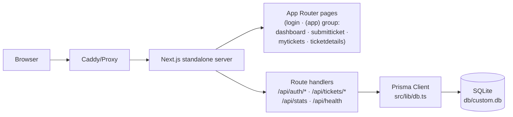

# ServiceDesk — IT Support Portal


A production-ready IT support ticketing portal — a feature-parity **superset** clone of the [base44 ServiceDesk reference app](https://service-desk-332a5ae4.base44.app/), rebuilt on Next.js 16 + React 19 + Prisma/SQLite. Users sign in, submit tickets across six issue categories, track status/priority, converse in comment threads, and manage their own ticket lifecycle.

## Overview

The portal solves a everyday enterprise problem: employees need a single place to report IT issues (hardware, software, network, access, email) and follow them to resolution, while the sidebar keeps live global stats visible. The clone reproduces the reference app's visual design (measured from its live DOM and computed styles — not guessed) and extends it with a working signup flow, password-reset request, file attachments, owner-side status control, search/filter/sort, and a full test pyramid.

**Verification status:** `lint` ✓ · `typecheck` ✓ · 287 Vitest unit tests ✓ · production build ✓ · 198 Playwright E2E tests ✓ · API smoke script (121 steps) ✓ · CI (GitHub Actions, on push/PR to main) ✓

## Key Features

| Feature | Description |
|---|---|
| 🎫 **Ticket lifecycle** | Submit → open → in progress → resolved → closed, with **owner-only status control** (non-owner writes 403 while reads stay open for the reference's shareable URLs — session 22's live measurement: the reference's update PUT applies ANY authenticated user's mutation on ANY ticket, their UI merely hides the control; our comment API likewise validates what theirs stores — empty/whitespace/50k-char/bogus-ticket comments all 200 on their side, 400/404 on ours) |
| 🔐 **Cookie sessions** | HMAC-SHA256 signed sessions, scrypt password hashing, per-IP rate limiting (login 10/15 min + forgot-password 5/15 min — both buckets smoke-pinned to return 429 + `Retry-After`, a deliberate superset: the reference's auth endpoints show no visible throttle at 20+ requests, session 21; the limiter keys on the RIGHTMOST `X-Forwarded-For` element — session 38: the proxy-appended socket address, so a rotating client-supplied XFF prefix cannot mint fresh buckets, plus the Next standalone's own socket-IP injection for XFF-less requests — measured and documented in `docs/DEPLOYMENT.md`); the login card swaps in place to the reference's reset-password + signup views (session 10); **the auth gate preserves deep links** — an unauthenticated visit to a guarded route bounces to `/login?from_url=<absolute url>` and sign-in returns the user to that exact page (session 19, the reference's measured `from_url` contract, hardened with a same-origin/open-redirect guard in `src/lib/redirect.ts` + the cookie-presence proxy `src/proxy.ts` alongside the authoritative layout guard); the deep link survives the in-card forgot-password detour too — reset, back, sign in, and you land on the ticket you were sent, not the dashboard (session 20, E2E-pinned; the reference's Google button was also measured — a real Google OAuth flow whose state carries their from_url, and backing out of it returns a clean login card with the from_url intact — while ours renders the truthful not-configured alert per the zero-third-party-auth doctrine; our wrong-password response is 401 + `{error}` where theirs is a FastAPI 400 envelope — the UI-visible message identical) |
| 🗂️ **Six categories** | Hardware / Software / Network / Access / Email / Other, each with an emoji tile |
| ⚡ **Four priorities** | Low / Medium / High / Urgent, sortable and filterable |
| 💬 **Comments** | Threaded updates per ticket with author + timestamp |
| 📎 **Attachments** | Images/PDFs/Word docs up to 2 MB each, 3 per ticket, streamed downloads — the submit-form rows and the detail-page display render the reference's measured contracts (session 13: the reference DOES ship a full attach UI — `multiple` picker, neutral slate rows, the X icon remove button, the generic "Attachment N" labels, new-tab downloads; session 14: the new tab renders the file INLINE like the reference CDN — Content-Disposition: inline with the sanitized save-as filename; session 15: the download route's cache window matches the reference CDN's year-long immutable window — `private, max-age=31536000, immutable`, `private` because the route is owner-scoped; session 23: the closed MIME allowlist is enforced at the SERVER seam — `validateAttachments` rejects any mimeType outside `ATTACHMENT_ACCEPTED_TYPES` with 400, the client mirrors it with a toast, closing a stored-XSS surface where a direct API POST could store `text/html` for inline serving; the reference's upload, by contrast, caps nothing — 15 MiB accepted, 10 URLs per ticket, a partial .exe/.bat blocklist, octet-stream serving) |
| 🔍 **Search & filters** | Full-text search, status/priority filters, newest/oldest/priority sort, My/All scope |
| 🛟 **Failure-resilient pages** | Fetch failures surface an error panel with retry (never a silent skeleton/empty state); per-route tab titles + favicon |
| 🧾 **Social/PWA metadata + SEO** | Per-route canonical URLs, OpenGraph + Twitter cards, apple-web-app meta, `theme-color`, a real PWA `manifest.json` (installable, with size-correct 192/512 icons + a 180×180 apple-touch-icon), BreadcrumbList JSON-LD per route (the reference's builder contract — dashboard exempt); `sitemap.xml` (public routes) + `robots.txt` with the Sitemap directive (sessions 10–11) |
| 📊 **Live stats** | Sidebar quick stats (global, refreshed on route change **and every 5s** — the reference's polling contract) + dashboard cards (yours) + average resolution time |
| 📱 **Responsive chrome** | shadcn/ui off-canvas mobile sidebar with overlay, Escape, and auto-close on navigate |
| 🎨 **Parity-pinned design** | 164 E2E parity tests pin the reference's measured contracts (adjacent nav icon/label layout, gradient quick stats, flat recent rows with FileText tiles, detail grid, login card, lowercase badges, entrance animations — per-surface timing + stagger + the x-axis row slide, badge shadow + per-surface padding, the measured focus-state matrix, reference-computed icon-button padding/shadows/spacings, the system font stack, the v3 radius scale, select dropdown structure + priority colors, the accent-token pair, the auth-error alert contract, the 80% sheet overlay, the button-cursor preflight, the stock shadcn token block, the old-gen Badge base, the translucent sidebar edge, the in-card auth views, the ticket-not-found Alert, the id-less detail route, the PWA manifest/theme-color/apple-icon, the per-route JSON-LD breadcrumbs, the per-route social URL set, the login-view computed margins, the submit-form attachment rows + detail-page attachment display + the no-comments empty state, the attachment inline-disposition + the ticketdetails full-URL canonicalization, the attachment cache window + the timezone-stable UTC date rendering, the 5s sidebar-stats polling, the viewport-fit=cover meta + the truth-telling og:image asset) |
| 🏃 **Entrance animations** | Per-surface, re-measured session 16 from the reference's framer-motion parameters (bundle) + live rAF timelines: stat cards + the submit/detail wrappers rise 20px over 0.5s with a gentle ease-out tween (no overshoot); mytickets cards rise as a ~300ms spring with a 50ms/index stagger; dashboard recent rows slide in from the LEFT (x-axis) as the same spring with a 100ms/index stagger; the opacity on the spring surfaces rides a separate piecewise curve (the framer-motion spring's slower opacity settle). All disabled under `prefers-reduced-motion` |
| 🧪 **Test pyramid** | 287 unit + 198 E2E tests + API smoke (121 steps) + GitHub Actions CI, pinned to the UI contract |

## Architecture

| Layer | Technology | Version | Purpose |
|---|---|---|---|
| Framework | Next.js (App Router, standalone output) | 16.4.0 | Server rendering, route handlers, route-group auth guard |
| UI runtime | React | 19.3.0 | Client islands inside server-rendered chrome |
| Language | TypeScript (strict) | 5.9.3 | Type safety across app and tests |
| Styling | Tailwind CSS (CSS-first `@theme inline`) | 4.3.3 | Utility styling; semantic tokens resolve `:root` vars |
| Components | shadcn/ui on Radix primitives | — | Sidebar/Sheet/Select/Tooltip/Toast/etc. |
| ORM | Prisma + SQLite | 6.19.3 | `User` / `Ticket` / `Comment` / `Attachment` at `db/custom.db` |
| Auth | Custom HMAC cookie + scrypt | — | Zero third-party auth surface; auditable in `src/lib/auth.ts` |
| Unit tests | Vitest | 5.0.3 | Pure domain seams: auth, validation, db-path, utils |
| E2E tests | Playwright (Chromium) | 1.64.0 | Production standalone server + isolated `db/e2e.db` |



## File Hierarchy

```
📂 service-desk/
├── 📂 src/
│   ├── 📂 app/
│   │   ├── 📂 (app)/                  ← authenticated route group (layout guards session)
│   │   │   ├── 📂 dashboard/          ← stat cards, performance metrics, recent tickets (flat rows)
│   │   │   ├── 📂 submitticket/       ← ticket form + attachments
│   │   │   ├── 📂 mytickets/          ← search/filter/sort/scope list (max-w-7xl, 3-col filter grid)
│   │   │   └── 📂 ticketdetails/      ← 3-col grid: gradient-header card + comments + info panel
│   │   ├── 📂 api/                    ← route handlers (auth, tickets, comments, stats, health)
│   │   ├── 📂 login/ · signup/ · forgotpassword/
│   │   ├── layout.tsx · page.tsx · globals.css
│   ├── 📂 components/
│   │   ├── 📂 ui/                     ← shadcn primitives (sidebar, sheet, select, toast, …)
│   │   ├── app-sidebar.tsx            ← nav + gradient quick stats + user footer
│   │   ├── app-sidebar-chrome.tsx     ← provider tree + gradient wrapper + mobile header + scroll container
│   │   ├── ticket-bits.tsx            ← badges + ticket card + flat recent-ticket row
│   │   └── toast.tsx                  ← Radix toast + useToast context
│   ├── 📂 hooks/use-mobile.ts         ← useSyncExternalStore media query
│   └── 📂 lib/                        ← auth, db, db-path, validation, constants, utils (+ tests)
├── 📂 prisma/schema.prisma · seed-data.ts · seed.ts
├── 📂 db/                             ← SQLite file lives here (gitignored *.db)
├── 📂 tests/e2e/                      ← Playwright specs (incl. visual-parity.spec.ts) + setup + global setup
├── 📂 scripts/                        ← smoke-test.sh + gradient probes
├── 📂 docs/                           ← deployment, Tailwind v4 report, remediation plan, screenshots, ssh push skill
├── 📂 public/                         ← logo.png (reference app logo) + robots.txt
└── next.config.ts · vitest.config.ts · playwright.config.ts
```

## Quick Start

Requires **Node.js ≥ 20** (or Bun ≥ 1.1). The seed's password hashing uses Node's built-in `node:crypto` — no Python required.

```bash
git clone https://github.com/nordeim/service-desk.git
cd service-desk
bun install                # or: npm install

cp .env.example .env       # defaults: DATABASE_URL="file:../db/custom.db"
# generate a session secret (REQUIRED in production):
#   openssl rand -hex 32   (or: python3 -c "import secrets; print(secrets.token_hex(32))")   → AUTH_SECRET

bun run db:push            # create db/custom.db from prisma/schema.prisma
bun run db:seed            # demo corpus: 4 users, 11 tickets, 3 comments

bun run dev                # http://localhost:3000
```

**Demo login:** `demo@servicedesk.app` / `Demo1234!`

### Verify Setup

```bash
curl http://localhost:3000/api/health
# {"status":"ok","db":"up","time":"..."}          ← server + database healthy

bun run lint && bun run typecheck && bun run test
# ESLint clean · tsc clean · 35 files / 287 tests passed
```

## Environment Variables

| Variable | Required | Purpose |
|---|---|---|
| `DATABASE_URL` | yes | SQLite path, **relative to `prisma/schema.prisma`**. Keep `file:../db/custom.db` → resolves to `<repo>/db/custom.db` for CLI, dev, build, and the standalone server (see `src/lib/db-path.ts`). Production recommends an absolute path. |
| `AUTH_SECRET` | prod | HMAC signing key for session cookies (`openssl rand -hex 32`). Falls back to an insecure dev constant with a loud warning. |
| `NEXT_PUBLIC_SITE_URL` | no | Canonical origin for metadata (default `http://localhost:3000`). |

> **Gotcha:** the npm scripts pin `DATABASE_URL='file:../db/custom.db'` inline. An ambient `DATABASE_URL` env var (e.g. from a sandbox) would otherwise override `.env` and redirect the database; the inline pin makes every script deterministic.

## Testing

```bash
bun run test               # Vitest unit: 287 tests (auth HMAC/scrypt/rate-limit + the clientIp + the 405 seam + the s41 routeAllow (the s42 fail-fast input validation: unknown method names THROW at module scope) + the s42 log-layer pins (the AUTH_SECRET production warning + the forgot-password audit-trail lines — every console.* site in src/ now pinned) + the s43 db-script pins (every package.json script that touches a database carries the inline DATABASE_URL pin — the smoke + E2E layers alongside) + the s43 seed-corpus pins (the canonical 4/11/3 fixture shape, vocabulary, and demo login — via the side-effect-free prisma/seed-data.ts) + the s44 e2e-provisioning pins (the global-setup bun/npx fallback chain shape + tsx pinned as a devDependency so the documented npx fallback resolves locally, never the network) + the s45 ci-contract pins (the CI workflow's silent-failure surface: --frozen-lockfile in both jobs, include-hidden-files: true, the [main] triggers, the bun.lock tsx entry) + the s46 env-contract pins (the .env.example ↔ codebase bidirectional coverage: every code-read env var documented, every documented var live, the canonical DATABASE_URL literal — line-anchored) + the s47 gitignore-contract pins (the secret-guard surface: .env, *.key/*.pem/ssh-key.txt, db binaries — EXECUTABLE check-ignore pins + the tracked-surface pin (git ls-files carries no secret-shaped path, the PAD §7.4 checklist automated) + .env.example tracked, not ignored — the quickstart source) + the s47 docs-contract pins (DEPLOYMENT.md's route-module claim (12, fs-counted) + its smoke-claim (121 steps) — the docs surface that never had a drift watch, the stale '16'/'30' figures closed) + the s48 corpus-count-contract pins (the drift-watch automation: every live unit/e2e/parity/smoke corpus claim site names ONE number across the five docs, with minimum-site floors — the stale '54 unit'/'57 E2E'/'11-step'/'# 107 E2E' figures in the SKILL appendices + README's '163 parity' closed) + the s48 version-contract pins (the README badge row + the PAD §2 tech table ↔ the installed node_modules versions + the bun.lock resolved entries — the stack's face pinned bidirectionally) + the s49 pad-testcount pins (the PAD §7.1 per-file test distribution pinned bidirectionally to the RUNTIME — every row names its file's runtime count, every runtime file has a row, via the nested vitest JSON run + the playwright --list; the smoke row joined the s48 corpus family) + the s50 quickstart BRIDGE pin (the README Quick Start's verify-setup output line: the quoted file figure == the fs listing of the vitest include patterns, the quoted test figure == the runtime-pinned §7.1 Vitest sum, and the family canonical == that same sum — the quoted-output claim class closed + the s48 whole-family-drift blind spot closed) + the s51 prerequisites pins (the README Quick Start's Requires line held two-sided: the seed's crypto is node:crypto + the requirements enumeration carries no Python token — the false 'Python ≥ 3.9 for the seed's crypto imports' claim that survived 50 sessions closed)
                           # XFF seam (s38: the rightmost-element trust — the proxy-appended
                           # value, the trim, the single-element/x-real-ip/unknown fallbacks),
                           # validation incl. the
                           # attachment MIME allowlist + the parseListParams pagination seam + the
                           # parseListFilters vocabulary seam + the parseListSearch literal-search seam
                           # + the parseListQuery param-set seam + the parseStatsQuery empty-grammar
                           # seam + the parseNoQuery shared empty-grammar seam (s29, API-wide),
                           # the headers-config contract (s30: the five-header security set incl.
                           # HSTS + the poweredByHeader lockdown), the parseBodyKeys request-body
                           # grammar seam (s32: unknown top-level fields rejected 400 on every
                           # write route — the s27 doctrine at the body level), the parseBodySize
                           # request-size seam + the attachment data-honesty contract (s35: a
                           # Content-Length ceiling of 10 MiB checked BEFORE req.json() on all six
                           # write routes — 413, the header-read cost, never the buffered-parse
                           # cost — plus the canonical-base64 form check + the declared-size
                           # equality on attachment payloads), the proxy-contract
                           # pins (s36: the auth-gate from_url construction seam — the
                           # cookie-present passthrough, the full-absolute-URL deep-link
                           # construction with query survival, the spoofed-Host reflection
                           # (the documented INERT two-layer guard: the relative Location +
                           # the browser-origin check), the X-Forwarded-Host no-op, and the
                           # exact four-route matcher boundary), the loginBounceUrl
                           # layout-bounce seam + the downstream-header pins (s37: the
                           # invalid-cookie deep-link preservation — the proxy forwards its
                           # constructed target as the x-sd-from-url request header (the
                           # overwrite is total — a client-supplied value never survives),
                           # the layout consumes it via loginBounceUrl so an expired
                           # session's shared link survives the auth gate), the API catch-all
                           # 404 contract (s33: unknown /api/** paths answer 404 + application/json
                           # + {error} on every method — the JSON-namespace boundary), db-path,
                           # utils incl. the timezone-pinned formatters, priority-select colors,
                           # attachment accept list, the from_url redirect-target guard)
bun run test:e2e           # Playwright E2E (198 tests): builds nothing — boots the PRODUCTION standalone server
                           # on :3100 with an isolated db/e2e.db (schema pushed + seeded by global setup)
bash scripts/smoke-test.sh # API surface against a throwaway standalone server on :3999 — incl. the
                           # rate-limiter pins: the 11th login attempt + the 6th forgot-password request
                           # both assert 429 + Retry-After (session 21, the security superset) — the
                           # write-path pins: the non-owner PATCH 403 + the comment-validation matrix
                           # (empty/whitespace/overlong 400 + unknown-ticket 404, session 22) — the
                           # create-path pins: the client-sent status ignored (201 + open), the
                           # attachment count/size/filename/MIME guards (400, session 23) — and the
                           # pagination pins: limit=2 honored, skip=2 pages disjointly, limit=0/501
                           # filter-vocabulary pins: status=resolved/priority=urgent honored,
                           # status/priority/sort/scope=banana rejected 400 (s25) — the literal-search
                           # pins: search=Outlook honored (exactly 1), search=%/_ match NOTHING (the
                           # wildcard lie closed — Prisma's contains is a bare LIKE), a 250-char
                           # term rejected 400 + the cap message (s26) — and the param-set pins:
                           # banana=1 rejected 400 + the unknown message + the allowed set, a
                           # duplicate status rejected 400, all seven known params compose (s27)
                           # rejected 400 (session 24) — and the stats-grammar pins: /api/stats?
                           # banana=1 and the cross-route ?scope=mine rejected 400, the no-param
                           # aggregate intact (s28) — and the API-wide empty-grammar pins (s29):
                           # ?banana=1 rejected 400 on health, me, signup, logout, the ticket CREATE,
                           # the detail GET/PATCH, and comments; the cross-route ?scope=mine
                           # rejected 400 on me + comments; the bare happy paths intact — and the
                           # response-header pins (s30): /api/health carries HSTS
                           # max-age=31536000 + the full four-header baseline + no X-Powered-By
                           # disclosure, and the 404 error path carries them too (the universal rule)
                           # — and the response-schema pins (s31): the me/login user keys exactly
                           # {id,name,email} (the no-leak contract), the list rows bounded to the
                           # eleven-key set, the detail attachments carrying no data blob (the
                           # base64 leak guard), the comment author keys exact, and the stats
                           # mine+global symmetric five-status vocabulary — and the request-body
                           # grammar pins (s32): an unknown top-level field (banana) rejected 400
                           # + the allowed-set message on every write route (create, login, signup,
                           # forgot-password, comment, PATCH), the cross-route shape (a client-sent
                           # status on the CREATE) rejected 400, the bare create still 201 +
                           # status:open (the s23 contract carried forward) — and the envelope +
                           # HEAD/OPTIONS pins (s32): the 401/404 error envelopes exactly {error},
                           # the form-validation 400 exactly {error, errors}, HEAD /api/health
                           # 200 + HSTS + no X-Powered-By, OPTIONS 204 + allow: GET, HEAD,
                           # OPTIONS + empty body — and the catch-all + cookie + concurrency
                           # pins (s33): unknown /api/** paths (nested, deep, bare /api) answer
                           # 404 + application/json + {error} + HSTS on every method incl. HEAD
                           # (empty body) + OPTIONS (404, not the framework 204-with-allow),
                           # the known routes verified unshadowed, the login/signup/logout
                           # set-cookie attribute set (Path, Max-Age, Secure, HttpOnly,
                           # SameSite=lax — Max-Age=0 on the clear), and 5+5 parallel
                           # comments/PATCHes all-2xx with a coherent final count — and
                           # the cache-behavior pins (s34): every response under /api/**
                           # carries Cache-Control: no-store (the authenticated identity/
                           # data JSON — me/tickets/stats — plus the error paths and
                           # health; cookie auth rides the Cookie header, which RFC
                           # 9111's Authorization-header no-store rule does NOT cover),
                           # with the attachment download KEEPING its s15 year-long
                           # immutable private window (the interplay pin: a headers()
                           # rule overrides route-level Cache-Control, so the exception
                           # wins by rule order — the blanket first, the exception after) —
                           # and the request-size pins (s35): a 20 MB body on the create AND the
                           # comment route rejected 413 + the message naming the 10485760
                           # ceiling (the shared seam across routes, checked before the body is
                           # read), an attachment payload that is not its declared size rejected
                           # 400 (the honesty contract — the per-file cap used to enforce a
                           # number the attacker controlled), non-canonical base64 rejected 400
                           # (Node's decoder silently drops non-alphabet chars — a megabyte of
                           # '!' decoded to 0 bytes and stored), the 3x2MiB maximum legitimate
                           # create still 201 (the boundary — no false rejections), and chunked
                           # bodies passing the seam to the value level (the documented
                           # pass-through) — and the proxy-surface pins (s36): a spoofed Host
                           # on a guarded route bounces 307 with a RELATIVE /login Location +
                           # the reflected (inert) from_url value, X-Forwarded-Proto flips the
                           # from_url protocol (the middleware-runner contract), X-Forwarded-
                           # Host is ignored, the /login page reflects nothing server-side
                           # (the XSS surface closed), an unmatched sub-path renders the public
                           # 404 (the matcher boundary), and the deep-link query survives
                           # — and the auth-cookie lifecycle pins (s37): the invalid-cookie
                           # deep-link bounce carries from_url (the expired-session contract —
                           # the layout-side bounce consuming the proxy's x-sd-from-url
                           # request header), the spoofed-Host invalid-cookie bounce keeps the
                           # RELATIVE Location (the two-layer guard on the new path), and the
                           # header mechanism never decorates unguarded routes (the matcher
                           # boundary) + the XFF rightmost-element pins (s38: a rotating
                           # client-supplied XFF prefix cannot mint fresh login buckets — the
                           # 11th attempt on the stable proxy-appended key answers 429; the
                           # standalone's injected XFF shadows x-real-ip — the X-Real-IP-only
                           # requests exhaust the shared socket-IP bucket, so the 6th
                           # no-header request 429s) + the s39 pins (the signup bucket rides the shared rightmost-element seam — the 11th rotating-prefix attempt 429s; the 1050-request unique-XFF flood crosses the sweep threshold and the limiter stays exact — the eviction integration guard) + the s40 pins (every known route's unimplemented methods answer 405 + application/json + {error} + the RFC-mandated Allow header via the shared methodNotAllowed seam; the paired explicit OPTIONS re-asserts each route's honest allow list — a stub export alone would make the framework's auto-OPTIONS advertise the stubbed methods as allowed; HEAD on a POST-only route answers the 405 stub; the implemented methods stay unshadowed — the JSON boundary the s33 catch-all closed for unknown PATHS, closed at the METHOD level) (121 smoke steps)
```

E2E notes: the suite signs the demo user in **once** (setup project → saved `storageState`) because the auth endpoints are rate-limited (10 attempts/IP/15 min). `tests/e2e/auth.spec.ts` opts out of the shared session to test the logged-out surface. The mobile-navigation spec pins the off-canvas sheet contract (open, overlay close, Escape close, auto-close on navigate, desktop gradient parity, the 80% overlay dim) — session 29 re-verified it live on the new build via real clicks (375=375, the button clickable, the sheet opens, nav-tap auto-closes + navigates) while the reference's own menu button remained blocked by its toast viewports (the s4 defect, still present after their third /login bundle rotation). Session-37 additions pin the auth-cookie lifecycle: the expired-session deep link (an invalid-cookie bounce that carries from_url end to end — the layout-side bounce — and returns to the ticket after sign-in) and the sign-out navigation's from_url carry (the reference's logout returns the user to the page they left). Session-38 added no E2E pins (the clientIp change is a server-side seam — its pins live in the unit + smoke layers per the s21 zero-fixture doctrine; the suite's login budget stays at 8 of 10). `tests/e2e/visual-parity.spec.ts` (164 tests) pins the session-2 through session-18 remediation contracts measured from the live reference: gradient quick-stats rows, flat divide-y recent tickets with FileText icon tiles + arrows + date-only dates, lowercase badges, the detail page's `lg:grid-cols-3` layout with gradient card header, `text-4xl` page headings, the non-sticky mobile header, the login card shell, the reference entrance animations (per-surface: the 500ms tween wrappers, the staggered spring cards, the x-axis row slide — all disabled under `prefers-reduced-motion`), and the submit form details (circle-alert header icon, blue priority value, upload dropzone, inline footer). Session-5 additions pin the reference-computed values that class names alone cannot express: icon-button 16px horizontal padding, the light v3-name shadow step (`shadow-xs` on the v4 scale), `mr-2` icon spacings, the CTA arrow's `translate-x-1` slide, and the system font stack (the reference loads no webfont). Session-6 additions pin the radius scale (6/8/12px steps — the shadcn v4 calc chain rendered +2px on every rounded control), the focus-state matrix (1px near-black rings on buttons/inputs, 2px slate-400 + white offset on auth inputs, per-surface cyan customs), the select dropdown contracts (emoji-span category options, per-priority option colors, trigger color follows selection), the whole-line signup link, and the shadow-less Google button. Session-7 additions pin the accent-token pair (gray #f5f5f5 + near-black #171717 on option highlights and hover text — ours were cyan), the option-radius drift (reference rounded-sm now 4px), the empty-state markup (w-20 gradient circle, FileText tile, text-xl heading), fetch-failure resilience (error panel + Try again, with recovery), the favicon, and per-route document titles. Session-8 additions pin the auth-error alert contract (translucent red-50/70 + red-700 + rounded-xl + p-4 — the reference's shadcn Alert), the mobile sheet overlay at 80% black, zero horizontal overflow at 375px (a deliberate superset over a defect the reference shares) with ellipsis-active row titles, the social/PWA head set (description, og:*, twitter:card, canonicals, apple-web-app), and the focus-visible ring tails on the raw sign-out/Remove buttons. Session-9 additions pin the Tailwind v4 cursor-preflight restoration (every true button renders the hand cursor, like the reference's v3 build), the stock shadcn token block (near-black --primary driving the dark badge hovers, neutral-200 --border on every Card, near-black --foreground on the CategoryBadge, blue-500 --sidebar-ring on nav keyboard focus — live-measured via real Tab presses), the old-gen Badge base (transition-colors including background-color — the 150 ms hover fade — plus the focus:ring-2 tail, replacing the new-gen ring-[3px] base), and the translucent desktop sidebar edge (border-slate-200/60). Session-10 additions pin the login card's in-card view state machine (the reference's "Forgot password?" / "Need an account? Sign up" buttons swap the card in place — reset view with the shorter h-10/sm:h-11 input generation, the Check-your-email success view with the slate icon circle + green alert, and the three-field signup view), the ticket-not-found state (the reference's destructive shadcn Alert — red-500 text, 50%-alpha border, 8px radius, inline in the max-w-5xl container), the attachment picker's doc/docx families, and the SEO surface (sitemap.xml public-route set + robots.txt with the Sitemap directive). Session-11 additions pin the id-less ticket-detail route (the bare `/ticketdetails` renders the reference's destructive Alert — never an infinite skeleton; `?id=` too), the PWA manifest surface (`/manifest.json` with the reference's measured field set — name/short_name, their description, standalone display, #000000 theme + #ffffff background colors, real size-correct 192/512 PNG icons — plus the head's `rel="manifest"` link), the `theme-color` meta (#000000) + the 180×180 apple-touch-icon, and the per-route BreadcrumbList JSON-LD (name = the lowercase path segment, exactly the reference's builder output — with `/dashboard` carrying none, their home special case). Session-12 additions pin the per-route social URL set (canonical + og:url + twitter:url, all three equal — the reference ships them on every route; ours had shipped NO og:url/twitter:url anywhere for four sessions on a false "derives from canonical" belief — Next emits og:url only from `openGraph.url`, and twitter:url only via `metadata.other`) and the login-view back buttons' computed margins (`mb-2 sm:mb-4` / `mb-2` computing the reference's 8–16px gaps, where the reference's own `-mb-2` class computed an 8px overlap on our v4 build — the space-y trap-log #4; the shadow-xs doctrine: parity is the COMPUTED value). Session-13 additions pin the attachment UI the reference actually ships (the session-8 "reference has no attachments" comment was false — live-probed: their `multiple` picker appends rows, uploads to a CDN, and renders the detail display): the submit-form attached-file rows (12px `p-3` padding, plain `text-sm text-slate-700 truncate flex-1` filename with no emoji/size, the 36px X icon remove button with `hover:bg-red-50 hover:text-red-600`, the list's `mt-4` offset) and the detail-page attachment display (neutral `p-3 bg-slate-50 rounded-lg` rows with the Paperclip icon, the GENERIC indexed "Attachment N" label, `target=_blank` downloads, the Paperclip `w-4` + `mb-3` section heading, the Description heading's `w-4` icon) plus the no-comments empty state (slate-500 + py-8). Color pins accept both rgb() and lab() representations (Tailwind v4 emits palette colors as lab()). Session-14 additions pin the attachment DOWNLOAD UX (the download route serves Content-Disposition: inline — the new tab displays the file like the reference's CDN links, which ship no disposition header at all; the sanitized filename stays the save-as name) and the ticketdetails URL canonicalization (the reference's platform canonicalizes the full current URL: canonical + og:url + twitter:url + the BreadcrumbList JSON-LD item all carry ?id=<id> on the id-bearing route; the bare route stays segment-canonical — no query invented for the s11 Alert state). Session-15 additions pin the attachment route's cache window (`private, max-age=31536000, immutable` — the reference CDN's measured year-long immutable window, our `private` scope because the route is owner-scoped) and the timezone-stable date rendering (the reference's API returns naive datetimes that round-trip as the stored UTC wall-clock to every viewer; our formatters pin `timeZone: "UTC"` — verified in Singapore-timezone and extreme +14/-12 browser contexts, where ours previously rendered the viewer's local time, an 8h-visible divergence for the Singapore operator). Session-16 additions pin the per-surface entrance-animation contract (re-measured from the reference's framer-motion parameters in their production bundle + live rAF timelines: the stat cards + submit/detail wrappers as ONE 500ms ease-out tween each — cubic-bezier(0.61, 1, 0.88, 1), no overshoot; the mytickets cards as a ~300ms spring with a 50ms/index stagger; the dashboard recent rows as an X-AXIS slide (translateX(-20px), never y) with a 100ms/index stagger; the spring surfaces' opacity on a separate piecewise curve matching framer-motion's slower opacity settle) and the sidebar QUICK STATS' 5-second polling (the reference's setInterval(5e3) — ours had fetched only on route change). Session-17 additions pin the head-layer VALUE contracts (the first value-level head sweep): the viewport meta ships `viewport-fit=cover` (the reference's measured string — the notched-device/PWA full-bleed companion; ours had shipped the meta without the key), and the og:image points at the REAL 512×512 PNG (`/icon-512.png`, the s11 PWA-manifest set — our declaration had claimed 512×512 over the 480×480 JPEG served at `/icon.png`; the reference declares 1200×630 against the same ~480×480 file, their platform defect, never mirrored — the s11 size-correct precedent extended to the OG card, with the asset GET + PNG magic bytes pinned). Session-18 additions pin the favicon asset truth (GET `/icon.png` → 200 + `image/png` + PNG magic bytes + the `<link rel="icon">` type claim — the route had served a JPEG body under the PNG name, the one remaining head-facing falsity, closed with a pixel-identical re-encode) and re-anchor the og:image pin's asset GET to the E2E server's origin (the absolute-URL fetch had passed only under an ambient :3000 listener and failed in every clean environment — including the CI run on the s17 push, whose badge sat red until this fix; the suite now verifies green in a clean environment, 194/194 with :3000 down). Session-19 additions pin the auth-gate deep-link contract (the reference's measured `from_url` mechanism: an unauthenticated visit to a guarded route lands on `/login?from_url=<absolute url>` and sign-in RETURNS to that exact page — ours had discarded the deep link; now `src/proxy.ts` decorates the cookie-less bounce, `src/lib/redirect.ts` validates the target — same-origin, auth-pages rejected, `/dashboard` fallback — and the login card's sign-in + in-card signup navigate to the validated target; the reference's post-login landing verified live on their side with a non-dashboard deep link). Session-20 additions pin the compound deep-link path (the reset detour: a shared ticket URL opened logged out → Forgot password? → Send reset link → Back to sign in → sign in → **back on the same ticket URL** — the s10 view machine never changes the URL through the swaps, which is why the from_url survives; the pin guards the interaction between the view machine and the s19 contract through the most common real-world path to a shared link; the session also measured the reference's Google button — a real Google OAuth flow whose state param carries their from_url through the OAuth round-trip — and their gate's route-set: a catch-all that bounces even unknown routes and their own `/signup` to login when cookie-less, where ours gates exactly the four app routes, serves the real `/signup`, and 404s unknown routes publicly — documented architecture-driven divergences). Session-21 additions live at the smoke layer: the rate-limiter pins (both auth buckets — the 11th login attempt and the 6th forgot-password request each assert 429 + `Retry-After` + the message on the throwaway server; the reference's endpoints show no visible throttle, making ours the documented security superset; an E2E pin was deliberately rejected — burning 11 real attempts would consume the whole rate budget and cascade-flake the suite, so the pin lives at the layer with zero fixture cost). Session-22 additions live at the smoke layer too: the write-path pins (the non-owner PATCH returns 403 + "Only the ticket owner can update it" while the non-owner read stays 200 for the shareable-URL contract, and the comment-validation matrix rejects empty/whitespace/over-2000-char content with 400 + the unknown ticket with 404 — the reference's write path is UI-guarded only: their comment API stores empty, whitespace-only, 50,000-character, and even bogus-ticket-id comments at 200, and their ticket-update PUT applies any authenticated user's mutation on any ticket, all measured live in session 22). Session-23 additions: the unit layer gains the server-side MIME-allowlist pin (the RED→GREEN TDD fix — `validateAttachments` rejecting `text/html`/`application/x-msdownload`/`application/javascript` and accepting every advertised type; previously the closed MIME list was enforced nowhere — the picker's `accept` attribute is a hint, and the download route serves the stored type inline, a stored-XSS surface closed at the seam), and the smoke layer gains the create-path pins (a client-sent `"status":"banana"` is ignored — the create comes back 201 with `status:"open"`, where the reference stores the banana and renders it as a fallback near-black badge; the attachment count cap — 400 + "At most 3 files" where their platform stored 10 URLs; the 2 MiB size cap — 400 where their upload accepted 15 MiB; the path-traversal filename guard; and the MIME allowlist — 400 + "unsupported file type"). Session-24 additions: the unit layer gains the `parseListParams` pagination seam (6 pins — the 200-default/0-skip defaults, `limit`/`skip` honored alone and combined, the 1/500 boundaries, the `limit=0`/negative/over-ceiling/non-integer rejects, the negative/non-numeric skip rejects, empty-string-as-absent — the reference's entity APIs page with these exact param names while ours had a silent `take: 200` with no escape hatch), and the smoke layer gains the pagination pins (`?limit=2` returns exactly 2, `?limit=2&skip=2` pages disjointly from page 1, `?limit=0` and `?limit=501` reject 400 with the range message — the session's finding: a cap without params is a silent truncation). The session also measured the reference's admin-surface access-control matrix for the first time (`/alltickets` renders the full 121-ticket global feed with every user's email to ANY authenticated regular user — their admin gate is a hidden nav item, the s22 UI-only-guard class; `/analytics`/`/settings`/`/developer` render in-page permission notices; their User entity list is the one 403-protected endpoint) — ours keeps the exact-route 404s (the no-roles architecture) with the My/All scope toggle as the honest global-feed surface. Session-25 additions: the unit layer gains the `parseListFilters` vocabulary seam (8 pins — the mine/newest defaults, valid status/priority/sort/scope honored alone and combined, the four out-of-vocabulary rejects with the exact messages, empty-string-as-absent; previously `?status=banana`/`?priority=banana`/`?sort=banana`/`?scope=banana` all silently defaulted to 200 — the s24 strict-validation doctrine applied to only the pagination params), and the smoke layer gains the filter-vocabulary pins (`?status=resolved` and `?priority=urgent` return exactly the seeded rows; the four `banana` probes reject 400 with the vocabulary messages — the reference's platform silently ignores out-of-vocabulary values, measured on their `?sort=banana`). The session also closed the s24 `/analytics` open question at the bundle level: the guard is `role === "admin"` and their platform supports only "user" and "admin" (the inviteUser validation string) — "IT staff" is a UI-copy misnomer; one intended admin gate rendered three ways (missing on /alltickets, the leak; "IT staff" copy on /analytics; "administrator" copy on /settings + /developer). `tests/e2e/dashboard.spec.ts` also pins a clean hydration (no console hydration-mismatch errors). Session-26 additions: the unit layer gains the `parseListSearch` seam (6 pins — absent/whitespace-as-absent, the trim, the 200-char boundary, the 201/250-char rejects with the exact cap message, wildcard-bearing values passing through untouched; the last unaudited param family on the list route, completing the strictness matrix: pagination s24, vocabulary s25, free text s26), and the smoke layer gains the literal-search pins (`?search=Outlook` returns exactly the seeded row; `?search=%` and `?search=_` return 0 rows — closing the wildcard lie where Prisma's SQLite `contains` compiles to a bare `LIKE` with no `ESCAPE` clause and a literal `%` had silently rendered the whole unfiltered feed; a 250-char term rejects 400 + the cap message). The route's search predicate is now an `instr(lower(col), lower(?))` id-subquery feeding `where.id = { in: [...] }` — the reference's measured client-side `.toLowerCase().includes()` semantics (pinned at its bundle), with the where-builder/pagination/includes and the response shape untouched; the mytickets search input mirrors the cap (`maxLength={200}`). The session also measured the reference's entity-API filter grammar to closure (generic exact-match equality on any known field, composing with pagination + sort; unknown values AND unknown fields both yield `[]`; case-sensitive; duplicate params last-wins; `sort` garbage silently ignored — the one exception), decoded their `/analytics` page at the bundle level (an admin-gated print report — stat cards, percentage summary, category/priority chart bars, technician-performance table by `assigned_to`, CSV + text exports — computed client-side from the same public entity APIs; our documented decision: we do NOT add an analytics surface — the no-roles doctrine, no assignment concept in our schema, and the visible equivalents already ship), and recorded the first `/login` bundle rotation since s24 (`index-BTm9sXpu.js` → `index-CM-qL9yl.js`, a Rolldown platform rebuild — the login UI, the `from_url` contract, and the live flow verified unchanged; the CSS chunk and the app-route pair unchanged). Session-27 additions: the unit layer gains the `parseListQuery` seam (7 pins — the no-param happy path, every known name accepted, the all-seven composition, the unknown-name rejects with the exact message naming the param AND the allowed set, the unknown-alongside-known reject, the duplicate rejects across families, the s25 empty-as-absent convention preserved for KNOWN names; the route's query grammar is the closed set of seven — `search, status, priority, sort, scope, limit, skip` — completing the strictness matrix at the SET level after the value families were closed: pagination s24, vocabularies s25, free text s26, the set s27), and the smoke layer gains the param-set pins (`?banana=1` rejects 400 + the unknown message + the allowed set; a duplicate `?status=open&status=resolved` rejects 400 + the duplicate message; all seven known params compose to exactly the seeded Outlook row). Before the fix the unknown/duplicate surface was silently ignored — measured live: `?banana=1`, `?category=hardware`, and their platform's `?q={…}` JSON grammar all returned 200 with the unfiltered feed presented as matches, and duplicates were first-wins by the `URLSearchParams.get()` accident (the s25 lesson-79 class). The session also measured their platform's `/count` endpoint for the first time (special-cased on entities, composing with the `q=` JSON filter grammar but not ad-hoc params; `User/count` collaborator-gated — but their SDK client wraps no count method and their app never calls it, so the documented decision is: no count endpoint on ours — `/api/stats` stays the user-visible superset), and measured their logged-IN unknown-route render for the first time (the in-app 404 — "404"/"Page Not Found"/"Go Home" at HTTP 200, plus their `/signup` route 404ing logged-in since signup is the in-card login view; their logged-out catch-all gate holds — the s20 ledger intact; ours: the true 404 status + the same 404 design + the real `/signup` route, parity plus the SEO superset). Session-28 additions: the unit layer gains the `parseStatsQuery` empty-grammar seam (5 pins — the no-param happy path, the unknown-name reject with the exact message, the cross-route confusion pin rejecting the sibling route's REAL param names, the empty-value-still-unknown reject, the duplicate subsumed by the unknown message; `/api/stats` takes no query params at all, and before s28 `?scope=mine`/`?status=open&limit=5` were silently ignored, returning the identical full aggregate — the cross-route variant of the s25 lesson-79 class), and the smoke layer gains the stats-grammar pins (`?banana=1` and the cross-route `?scope=mine` reject 400; the no-param aggregate shape intact). The session also recorded the SECOND `/login` bundle rotation since s24 (`index-CM-qL9yl.js` → `index-GvewFNv-.js` + the CSS pair rotating too, with the whole graph re-split around a new `rolldown-runtime` — the login UI strings, the `from_url` contract, and the live flow verified unchanged), decoded their mobile-app chunks to closure (`useHideNativeBottomTabs` + `native-mobile-app` = the Wix native-shell bridge, `window.wixMobileNativeBridge.base44.*`, every call guarded by `isNativeMobile` — inert in the browser, platform infrastructure per the s2 no-platform-chrome doctrine), and measured the s4-documented reference mobile defect RECURRED and WORSENED (their menu button BLOCKED by the empty toast-viewport divs — now TWO stacked `fixed top-0 z-[100] w-full` bands with `pointer-events: auto`, ~64px vs the s4 single 32px strip — a real click at the button's coordinates lands on the container and the menu does not open; ours keeps the inline `pointer-events: none` on the Radix viewport region — the working menu, their defect documented, not cloned). Session-29 additions: the unit layer gains the `parseNoQuery` shared empty-grammar seam (7 pins — the no-param happy path, the unknown-name reject with the exact message, the cross-route confusion pin rejecting the sibling route's REAL param names, the empty-value-still-unknown reject, the duplicate subsumed by the unknown, the first-name reject, and the stats-delegation contract pin; the s28 `parseStatsQuery` now delegates to it), and the smoke layer gains the API-wide empty-grammar pins (`?banana=1` rejected 400 on health, signup, logout, the ticket CREATE, and the detail GET/PATCH; the cross-route `?scope=mine` rejected 400 on me and comments; the bare happy paths intact — 54 smoke steps). Before s29 every remaining route family silently ignored any query string — measured live on all ten: a `?scope=mine` on `/api/auth/me`, a `?banana=1` ticket CREATE that created the ticket, the same on login/signup/forgot-password/logout/health/detail/PATCH/comments — the cross-route confusion variant of the lesson-82 class, closed API-wide by the shared seam (the rate-limited routes pin their grammar in `scripts/s29-live-verify.mjs` where the buckets are fresh: 22 live checks, all green). The session also recorded the THIRD `/login` bundle rotation since s24 (`index-GvewFNv-.js` → `index-NgIJwTZs.js` + the CSS pair rotating again; `UserAppMain` renamed `BZ-6C68G` → `BgdljW3t` — the login UI strings, the `from_url` contract, and the live gate verified unchanged through the new bundles, with the two new preload chunks decoded as platform infrastructure: `domainValidation` URL-security + `logoutReturnPath` workspace-access gating), measured a NEW reference-side desktop horizontal overflow for the first time (their `scrollWidth` 1328 at `clientWidth` 1280 — four decorative gradient blobs anchored `right-0` to an un-clipped 1328-wide wrapper, 48px of desktop overflow on their latest rebuild; ours stays 1280=1280), and re-measured the s4 toast-viewport blocking (STILL present after their rebuild: two overlapping 32px `fixed top-0 z-[100]` bands, the real click at the button's center still lands on the container and the menu does not open — the s46 question answered: the defect did not recede). Session-30 additions live at the unit + smoke layers: the `tests/headers-config.test.ts` contract (4 pins — `poweredByHeader: false`, the one universal `/(.*)` rule, the exact five-header set, and the HSTS entry `Strict-Transport-Security: max-age=31536000`; the reference's stack emits HSTS on every response — measured on their 200s, 405s, and catch-alls — while ours shipped none, and the s17/s21 "defer it to the TLS proxy" position was never operationalized in DEPLOYMENT.md, so the app now emits it itself: inert over plain HTTP per RFC 6797, effective behind any TLS-terminating proxy) and the smoke response-header pins (/api/health carries HSTS + the four-header baseline + no `X-Powered-By` disclosure; the 404 error path carries them too — 58 smoke steps). The session also recorded the FOURTH `/login` JS rotation since s24 AND the app-route pair's first rotation in eleven sweeps (both routes now share `index-Bv7e1rqD.js` + `index-CykrcFnx.css`; `UserAppMain` renamed `BgdljW3t` → `CDUve4NQ` — the login UI strings, the `from_url` ×14 contract, and the live flow verified unchanged through the new bundles), re-measured the s4 toast-viewport blocking (STILL present, geometry unchanged from s29 — the real click at the button's center remains blocked on their side) and their desktop 1328-vs-1280 overflow (unchanged — the four gradient blobs on their un-clipped wrapper; ours stays 1280=1280), and hardened `scripts/s29-live-verify.mjs` to be self-contained (the deterministic DATABASE_URL pin + dynamic import — a bare `node` invocation previously crashed at its PrismaClient cleanup when the ambient env was absent or stale, leaving fixtures in the canonical db). Session-31 additions live at the smoke layer: the response-schema pins (six exact-key-set contracts — the me/login user keys exactly `{id,name,email}` with the no-leak guarantee, the list rows bounded to the eleven-key set with `createdBy` + `_count` only, the detail attachments carrying exactly `{id,fileName,mimeType,sizeBytes,createdAt}` — never the base64 `data` blob, the comment author keys exact, and the stats `mine`+`global` symmetric five-status vocabulary; 64 smoke steps). The pins came out of the s50-directed response-BODY schema audit — every route family's JSON key sets + types measured live on both sides and found CLEAN but UNPINNED, exactly the class where a future refactor's silently-widened Prisma include would ship the passwordHash or base64 blobs; the RED phase was demonstrated by mutation (removing the me-route's select → the pin FAIL → restore → GREEN). The session also recorded the FIFTH `/login` rotation since s24 — both halves this wave (`index-yqAONkSu.js` + `index-BQkILzMl.css`) — and the app-route pair RE-SPLIT to the old pre-s30 pair (the s49 prediction materialized; the login contract re-verified in the new bundle: five strings + `from_url` ×14), re-measured the s4 toast-viewport blocking (STILL present through the new bundle wave, geometry unchanged) and their desktop 1328-vs-1280 overflow (unchanged; ours stays 1280=1280), and verified the attachment-route header interplay for the first time explicitly (the s15 cache-window contract coexisting with the s30 universal five-header set — no conflict). Session-32 additions live at the unit + smoke layers: the `parseBodyKeys` request-body grammar seam (9 unit pins — unknown top-level fields rejected with the exact message naming the field AND the allowed set, known/subset/empty bodies passing, non-objects passing through to the value-level validators, each write route's allowed set pinned, the cross-route shapes rejected: a client-sent `status` on the CREATE and a `name` on the LOGIN; every write route previously silently accepted unknown body keys — measured live: a create carrying `banana:1` stored the ticket, a login carrying `banana` logged in — the body-level variant of the s25 lesson-79 class, while the reference's platform silently DROPS unknown keys, the Pydantic ignore-extras default), and the smoke grammar + envelope + HEAD/OPTIONS pins (12 — the six route grammars rejecting `+banana` with 400 + the allowed-set message, the bare create still 201 + `status:open` re-pinning the s23 server-controlled contract, the 401/404 error envelopes exactly `{error}`, the form-validation 400 exactly `{error, errors}`, HEAD /api/health 200 + HSTS + no X-Powered-By, OPTIONS 204 + `allow: GET, HEAD, OPTIONS` + empty body; 76 smoke steps). The session also recorded the SIXTH `/login` rotation since s24 — both halves again (`index-Bp10hac5.js` + `index-pXNNffyR.css`; `UserAppMain` renamed `B2UjrI81` → `BN_RuQ68`) — while the app-route pair STAYED on the old pre-s30 split, re-measured the s4 toast-viewport blocking (STILL present, geometry unchanged — agent-browser itself now refuses the blocked click) and their desktop 1328-vs-1280 + mobile 468-vs-375 overflows (unchanged; ours stays 1280=1280 + 375=375), and the desktop paired VLM check LAYOUT-OK. Session-33 additions live at the unit + smoke layers: the API-namespace JSON 404 catch-all (`src/app/api/[[...path]]/route.ts` — 19 unit pins: every method answering 404 + application/json + the `{error}` envelope exactly + the constant message, the query string ignored; every UNKNOWN path under /api/** previously served the framework's HTML 404 page — content-type text/html — the last non-JSON surface in the API namespace: a JSON client hitting a mistyped route got an HTML body it could not parse, while the known routes' error paths already spoke JSON; the reference's platform, by contrast, serves its SPA HTML shell at 200 for every unknown path — the JSON 404 is our superset, and the pages keep the designed human-facing HTML 404), the cookie-attribute pins (the login/signup/logout set-cookie attribute set — Path, Max-Age 604800/0, Secure, HttpOnly, SameSite=lax — the s30 audit values now pinned at the attribute level across all three mutation paths), and the concurrency pins (5+5 parallel comments/PATCHes all-2xx with a coherent final count — SQLite-under-Prisma's busy handling measured clean at 33 parallel mutations and pinned; 85 smoke steps). The session also recorded the SEVENTH `/login` rotation since s24 — both halves again, the third consecutive both-halves wave (`index-Bp10hac5.js` → `index-DKhUPeaf.js` + `index-pXNNffyR.css` → `index-C15ZH32J.css`; `UserAppMain` renamed `BN_RuQ68` → `C1OAwpzh` — the login contract re-verified: five strings + from_url across UserAppMain/AuthAPI/AuthContext/axiosClient) — while the app-route pair STAYED on the old pre-s30 split; the s4 toast-viewport blocking + their desktop 1328-vs-1280 + mobile 468-vs-375 overflows persist (fifteenth re-verification — agent-browser still refuses their blocked click); ours stays 1280=1280 + 375=375 with the working menu; the chrome ledger holds (fifteenth); and the desktop paired VLM check LAYOUT-OK. Session-34 additions live at the unit + smoke layers: the API-namespace no-store cache contract (tests/headers-config.test.ts pins the two next.config.ts rules — the blanket /api/:path* no-store plus the LATER-LISTED attachment exception, with the rule ORDER pinned as load-bearing; every authenticated JSON response under /api/** previously shipped with NO Cache-Control — measured live: /api/auth/me carries the user's id/name/email, /api/tickets, /api/stats — and cookie sessions ride the Cookie header, which RFC 9111's mandatory shared-cache no-store (the Authorization-header rule) does NOT cover, so a shared intermediary could store these responses keyed by URL and serve one user's identity JSON to another; the fix is app-level no-store on the whole namespace, the same proxy-independent posture as the s30 HSTS decision) and the smoke cache pins (me/tickets/stats carry no-store authenticated, the catch-all 404 + health too, and THE INTERPLAY PIN: the attachment download keeps its s15 year-long immutable private window + inline disposition under the blanket — a headers() rule overrides route-level Cache-Control, so the exception wins by rule order; 89 smoke steps). The session also recorded the EIGHTH /login JS rotation (the JS half only: index-DKhUPeaf.js to index-BqoEA--d.js, the CSS unchanged for a second session; UserAppMain renamed C1OAwpzh to CDMsumUd, the login contract re-verified: five strings + from_url x14) while the app-route pair STAYED on the old pre-s30 split; the s4 toast-viewport blocking + their desktop 1328-vs-1280 + mobile 468-vs-375 overflows persist (sixteenth re-verification — agent-browser still refuses their blocked click); ours stays 1280=1280 + 375=375 with the working menu (re-verified live on the new build via the snapshot-ref workflow); the chrome ledger holds (sixteenth); and the desktop paired VLM check LAYOUT-OK (the paired check validates the operator too — the first comparison captured our /mytickets and the model flagged it, the s33 lesson live again). Session-35 additions live at the unit + smoke + live layers: the request-size contract (`tests/body-size.test.ts` + the `validateAttachments` data pins — the shared `parseBodySize` seam: a 10 MiB Content-Length ceiling checked BEFORE `req.json()` on all six write routes, 413 at the header-read cost; the canonical-base64 form check + the declared-size equality closing the divergence where a `sizeBytes: 11` row carried ~100 KB of real data and stored it verbatim); the fixture audit that came with it (the E2E/smoke/live-verify fixtures' declared sizes corrected to their true decoded lengths — the pin-evolution doctrine); the seventeenth sweep measured NO ninth /login rotation (all three chunks byte-identical to s34) with the app-route pair still on the old split, the s4 toast-viewport blocking + both overflows persisting on their side, ours the working superset (re-verified live on the s35 build via the snapshot-ref workflow), and the VLM paired check LAYOUT-OK (both captures verified on /dashboard first). The session-36 pin set added the cross-origin from_url rejection round-trip (the open-redirect guard firing end-to-end — one real login, 7 of the 10-per-15-min budget) and the eighteenth sweep re-verified the same picture (the third consecutive quiet bundle session, their defects persisting, ours green via real clicks).

### CI

GitHub Actions (`.github/workflows/ci.yml`) runs on every push/PR to `main`: the `verify` job (lint → typecheck → unit → production build) and an `e2e` job that restores the standalone build, installs Playwright Chromium, and runs the full E2E suite against the production server.

## API Reference

| Endpoint | Method | Auth | Description |
|---|---|---|---|
| `/api/auth/login` | POST | — | Email + password → session cookie |
| `/api/auth/signup` | POST | — | Create account → session cookie |
| `/api/auth/logout` | POST | — | Clear session cookie |
| `/api/auth/me` | GET | — | Current user (401 when signed out) |
| `/api/auth/forgot-password` | POST | — | Reset request (generic response; no account enumeration) |
| `/api/tickets` | GET | ✓ | List (filters: `search` — **a literal case-insensitive substring match capped at 200 chars, 400 beyond — `%`/`_` carry NO wildcard meaning (the reference's measured client-side `.toLowerCase().includes()` semantics; Prisma's SQLite `contains` compiles to a bare `LIKE` with no `ESCAPE` clause, so a literal `%` silently matched the whole feed — closed session 26 with an `instr()`-based predicate)**, `status`, `priority`, `sort=newest\|oldest\|priority`, `scope=mine\|all` — **all strict-validated against their closed vocabularies with 400 on out-of-vocabulary values, session 25**; **pagination: `limit` 1–500 + `skip` ≥ 0** — the reference entity API's measured param names, strict-validated with 400 on garbage; default `limit=200`, the DoS-safety ceiling over their unbounded default — session 24) |
| `/api/tickets` | POST | ✓ | Create ticket (+ optional base64 attachments) |
| `/api/tickets/[id]` | GET | ✓ | Ticket detail with comments + attachments |
| `/api/tickets/[id]` | PATCH | ✓ | Owner-only status transition ⚠️ |
| `/api/tickets/[id]/comments` | POST | ✓ | Add comment (touches ticket `updatedAt`) |
| `/api/tickets/[id]/attachments/[attachmentId]` | GET | ✓ | Stream attachment (safe Content-Disposition) |
| `/api/stats` | GET | ✓ | Mine + global counts, average resolution time |
| `/api/health` | GET | — | Liveness + DB readiness probe |

## Design System

Measured from the reference app (computed styles + extracted `:root` variables). Session-9's full token diff established that the reference's `:root` is verbatim **stock shadcn** (zinc neutrals, near-black primary, blue-500 sidebar ring) — the cyan→blue motif lives entirely in explicit utilities, never in the semantic tokens:

| Token | Hex | Usage |
|---|---|---|
| `--background` | `#ffffff` | Body base (white — stock; the visible slate-50 page base comes from the gradient wrappers) |
| `--sidebar` | `#fafafa` | Sidebar panel — **not** white (measured) |
| `--primary` / `--ring` | `#171717` / `#0a0a0a` | Near-black (stock): badge hovers (`hover:bg-primary/80` → dark) and focus rings; cyan accents come from explicit `*-cyan-500` utilities |
| `--border` / `--input` | `#e5e5e5` | Neutral-200 (stock) — every default-bordered Card/control edge |
| `--foreground` | `#0a0a0a` | Near-black (stock) — the outline CategoryBadge text + inherited card text |
| `--sidebar-ring` | `#3b82f6` | Blue-500 (stock) — nav keyboard focus rings |
| `--navy-950 … 800` | `#0a1628` / `#0f2744` / `#1a3a5c` | Dark surfaces (login badge, dark theme) |
| `--amber-500` | `#f59e0b` | "Open" stat badge |
| `--emerald-500` | `#10b981` | "Resolved" accent |

- **Typography (session-5 re-measure): the system font stack — the reference loads NO webfont (`document.fonts` empty); the body computes `ui-sans-serif, system-ui, sans-serif, …` (pinned in `globals.css` `@theme inline`), smoothing left at `auto`. Tight tracking on headings (`tracking-tight`); page h1s are `text-4xl` with `text-lg text-slate-600` subtitles (reference scale, session 2). Badge text is lowercase ("open", "medium priority", "hardware" — reference convention, session 3); dashboard recent rows show date-only dates while mytickets cards keep the full "Oct 9, 2026 at 12:47 AM" format.
- **Signature motif:** `bg-gradient-to-r from-cyan-500 to-blue-600` — active nav, primary buttons; icon tiles and card headers use per-context gradients (violet→purple, amber→orange, blue→cyan, emerald→green; card headers cyan-50/50→blue-50/50).
- **Quick stats:** gradient rows `from-amber-50 to-orange-50` / `from-blue-50 to-cyan-50` / `from-slate-50 to-gray-50` with `shadow-md` value badges — geometry verified identical to the reference (48 px rows, 16 px group offset, 14 px labels).
- **Entrance animation (session 3):** `animate-rise-in` — `opacity 0→1` + `translateY(20px)→0`, 0.3 s `cubic-bezier(0.34, 1.56, 0.64, 1)` (measured from the reference's framer-motion spring, ~310 ms with ~12% overshoot, no stagger) on dashboard stat cards + recent rows, mytickets cards, the submit form card, and the detail back+grid wrapper. Always paired with `motion-reduce:animate-none`; a global `prefers-reduced-motion` block collapses all other animations/transitions.
- **Login card:** `max-w-md`, `bg-white/95 backdrop-blur-sm shadow-2xl` with a slate gradient top bar and an in-card `ring-4` logo circle; inputs `bg-slate-50/50` (focus `border-slate-400`), sign-in button `bg-slate-900`; no caption below the card.
- **Motion:** 300–500 ms `transition-all` on cards/links; sheet slide-in 500 ms; hover lift + arrow slide on ticket cards (mytickets rows only — dashboard recent rows use the FileText tile + arrow, flat).

## Deployment

See **[docs/DEPLOYMENT.md](docs/DEPLOYMENT.md)** for the full guide (standalone build, absolute `DATABASE_URL` in production, reverse-proxy notes). Summary:

```bash
bun install
bun run build              # .next/standalone/server.js + static + public
AUTH_SECRET=$(openssl rand -hex 32) DATABASE_URL="file:$PWD/db/custom.db" \
  NODE_ENV=production bun .next/standalone/server.js
```

## Contributing

- **TDD flow:** red → green → refactor for domain logic (`src/lib/**` seams are unit-tested; the UI contract is E2E-pinned).
- **Conventions that differ from defaults:** React 19 (no `forwardRef`), Tailwind v4 CSS-first config (no `tailwind.config.js` — semantic tokens use `@theme inline`; a bare `@theme` with `var()` chains is dropped by the build), `cookies()`/`params`/`searchParams` are async in Next 16.
- **Gates before every commit:** `bun run lint && bun run typecheck && bun run test && bun run build`.
- Commits follow Conventional Commits; one logical change per commit.

## License

Private project — all rights reserved by the repository owner.
